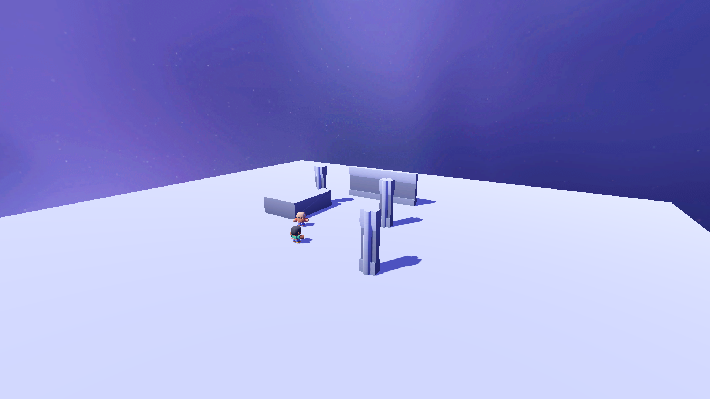
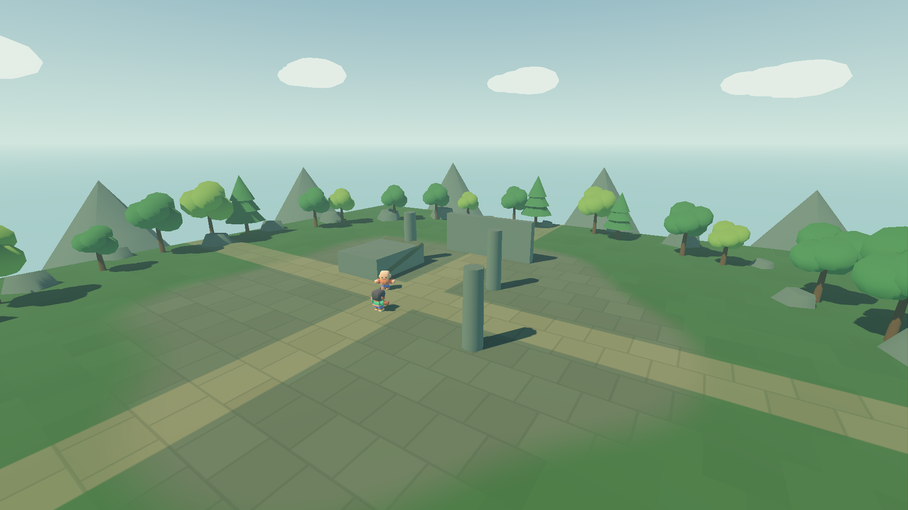
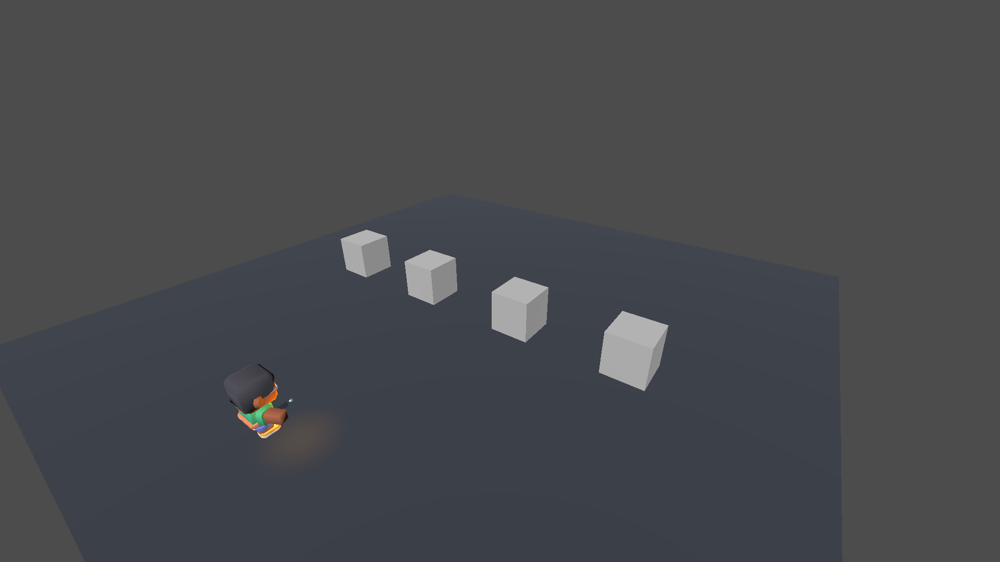
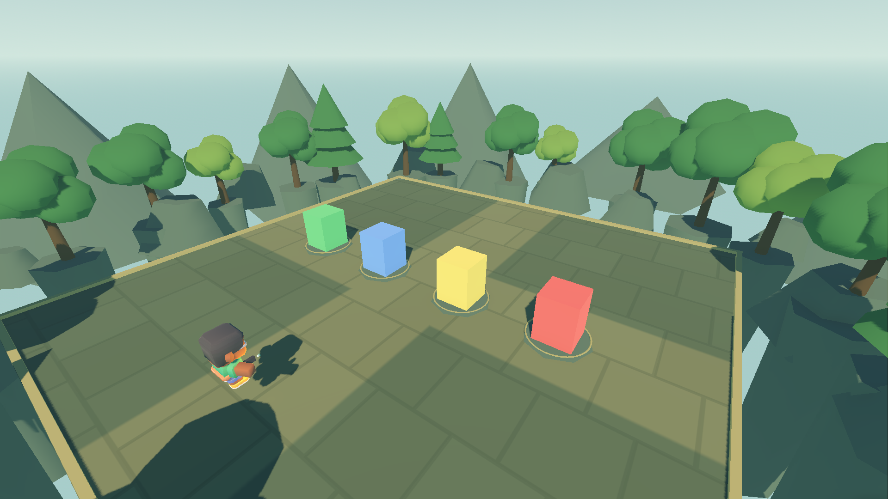
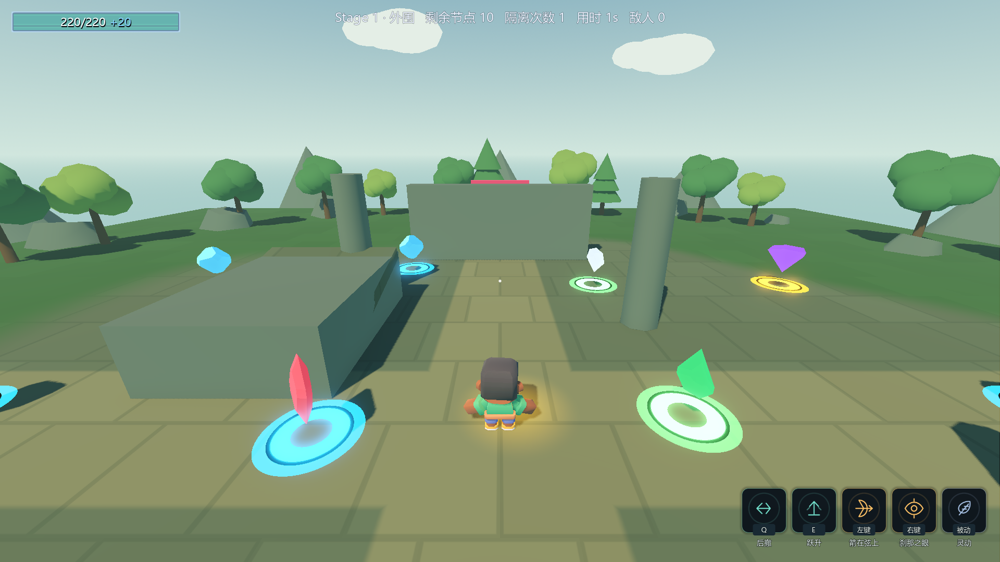
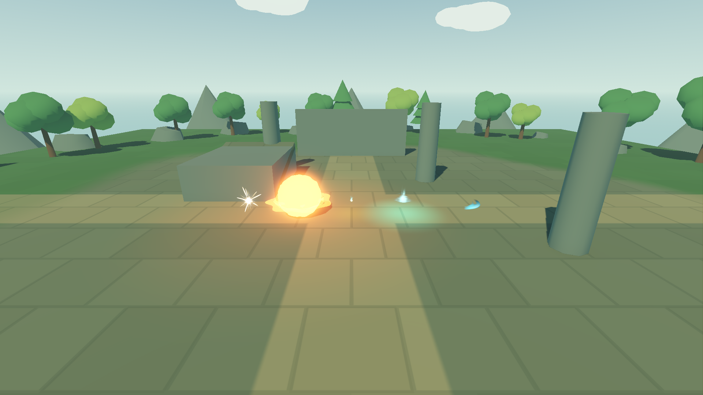
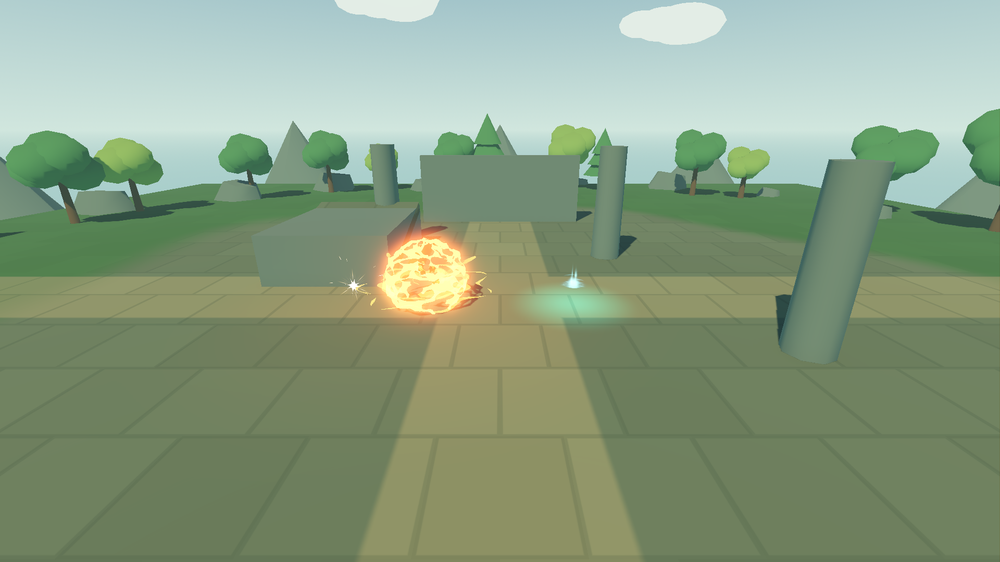

# 画面改善实测验收 · 2026-10-16

交付：暖阳青绿庭院、分区地面、低模环境、五类特效的实例隔离与独立预制体、可选屏幕像素采样。
生产默认使用清晰3D渲染，没有强制像素化。来源/许可见 [素材审计](art-refresh-sources.md)，后续接线见 [专项交接](art-refresh-handoff.md)。

| 验收 | 结果与边界 |
|---|---|
| 固定构建命令 | `build.ps1 --no-incremental -v minimal`，**0 warning / 0 error** |
| 美术独立探针 | **28 PASS / 0 FAIL**，退出码0，渲染日志无错误 |
| 正式Main玩家镜头 | 退出码0；运行期断言环境路径必须为 `res://Assets/ArtRefresh/env_level_garden.tres` 且有新装饰节点；真实 `/root/Main/Player/CameraRig/SpringArm/Camera`，1920×1080，沿用正式HUD |
| 正式Main完整自测 | **未隔离、未隐藏技能栏**；到达结束标记、退出码0；八条硬指标与 **docs/e-batch-evidence.log** 逐字一致；没有新增运行错误，仅保留基线退出资源提示 |
| 存档 | meta.cfg / ability_cards.cfg / settings.cfg 的复核前后SHA-256均不变；当前用户设置为2560×1440。拍摄台只临时设定运行期内部渲染尺寸，不写配置文件；未创建 selftest.flag，结束确认不存在 |
| 物理与导航 | 竞技场原7个碰撞形状、地面80×1×80、基地26×1×26保持；装饰/VFX无碰撞、单位或分组 |
| 五类VFX | Hit/Explosion/Muzzle/Loot/Battle，双实例的每份 shader/粒子过程材质均不同；修改A不改变B，子树安全检查通过 |
| 像素插拔 | 独立CanvasLayer仅屏幕采样；输入穿透；移除即恢复。生产场景未挂载 |

原始输出摘录、八条全文、存档及10张截图哈希见 [art-refresh-evidence.log](art-refresh-evidence.log)。

## 同机位场景对比

基线 d4270fc；同一探针相机/FOV、模型尺寸和机位；仅旧/新环境切换。









## 正式游玩视角



## 特效与可选风格

以下从左到右：Hit、Explosion、Muzzle、Loot、Battle Swing。使用真实动画默认播放速度，约0.07s与0.24s两次采样；
截图拍摄台将Explosion/Muzzle显示缩放设为0.5便于横向观察，未改变生产调用处大小/伤害参数。
Loot是持续循环效果，另外四类为一次性表现（Muzzle由拍摄台显式play）。






## 复现与已知问题

在已有编辑器完成资源导入的工作区执行：

```powershell
& 'F:\Godot项目\项目a\Assets\ArtRefresh\tools\verify_art_refresh.ps1' -SkipImport -Before
```

脚本直接运行未隔离的正式Main完整自测；不会绕过新错误，遇到任何非基线运行错误返回失败。
每次构建/启动均持有 `.ai_validation.lock` 的FileShare.None句柄，进程退出后释放。没有关闭编辑器、没有全局stop_project。
前后截图临时场景来自git基线，使用每轮唯一文件名、去掉UID，并安排在正式Main回归之后运行，最后在finally删除；不覆盖项目原场景。
旧版比较脚本曾让编辑器复用临时场景的旧UID映射，造成正式截图加载旧竞技场；现已修复，并用运行期环境路径断言防止再被误计为通过。

- ⚠️ 旧基线问题仍存在：导航网格为空、cell_height 0.15/0.25不匹配；完整自测退出仍是 **4 ObjectDB instances leaked / 2 resources still in use**。
- ⚠️ P4旧偏差仍存在：落剑式触发1→1；长枪上限4而旧期望3，路径12m而旧期望20.74。本轮未修改这些机制与旧测试。
- 早期Main记录过MapManager.cs的UID路径回退提示；本专项没有修改Main或MapManager文件来处理它。
- 首次 `--headless --import` 的第二编辑器扫描占用9080失败提示与21资源退出提示已识别为编辑器插件会话冲突；没有关闭宿主。
  文本资源随后均通过独立运行场景的实际加载与渲染；正式验收使用SkipImport，不把扫描退出码0冒充无错误。
- 角色、终端主体与战斗场地基础形状仍是阶段性素材，本轮不是最终成品美术。Loot/Battle的玩法接线严格留给功能任务，位置与生命周期已明确记录。
- CodeGraph仅做低成本健康查询：167个C#文件、4611节点、8431边；本轮新增GDScript不在该C#索引范围，没有重建索引。
- 初次共享工作区回归发现并行B批AbilityHud三角化错误；B批自行修正后，本专项重新构建并完整通过正式Main回归。临时诊断用的隔离场景/选项已移除，最终证据均来自正常路径。
- 收尾提交d129861曾误带基地GM接线的5行差异；76bb546已用仅修改Git索引的逆补丁撤出，工作区里的GM内容始终保留，留给B批自行提交。
