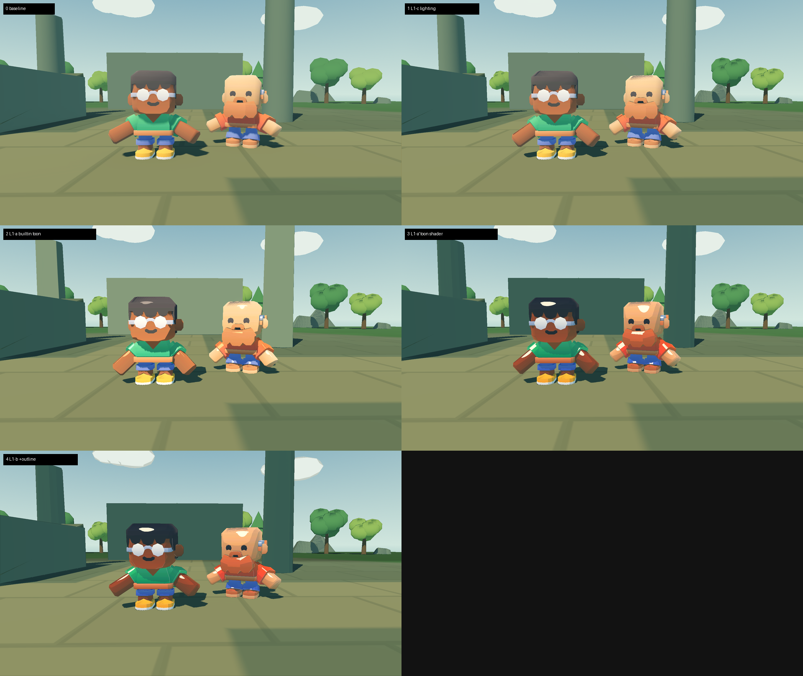
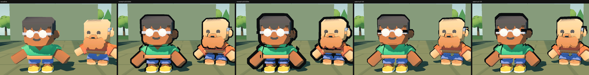
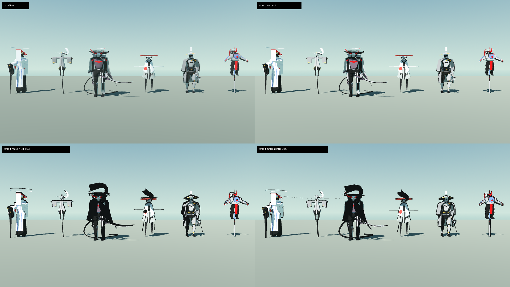
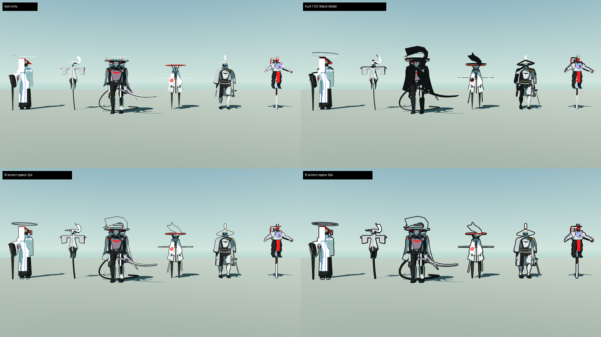
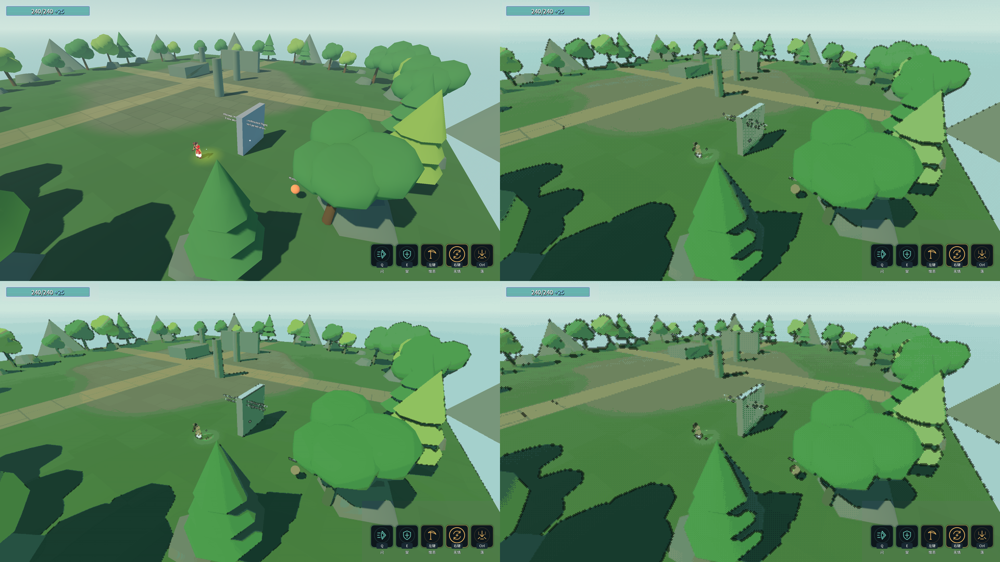

# 卡通＋像素 渲染方案 v2（提案 · 未落地）

> **v2 变更**：① 新增 §5「t3ssel8r 风格能不能做」② 用户裁定 **L1-a/b/c 全做、roughness = 0**（§3.4 澄清这条到底意味着什么）③ **修正 v1 的"不建议 SubViewport"**——有更优解（§5.3）。
> 状态：只读侦察 + 截图模拟。**没改代码、没跑构建、没跑 Godot**（`.ai_validation.lock` / `.ai_git.lock` 均在，Godot 进程 2844 正在跑，锁是 codex 的）。未验证项集中在 §9。

---

## 1. 现状取证

| 项 | 实测 |
|---|---|
| 渲染器 | `config/features = Forward Plus`，`rendering_device/driver.windows = d3d12` |
| 视口 | 基准 `1920×1080`，`stretch/mode = canvas_items` → **3D 按窗口真实分辨率渲染**（证据：已有 2560×1440 的截图），UI 按 1920×1080 缩放 |
| 环境 | `env_level_garden.tres`：**SSAO 开**、glow 0.32（柔）、fog 0.0018、ambient 0.48 |
| 地面 | `mat_level_ground.gdshader` **已经是 toon**（`render_mode diffuse_toon, specular_disabled`） |
| 模型 | 25 GLB + 12 FBX；材质内嵌、**只有一张 colormap**（player 4096²），**无法线/粗糙度图** |
| toon 半成品 | `Assets/Materials/mat_Model_Toon_3d.tres`：`diffuse_mode=3(Toon)` + `specular_mode=1(Toon)` + `roughness=0.0` —— **全工程零引用**（已经就是用户要的那套参数，只是没接） |
| 像素骨架 | `optional_pixel_filter.gdshader`（canvas_item + screen texture + nearest，**只格化**）＋ `OptionalPixelFilter.tscn`（`CanvasLayer layer=1`），生产未挂 |
| 分层 | HUD `layer=3` > 滤镜 `layer=1` → 像素化不糊 UI |

**结论**：卡通和像素的"零件"都在工程里，缺的是接成一条可开关的管线。

## 2. 效果对比（2.1 = 真引擎实拍；2.2 / 2.3 = PIL 屏幕空间模拟）

### 2.1 ⭐ 真实引擎实拍（2026-10-18，卡通方案对比）

**这一节是真引擎渲出来的**（Godot 4.7.2 mono / Forward+ / d3d12 / 1920×1080）；2.2 / 2.3 才是 PIL 模拟。

**怎么做的**：新建一个隔离实验室场景 `Scenes/Debug/_ToonLab.tscn` ＋ `Assets/ArtRefresh/toonlab/toon_lab.gd`，里面
实例化**真实的 `TestArena.tscn`**（地面/石柱/树/环境/太阳）＋ 两个**真实 GLB 模型**（`mesh_player_body` / `mesh_enemy_chaser`，按生产里同样的 2.68 / 2.72 倍缩放和朝向），
然后在一个进程里依次切 5 种状态各拍一张。**没有改任何生产场景、`.tres`、玩法代码或存档**（`.tres` 只在内存里改，不写盘）。



1:1 局部（看分档、rim、高光、描边）：[toonlab_detail.png](screenshots/toonlab_detail.png)

| # | 状态 | 做了什么 | 实拍结论 |
|---|---|---|---|
| **0** | 基准 | 无 | 现状：柔和渐变、无高光、无描边 |
| **1** | L1-c 光照 | 关 SSAO、ambient 0.48→0.30、glow 0.32→0.18、fog 0.0018→0.001、阴影 blur/angular=0 | **变化最小**——单靠调环境出不了卡通感（这个场景本身对比度就够） |
| **2** | L1-a 内置 Toon | 246 个面全部 `diffuse_mode=Toon`、`specular_mode=Toon`、**`roughness=0`** | 明显变卡通：头发/脸出现硬边分档；`roughness=0` 出现**一个小高光点**。但**参数不可调**（没有档数/wrap/rim） |
| **3** | L1-a' 自定义 toon shader | 自己的 `light()`：`cuts=3` + `wrap=0.15` + 硬边高光 + rim | **最像动画片**：3 档硬边、肩/臂有白色 rim、头顶硬高光；但高光斑**过曝成纯白椭圆**、rim 在小件上有点脏 |
| **4** | L1-b 描边 | 叠 leopeltola 的全屏后处理（MIT，原样） | 轮廓出现 1px 暗线、凸边有亮线；1080p 下偏细，游戏机位会更细 |

**三条实测发现**：

1. **卡通感 90% 来自材质，不来自环境调参**（0→1 几乎没变，1→2→3 才是质变）。
2. **`roughness=0` 在两条路线上都能落地**：内置 Toon = 小硬高光点；自定义 shader = `step()` 阈值化高光斑（我这张里过曝，`specular_strength 0.85 → 0.3~0.4` 或 `specular_shininess 40 → 80` 就收住）。
3. **描边不用等低分辨率**：全屏后处理的 1px 线在 1080p 直接可用；**本场景没有粒子，所以作者警告的透明 bug 没出现**——真打起来（粒子/残影/光环）还要再验。

**踩到一个引擎坑（值得记）**：Godot 4 的 `light()` 里 **`ATTENUATION` 是 `float`**（Godot 3 才是 `vec3`）。第一版写成 `ATTENUATION.x` → 着色器编译失败：`Invalid member for 'float' expression: '.x'`。

**产物**（都是新增文件，没动生产文件）：
`Scenes/Debug/_ToonLab.tscn` · `Assets/ArtRefresh/toonlab/{toon_lab.gd, toonlab_toon.gdshader, toonlab_outline.gdshader, toonlab_unit_outline.gdshader}` · `docs/screenshots/toonlab_*.png`

### 2.1.1 按你的裁定再跑一次：**内置 Toon + 无高光 + 描边只给单位**

**裁定**（2026-10-18）：① 高光不要 ② 描边只给单位（角色/敌人），不要全屏 ③ 走**内置 Toon**（图 2 那条），不走自定义 shader。

追加实拍（同一进程、同一机位，先移除全屏描边）：



| 方案 | 结果 | 问题 |
|---|---|---|
| 无描边（裁定版材质） | `diffuse_mode=Toon` + **`specular_mode=DISABLED`** + `roughness=0`：图 2 那个高光点**没了**，纯分档 | 轮廓不分明 |
| **法线壳 0.020m** | 轮廓清楚、等厚 | 关节处有小黑刺（硬边模型沿法线外扩的固有毛病） |
| 法线壳 0.035m | 更粗 | 肩/腋下出现**黑色补块**，下巴边缘被吃掉 |
| **缩放壳 1.03** | **最干净**：轮廓贴形，没有内部补块 | 厚度随离模型原点距离变化（脚更粗、头更细） |
| 缩放壳 1.05 | 明显粗一圈，仍干净 | 同上，且小件（鞋/耳）开始糊 |

**结论 / 建议**：单位描边用**缩放壳**，`1.03`（日常）/ `1.05`（要更粗）；法线壳虽然等厚，但这批硬边低模会在关节出黑刺，`0.035` 已经不能用。

**实现方式**（零场景改动）：单位材质的 `next_pass = 一个 unshaded + cull_front 的 ShaderMaterial`，顶点里 `VERTEX *= scale`（或 `+= NORMAL * width`）。**全屏后处理那条按裁定废弃**（实验室里保留可切换，生产不用）。

⚠️ **还没验**：蒙皮动画幅度大时（挥砍/翻滚/跳跃）缩放壳会不会在四肢交叉处穿透、法线壳黑刺会不会更明显——这次拍的是 idle 小幅度动作。

### 2.1.2 首领模型 × 卡通（2026-10-18）

**资产来源**：`F:\Godot项目\_boss_asset_audit\models\`（用户素材包 `3d肉鸽雨中哈迪斯\素材\模型\首领\*_asset.zip` 拆出来的 6 个低模）
→ 已复制到 `Assets/Models/bosses/`（**仓库新增文件**，未接线、未进任何生产场景）。

| 首领 | 三角面 | 骨骼 | 动画 | 材质 | 缩放（到 2.8m） |
|---|---|---|---|---|---|
| DRIZZEL | 4,098 | 69 骨 | **无** | 平色 + 顶点色，无贴图 | 1.324 |
| GEKKOU | 4,652 | 83 骨 | **无** | 同上 | 0.797 |
| KASA | 4,706 | 82 骨 | **无** | 同上 | 1.305 |
| KURENAI | 2,646 | 65 骨 | **无** | 同上 | 1.267 |
| SAMIDALE | 4,028 | 75 骨 | **无** | 同上 | 1.683 |
| SHOGUN | 3,792 | 64 骨 | **无** | 同上 | 1.067 |

> 缩放**直接取审计结果** `_boss_asset_audit/audit-results.json` 的 `scale_for_2_8m_height`；运行时算 AABB 对蒙皮模型不可靠（第一版把 DRIZZEL 量成 0.01m → 放大 315 倍，已废弃）。



KASA 特写（看清问题）：[bosslab_detail.png](screenshots/bosslab_detail.png)

**结论**：

1. ✅ **Toon（无高光）在首领上效果很好**：红/白/黑硬分档，剪影干净，比小怪更能体现卡通感——这批资产（平色 + 顶点色 + 无贴图）就是为这种渲染准备的。
2. ❌ **壳类描边在"薄片部件"上会整块翻黑**：KASA 的伞/幞、SAMIDALE 的兜帽都是单面薄片，**缩放壳 1.03 和法线壳 0.02 都翻成黑色大块**；按网格名排除 `Cape_*` 也救不了（薄片混在主体 `*_Geo` 里）。
   → 所以本轮改做 **B 方案（屏幕空间 + 只描单位）**，见 §2.1.3。
3. ⚠️ **装进游戏前还要处理**：模型里自带 `UI_Geo` / `UI_Circle_Geo` / `Info_circle_Geo` / `fake_smoke_Geo` / `Tissue_*` 这些非本体网格，会被一起渲染；而且 6 个首领**全都没有动画**（只有骨骼），进游戏前要配动画。

### 2.1.3 B 方案：屏幕空间描边，只描单位（2026-10-18 实拍）

**做法**（不改引擎、不动生产场景）：

1. 每个单位网格复制一份「白色剪影」`MeshInstance3D`（同一个 mesh / skin / skeleton，`material_override` = unshaded 白色），放到**独立视觉层**（`layers` 第 2 位）；
2. 一个 **SubViewport**（1920×1080、`transparent_bg`、`own_world_3d=false` 共享同一个世界）里放一台只渲染该层的 `Camera3D`，每帧同步主相机的 transform / fov / near / far；
3. **主相机 `cull_mask` 排除该层** → 剪影只存在于 SubViewport，不污染画面；
4. 合成层（`CanvasLayer` + `ColorRect`）用剪影 alpha 做「外缘扩张」描边：8 方向 × `thickness_px` 采样取 max，再减去中心值 → 只留轮廓环。



KASA 特写：[bosslab_outline_schemes_detail.png](screenshots/bosslab_outline_schemes_detail.png)

**结果**：✅ **薄片不再翻黑**。KASA 的伞、SAMIDALE 的兜帽都变成干净的轮廓线；线宽按像素恒定（`thickness_px` 2~8 可调），不会因为远处/近处变粗变细，也不会在关节处出黑刺。

**代价与已知限制（都要写清楚）**：

| 项 | 说明 |
|---|---|
| 额外绘制 | 单位多画一遍（本实验室 28 个 `MeshInstance`，都是 2.6k~4.7k 面的低模）+ 一个全屏合成 pass（8×`thickness_px` 次采样） |
| ⚠️ **没有深度剔除** | 轮廓是画在剪影**外缘**的，所以单位被墙/柱子挡住时，线会**盖在遮挡物上**。修法：把深度编码进剪影的 RGB，合成时跟主场景深度比一次（工作量 +1 个 shader 分支） |
| ⚠️ 线会变多 | 这是"剪影线"：薄片的重叠边（KASA 伞面的褶皱）**也会出线**，比壳描边的线多。风格上更像手绘线稿，但需要按模型调 `thickness_px` |
| ⚠️ 只验了首领 | 角色/敌人走的是同一条代码路径，但**还没在角色实验室重拍**；接线时一起上 |

**实现产物**：`toonlab_mask.gdshader`（白色剪影）· `toonlab_unit_outline_post.gdshader`（遮罩描边合成）· `boss_lab.gd` 里的 `_setup_screen_outline()` / `_build_mask_duplicates()` / `_sync_mask_camera()`


### 2.2 只做屏幕滤镜（v1 的 A/B/C，模拟）

原四格对比图未保留；当前可用素材与表现方向见[美术接入](art-onboarding.md)，本页保留方案讨论文字。

结论：**卡通感主要来自描边+色阶，不是像素格**；C 档（6px）石砖路糊成噪声、角色丢形状，不建议。

### 2.3 t3ssel8r 风格（低分辨率 + 调色板 + 有序抖动 + 内部分辨率描边）



1:1 局部（看像素格、抖动图案、描边）：[art_t3ssel8r_detail.png](screenshots/art_t3ssel8r_detail.png)

| 档 | 内部分辨率 | 调色板 | 抖动 | 角色高度（约） | 观感 |
|---|---|---|---|---|---|
| **960** | 960×540（1/2） | 48 色 | Bayer 弱 | ~15px | **本工程可用的上限**：路面还能读，角色还认得出 |
| **640** | 640×360（1/3） | 40 色 | Bayer 中 | ~10px | 真"像素画"，但角色开始糊成一团 |
| **480** | 480×270（1/4） | 32 色 | Bayer 中 | ~7px | 只适合特写/基地，ACT 战斗不建议 |

> ⚠️ 模拟里角色比引擎实拍更糊涂：我的描边是**亮度**边缘，抓不到角色的红色轮廓；引擎里用 depth 描边会给每个物体包一圈 1px 线，**可读性会明显好于这张图**。

## 3. 卡通层（L1）：三条材质路线 + roughness=0

### 3.1 三条路线

| 路线 | 做法 | 拿到的效果 | 成本 |
|---|---|---|---|
| **A. 内置 Toon 模式** | `StandardMaterial3D`：`diffuse_mode=Toon`、`specular_mode=Toon`、`roughness=0` | 引擎内置两档 ramp，最省事；**参数不可调**（没有分档数、wrap、rim） | 极低（运行时改写或导入期改） |
| **B. 自定义 toon shader** | 自己的 `spatial` shader，`light()` 里做分档 | 分档数 / steepness / wrap / 硬边高光 / rim / **调色板 ramp 贴图** 全可调 | 中（1 个 shader + 运行时接管材质） |
| **C. `diffuse_toon` render_mode** | `render_mode diffuse_toon, specular_disabled` | 同 A，整材质仅内置 ramp；地面已经在用 | 极低 |

**参考实现（MIT，可商用）**：[Flexible Toon Shader（Godot Shaders）](https://godotshaders.com/shader/flexible-toon-shader/) / [源码与完整文档](https://github.com/CaptainProton42/FlexibleToonShaderGD)。它的参数正好覆盖 L1-a：`cuts`（分档数）、`steepness`（档宽）、`wrap`（明暗分界偏移）、`use_specular` + `specular_shininess`（**硬边**高光 blob，`step(0.5, specular)`）、`use_rim`、`use_ramp`（调色板贴图）、`clamp_diffuse_to_max`（多光源只取最亮，画面更统一）。

它文档里两条对**像素化**很关键：

1. 用像素调色板当 ramp 贴图时，**贴图必须关 Filter、关 Repeat**，且 `cuts` 要和调色板档数对齐；
2. 想"颜色严格等于调色板"，就要 **`render_mode ambient_light_disabled` ＋全白光源**，否则环境光会把调色板颜色推偏。

### 3.2 L1-c 光照与环境（最便宜，先做）

| 参数 | 现在 | 建议 | 为什么 |
|---|---|---|---|
| `ssao_enabled` | true | **false** | toon 不需要；颗粒噪声在像素/描边下变成脏点（Unity 那套 t3ssel8r 复刻也明确要求关 SSAO） |
| `glow_intensity` / `glow_blend_mode` | 0.32 / 柔 | 0.15~0.2 / 关柔 | 柔光糊掉分档边缘 |
| `ambient_light_energy` | 0.48 | 0.28~0.32（配 shader 时更低） | 均匀提亮抹平明暗分界；用 ramp 方案时要接近 0 |
| `fog_density` | 0.0018 | 0.0009~0.0012 | 雾把远景分档洗平 |
| `DirectionalLight shadow_blur` / `light_angular_distance` | 默认 | 0 / 0 | 硬边阴影是卡通关键特征 |

### 3.3 L1-b 描边：两套

- **屏幕空间描边**（打底）：depth + normal 边缘，参考 [David Holland 的 4 邻域核](https://www.davidhol.land/articles/3d-pixel-art-rendering/)（只取上下左右 → 保证 1px）+ [Bababuyyy 的方向对比 crease 检测](https://github.com/bababuyyy/unity-isometric-pixel-pipeline)（避免曲面被误判成折边）。
- **反向壳**（只给主角/首领）：蒙皮网格外扩会爆边，要按部位手调，别全量上。

⚠️ 引擎事实：**采样 depth/normal 纹理的 shader 会被引擎推进 transparent 管线**（Holland 在 4.3 上因此改了引擎源码）。本项目粒子/残影/光环极多，**透明排序是会踩的坑**；§5.3 给了绕法。

#### 3.3.1 现成实现（用户提供的那个 Godot Shaders 页面）：**对，就是要素 2**

[3D Pixel art outline & highlight（leopeltola，MIT）](https://godotshaders.com/shader/3d-pixel-art-outline-highlight-post-processing-shader/) / [demo 源码](https://github.com/leopeltola/Godot-3d-pixelart-demo)。读了源码（`pixelart_stylizer.gdshader`，4.6 KB）和它的 `project.godot`：

| 它的做法 | 源码事实 |
|---|---|
| 类型 | `shader_type spatial; render_mode unshaded;` —— **spatial 全屏 quad**，靠写 `ALBEDO` + `ALPHA` 叠在世界之上 |
| 纹理 | `DEPTH_TEXTURE : hint_depth_texture` + `SCREEN_TEXTURE : hint_screen_texture` + `NORMAL_TEXTURE : hint_normal_roughness_texture`（**Forward+ 专有**，我们是 Forward+ ✅） |
| **描边** | 4 邻域（上下左右）深度差，`depth_diff` 只累加"邻居更近"的量 → `smoothstep(0.2,0.3)` → 往 `shadow_color` 混 |
| **高光** | 4 邻域法线差（three.js 的 `normalIndicator`）＋ `neg_depth_diff` 抑制凹边 → **只亮凸边** |
| 像素单位 | `vec2 e = vec2(1./VIEWPORT_SIZE.xy)` —— **1 个渲染目标像素**，所以它天然是"内部分辨率 1px" |
| 低分辨率怎么来 | `project.godot`：`window/stretch/mode="viewport"`，基准 **240×135**，窗口 960×540 → **整个画面（含 UI）都低分辨率** |
| 相机 | `camera.gd` 只有 `post_processing` 开关，**没有像素 snap**（要素 3 它没做） |
| 授权 | **MIT**，可商用可改（要记进 `docs/art-sources.md`） |

**作者自己在 README 里写了三条硬限制**（和我们方案完全对得上）：

1. **只在低游戏分辨率下才正确**；"想把高分辨率渲染像素化，得用别的办法"（= 我们 §4 的 L2-a 伪像素靠它做不到）；
2. **想要高清 UI，就把"游戏"放进 SubViewport 再贴到 Sprite 上**；
3. **会有透明 bug**（[issue #4](https://github.com/leopeltola/Godot-3d-pixelart-demo/issues/4)），作者建议"**用在特定物体上**"而不是全屏后处理。

**落到本项目要改三处（不是照抄就能用）**：

| 差异 | 我们怎么处理 |
|---|---|
| 它靠 `stretch/mode=viewport` 全画面低分辨率 | ❌ 不能照抄：我们有整套 HUD/面板/伤害数字 + 30 处探针截图。改用 **`scaling_3d_scale`（只缩 3D）**，见 §5.3 |
| 它的 `e = 1/VIEWPORT_SIZE` 在"只缩 3D"下取到的是**窗口像素** | 如果 quad 作为 **spatial 物体**参与 3D 通道，`VIEWPORT_SIZE` 就是内部尺寸 → **一行不用改**；若做成 canvas_item 全屏层，则要改成"内部像素"步长（§9 待验第 1、2 条） |
| 它全屏覆盖 → 透明 bug | 按作者建议**分级**：先只给"角色/敌人"用 object 模式（可控、无排序问题）；全屏模式作为第二阶段再验 |

它还缺 3 个要素：**低分辨率本身**（要素 1）、**相机 snap**（要素 3）、**toon 分档/调色板**（要素 4，用 §3.1 的 Flexible Toon）。

### 3.4 「roughness 要为 0」这条裁定的含义（要跟你确认口径）

- **路线 A**：`roughness=0` + `specular_mode=Toon` 有实际效果 = 最锐的 GGX 高光点。⚠️ 在 640×360 下这个高光只有 1~2 px，**相机一动就会闪**；地面/大平面尤其明显。
- **路线 B（推荐）**：真 toon shader 里**根本没有 roughness 这个概念**——高光是一个 `step()` 硬边 blob，大小由 `specular_shininess` 控制、亮度由 `specular_strength` 控制。所以 **"roughness=0" 的落地形式 = 材质里不采样粗糙度、不生成 GGX 宽度、高光只用一个硬边 blob**。这也正是 `mat_Model_Toon_3d.tres` 现在 `roughness = 0.0` 想表达的东西。
- 需要你确认：**"roughness=0" 是"要那个又小又亮的硬边高光点"，还是"要完全平涂、连高光都不要"？** 前者 = `specular_shininess` 调高；后者 = `use_specular=false` 纯平涂。两条都能做，观感差很多。

## 4. 像素层（L2）：两代

| 代 | 做法 | 拿到什么 | 打不打得过 |
|---|---|---|---|
| **L2-a 伪像素**（现成骨架） | `OptionalPixelFilter` 升级成"格化 + 色阶 + 描边 + 可选抖动" | 画面像被像素化了，但**几何边缘仍是高分辨率**，放大看是"马赛克"不是"像素画" | 便宜、零风险、随时关 |
| **L2-b 真像素画**（t3ssel8r） | 3D **按低分辨率渲染**，再逐像素放大 + 调色板 + 抖动 + 内部分辨率描边 | 边是硬边、像素格与几何对齐、抖动图案真的在 1px 粒度上 | 见 §5 / §6 |

## 5. t3ssel8r 风格能不能做

### 5.1 那套效果实际由 5 件事组成（不是 1 个滤镜）

按 [Holland 的 Godot 实现说明](https://www.davidhol.land/articles/3d-pixel-art-rendering/) 与 [Unity 五段管线复刻](https://github.com/bababuyyy/unity-isometric-pixel-pipeline) 拆：

| # | 要素 | 作用 | 本工程现状 |
|---|---|---|---|
| 1 | **低内部渲染分辨率**（640×360 量级） | 一切的前提；像素格是真的 | ❌ 现在 3D 按窗口分辨率渲染 |
| 2 | **内部分辨率描边**（depth+normal，4 邻域核） | 保证"1 像素粗"的线；这是"像素画"感的最大来源 | ❌ 无 |
| 3 | **相机像素对齐**（snap 到 texel 网格 + 位移子像素补偿） | 消除画面游动/闪烁 | ❌ 无（且本项目相机常旋转，见 §6） |
| 4 | **toon 分档 + rim**（可选调色板 ramp + Bayer 抖动） | 明暗是硬的、色数有限 | ⚠️ 只有地面是 toon，模型不是 |
| 5 | **贴图扁平化**（平色/低分辨率贴图、关 mipmap/filter；关 SSAO） | 低分辨率下不糊成噪点 | ❌ 现在是 4096² 写实 colormap |

**所以答案是：能做，但这是"渲染管线级"改造，不是挂个滤镜。**

### 5.2 分成三档做（每档能单独验收、单独回滚）

| 档 | 内容 | 观感 | 工作量 |
|---|---|---|---|
| **P0 伪像素** | L2-a（格化+色阶+描边+抖动）+ L1-c 光照 | "像素化滤镜"，不是像素画 | 0.5 天 |
| **P1 真低分辨率** | 要素 1（+3 可选） | 硬边、真像素格，**这一步就已经很像 t3ssel8r 了** | 1~2 天 |
| **P2 完整** | +要素 2、4、5 | 线条感、调色板、扁平贴图 | 5~8 天（大头是调参） |

### 5.3 关键发现：本项目最省事的低分辨率路线

v1 我写的是"SubViewport 会动坐标空间，风险 > 收益"。**更好的做法是用 `Viewport.scaling_3d_scale`**：

```
渲染器设置：scaling_3d_mode = bilinear，scaling_3d_scale = 目标高度 / 窗口高度
→ 3D 只在 640×360（或 960×540）里画，引擎再放大到窗口；UI 完全不受影响
→ 我们自己那层滤镜用 nearest 按"内部像素格"点采样（pixel_size = 1/scale）
→ 结果：真·低分辨率几何，但鼠标瞄准、世界坐标投影、截图全还在窗口坐标系里
```

为什么这比 SubViewport 强：**坐标空间根本不变**。查了一遍工程里会被低分辨率碰到的地方：

| 位置 | 影响 | `scaling_3d_scale` 路线 | SubViewport 路线 |
|---|---|---|---|
| `AimUtil`（4 处 `GetVisibleRect().Size * 0.5f` + 鼠标位置） | 准星 / 瞄准 | **不用改**（准星按内部像素跳） | 必须换算，否则准星偏 |
| `WorldOverlay:610-616` / `PlayerHud:420-432`（`camera.UnprojectPosition`） | 敌人血条、伤害数字定位 | **不用改** | 必须乘缩放，否则全部错位 |
| 30+ 处 `GetViewport().GetTexture().GetImage().SavePng(...)` | 探针截图基线 | **尺寸不变**（内容变像素画） | 尺寸变，全部基线作废 |
| `HawkEyeAbility` 的 FOV 缩放 | 狙击 | 不用改 | 不用改 |
| 8 条硬指标 | 数值读数 | 不受影响 | 不受影响 |

⚠️ 这条路线有一个前提我还没在引擎里跑过：`scaling_3d_scale` 是否只作用于 3D 缓冲、`UnprojectPosition` 是否仍在窗口坐标（**§9 待验证第 1 条**）。另外它是 bilinear 放大，所以"硬边"必须由我们自己的滤镜点采样来恢复。

**和 §3.3.1 那个描边 shader 的联动（关键）**：它算像素步长用的是 `1.0 / VIEWPORT_SIZE`。如果这个 quad 是**参与 3D 通道的 spatial 物体**，那么在 `scaling_3d_scale` 下 `VIEWPORT_SIZE` = 内部尺寸 → **步长自动就是 1 个内部像素，源码一行不用改**，depth/normal 纹理也本来就是内部分辨率。这是"`scaling_3d_scale` + 它的 spatial 写法"比"SubViewport + 贴到 Sprite"更省的地方（作者 README 推荐的是后者，因为他的 demo 没有 UI）。

### 5.4 画面适配问题（比技术更重要）

t3ssel8r 的作品是**近景立体模型**（角色能占画面 1/4 高），本工程是**远景第三人称 ACT**：实拍里主角只有 ~30px 高，降到 1/3 只剩 ~10px。

- **建议内部分辨率从 960×540（1/2）起**，不要直接上 640×360；
- 或者配合 §8 第 3 条（模型放大 / 相机拉近）后再上 640。

## 6. 代价与风险（分级）

| 项 | 判断 |
|---|---|
| 低分辨率渲染 + 锐利放大 | ✅ 可做，`scaling_3d_scale` 路线几乎零坐标风险 |
| toon 材质（A/B/C 三条） | ✅ 可做，`mat_Model_Toon_3d.tres` 已就位；B 路线有 MIT 参考 |
| 调色板 + Bayer 抖动 | ✅ 可做，纯 shader |
| 内部分辨率描边 | ⚠️ 可做，但要解决"采样 depth/normal 被推进 transparent 管线"的排序问题（本项目粒子/残影多）；退路是只做 depth 描边（少 crease / 凸边高光） |
| 相机像素对齐 | ⚠️ **平移能补，旋转不能补**。本工程相机常跟鼠标转 → 只能 snap 到像素网格并接受量化抖动；等距/正交机位才彻底干净。这是本工程与 t3ssel8r 最大的先天差异 |
| 角色辨识度 | ⚠️ 1/3 分辨率下主角 ~10px；必须靠"角色描边 + 放大模型 + 相机拉近"一起救 |
| 贴图降采样 | ⚠️ 25 个模型全部重导 + 关 mipmap/filter，且要重拍所有截图 |
| 真·低分辨率后截图 | ⚠️ 30+ 处探针截图内容全变，evidence 图要整批重拍（尺寸不变，可接受） |
| 工作量 | P0 半天 / P1 1~2 天 / P2 5~8 天（调参占大头） |

## 7. 落地顺序（等你点头 + 锁空出来）

0. **冻结基线**：同机位/角色/敌人各拍 1 张（`j15_world.png` 可当基线）
1. **L1-c** 改 6 个环境数值 → 拍对比（半天内出图）
2. **L1-a** 运行时 `ToonPass`（`MeshInstance3D` 的材质 duplicate 后改 toon 三参数，**roughness=0**）→ 拍对比
3. **L1-b** 描边：先拿 §3.3.1 那个 MIT shader 的 **object 模式**挂到角色/敌人（无透明风险），拍对比 → 满意再试全屏模式
4. **L2-a** 现有像素滤镜升级（格化+色阶+抖动，参数进材质）→ 拍对比
5. **P1** `scaling_3d_scale` 低分辨率 + 锐利放大（开关：`scaling_3d_scale=1` 即恢复）→ 拍对比；**顺手验证这个 shader 在内部尺寸下是否零改动可用**
6. **P2** 全屏内部分辨率描边 + 调色板 + 贴图降采样 + 相机 snap

**每步验收**：双构建 0/0 · Main 退出 0 · 8 硬指标逐字一致 · 5 个回归探针全绿 · 四存档 SHA256 不变（渲染改动**不应该**动任何数值）。
**默认值 = 当前现状**，所有开关关闭时必须逐位不变。

## 8. 要你裁定的事

> **用户 2026-10-18 已定**：**像素先不考虑**（§4 / §5 整块搁置），本轮只做卡通。所以下面 1、2 两条先搁着。

1. （搁置）像素进默认画面吗？
2. （搁置）像素目标档位：P0 / P1 / P2。
3. **角色辨识度**：要不要把主角/敌人模型放大 10~15%，或把相机拉近？（影响后续低分辨率/描边密度）
4. **roughness=0 的口径**（§3.4）：要"又小又亮的硬边高光点"，还是"完全平涂不要高光"？—— 实测第 3 格那个高光**过曝成纯白椭圆**，需要你定"收小"还是"去掉"。
5. **描边覆盖范围**（§3.3.1）：先只给**角色/敌人**（object 模式，作者推荐、无透明问题）/ 还是直接**全屏后处理**（一次全覆盖，但要趟透明排序的坑）？
6. **卡通路线二选一**：**内置 Toon 模式**（零成本、参数不可调，第 2 格）/ **自定义 toon shader**（分档/rim/调色板全可调，第 3 格），还是"先内置、再逐步换 shader"？

## 9. 验证状态（✅ 已实测 / ⚠️ 仍未验证）

**已实测（2026-10-18，真引擎，`_ToonLab` 一次渲染 5 张）**：

- ✅ `diffuse_mode=Toon` + `specular_mode=Toon` + `roughness=0` 在 246 个面上一键生效（运行时改材质，不写盘）——见 §2.1 第 2 格
- ✅ 自定义 toon shader（`light()` 里分档 + 硬边高光 + rim）编译并生效——见 §2.1 第 3 格；**`ATTENUATION` 在 Godot 4 是 `float`**（写成 `.x` 会编译失败）
- ✅ leopeltola 描边 shader 在本工程 Forward+ 下可用：`hint_depth_texture` / `hint_screen_texture` / `hint_normal_roughness_texture` 都取到了，全屏 quad 模式（`QuadMesh` 4×4 挂在相机 z=−1）出 1px 轮廓 + 凸边高光
- ✅ 真模型（player / chaser GLB）+ 真关卡（TestArena）在隔离场景里可跑，退出 0

**仍未验证**：

1. ⚠️ `Viewport.scaling_3d_scale` + `scaling_3d_mode=bilinear` 在 4.7.2 + d3d12 下：是否只缩 3D 缓冲、`UnprojectPosition` / `GetVisibleRect` 是否仍在窗口坐标、截图尺寸是否不变；**以及 spatial 全屏 quad 里的 `VIEWPORT_SIZE` 是否等于内部尺寸**（决定 §3.3.1 那个 shader 在低分辨率下能不能零改动）。
2. ⚠️ 描边**全屏模式在真实战斗场景**里与粒子/残影/光环的透明排序（本实验室场景没有粒子，作者 issue #4 的场景没复现）。
3. ⚠️ `diffuse_mode=Toon` 在**低分辨率**下的实际分档观感（本次只验了 1080p）。
4. ⚠️ 相机 snap 的抖动幅度（本项目相机跟鼠标转）。
5. ⚠️ 全部改动**尚未接入生产**：`Main`/基地/竞技场一行没改，8 硬指标和 5 个探针这轮**没跑**（因为确实没碰生产文件，但也因此不能声称"不影响"——接线那一步必须重跑全套）。
6. ⚠️ §2.2 / §2.3 的图是 **PIL 屏幕空间近似**：格化=盒滤波降采样、色阶=posterize、描边=亮度 Sobel、抖动=Bayer 4×4、调色板=中位切分。**不等于引擎结果**（模拟脚本在仓库外：`F:\Godot项目\_art_proposal\mockup.py`、`mockup_t3.py`、`compose_toonlab.py`）。

**引用**：[Flexible Toon Shader（MIT）](https://github.com/CaptainProton42/FlexibleToonShaderGD) · [Godot Shaders 页面](https://godotshaders.com/shader/flexible-toon-shader/) · [3D Pixel art outline & highlight（MIT，leopeltola）](https://godotshaders.com/shader/3d-pixel-art-outline-highlight-post-processing-shader/) · [其 demo 源码](https://github.com/leopeltola/Godot-3d-pixelart-demo) · [David Holland：3D Pixel Art Rendering](https://www.davidhol.land/articles/3d-pixel-art-rendering/) · [t3ssel8r 3D pixel art 复刻（Unity）](https://github.com/bababuyyy/unity-isometric-pixel-pipeline)
