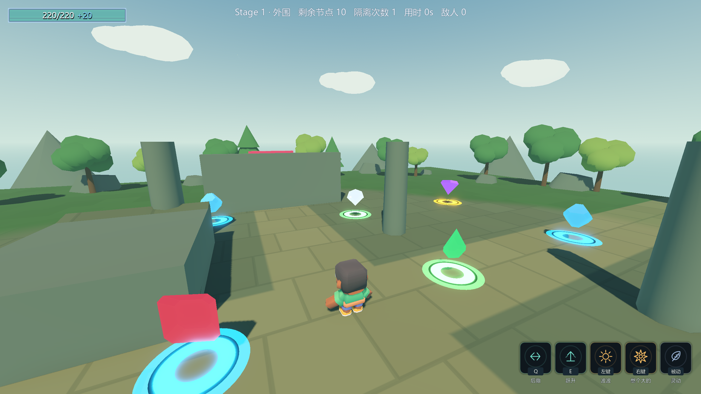
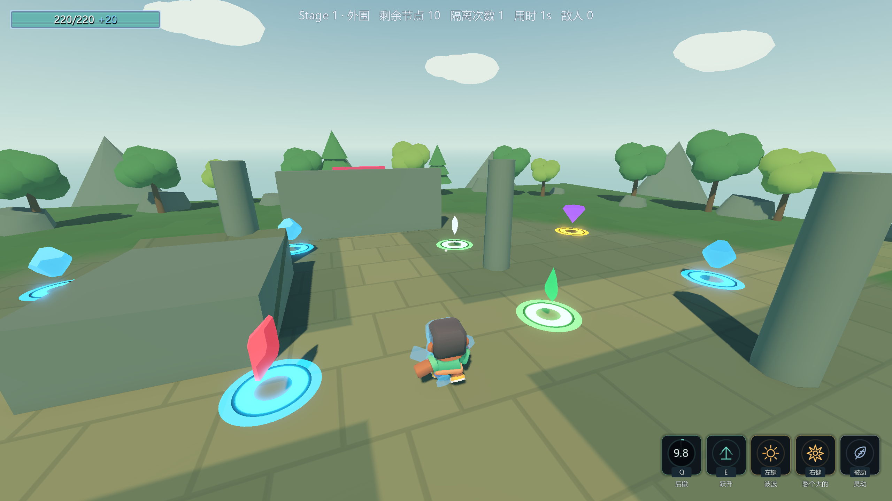
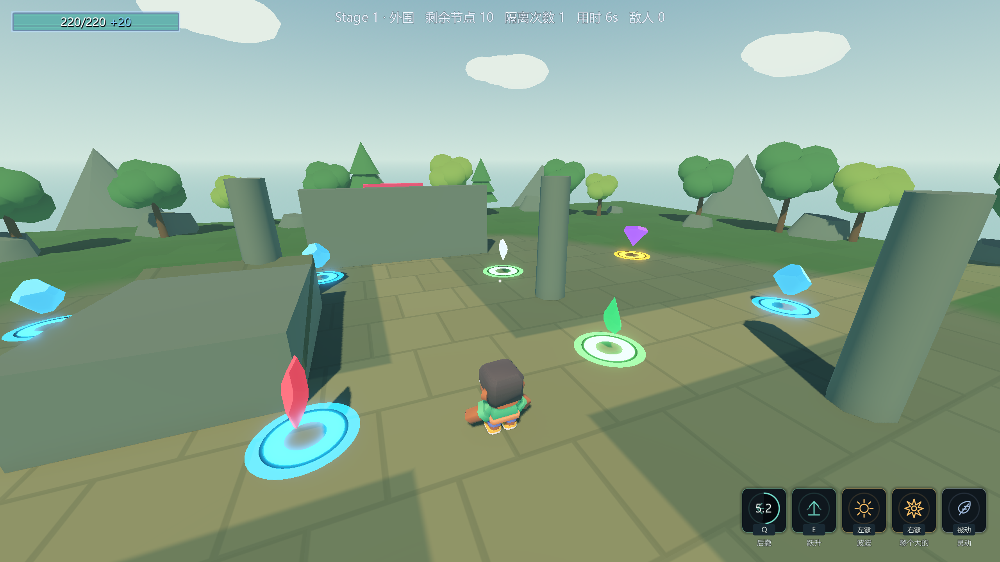
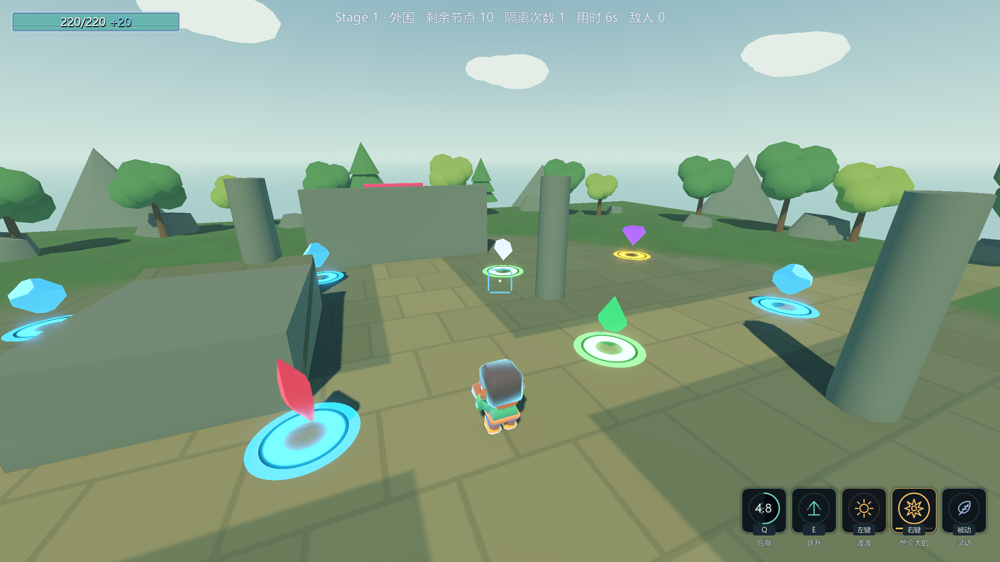
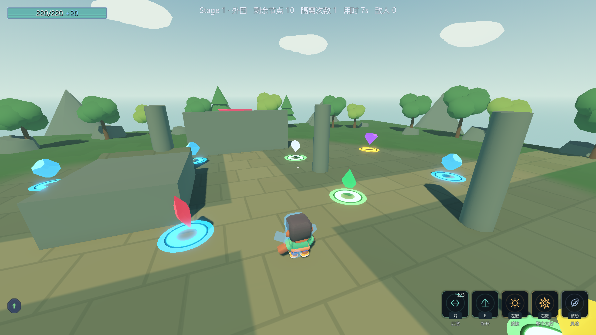
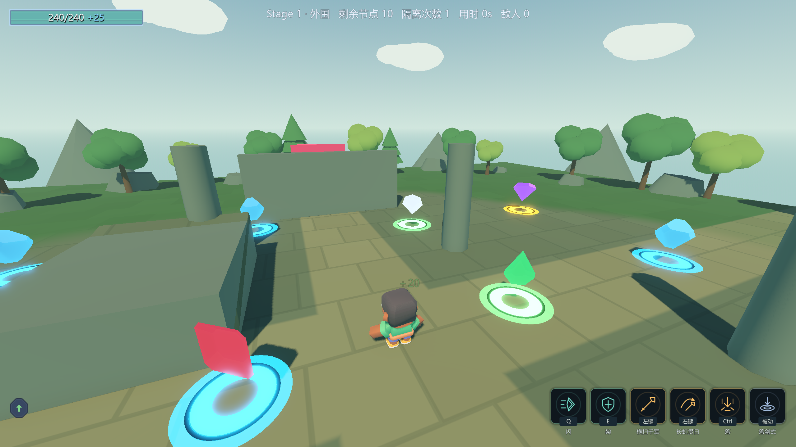
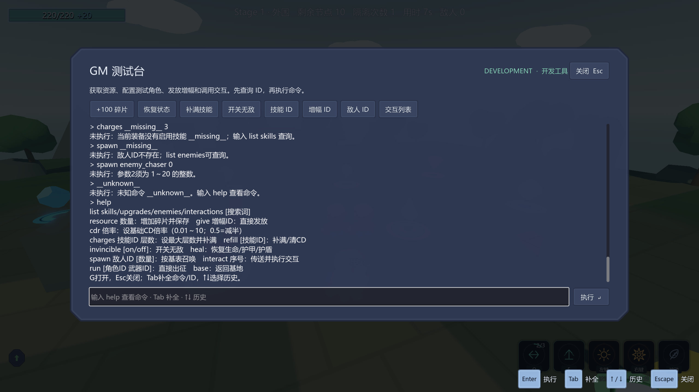
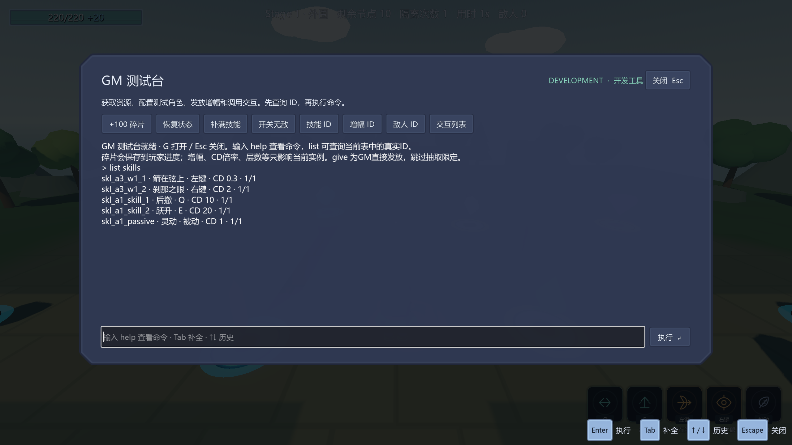

# B批验收 · 2026-10-16

B-1完成右下角技能栏；B-2完成G键可插拔GM。Main和基地挂同一GM预制体，删除实例即移除快捷键和面板。
源码/资源只改HUD表现与调试入口，不改战斗表值或单位列表；`ConfigIndex.tres`未修改，技能仍39条。

| 检查 | 实测结果 |
|---|---|
| 固定Debug构建 | `build.ps1 --no-incremental -v minimal`，0 warning / 0 error |
| 正式发行配置构建 | `dotnet build ActRoguelike.csproj --no-incremental -v minimal -c ExportRelease`，0 warning / 0 error |
| Main完整自测 | 退出码0，日志到达 `=== 自测结束 ===` |
| B渲染探针 | **82 PASS / 0 FAIL**，退出码0，无新增运行ERROR |
| A无头回归 | **23 PASS / 0 FAIL**，退出码0；跳过拍摄，不覆盖A图 |
| E无头回归 | **39 PASS / 0 FAIL**，退出码0；跳过4次拍摄，不覆盖E图 |
| 8条硬指标 | 去时间戳后与E批基线逐字一致，含ConfigIndex已加载、39技能、玩家220/20/6.5、Pressure、白板首领、端到端及最小闭环 |
| 存档与flag | GM资源测试还原meta.cfg原始字节；ability_cards.cfg/settings.cfg未改；结束确认selftest.flag不存在 |
| 视觉证据 | 8张真实视口图及SHA-256，当前用户设置2560×1440 |

完整输出摘录、8条对比全文、存档哈希与截图哈希见 [b-batch-evidence.log](b-batch-evidence.log)。

## 技能栏

19条玩家技能行通过 `HudIcon / HudColor / HudOrder` 绑定19个SVG图标，按当前角色/武器声明和实际Enabled交叉过滤。
猎手三武器各5格，武器大师三武器各6格；落剑式当前在角色表Skills中声明，因此三武器均显示，未在表现层更改其归属。
按键从InputMap读取；真实Q触发后验证CD比例递减和扇形遮罩，验证层数2/3、右键蓄力、后台维持状态及鼠标穿透。
近0/1的遮罩分别跳过/画整圆，避免浮点退化三角化错误。窄区域400×300自动换行，无格子越界。
HUD layer=3，像素滤镜layer=1，生产默认不挂像素滤镜。基地技能启用与正式角色切换仍由C批完成。













## GM实际输入与插拔

探针通过 `InputEventKey` 打开G、LineEdit输入命令并按真实Enter执行；每条确认CommandCount恰加1，避免误读旧结果。
覆盖资源落盘、增幅、CD倍率、技能层数/补满、无敌/恢复、敌人召唤、ID目录、非法参数、Tab补全与↑历史。
真实奖励节点交互后，经base返回基地、run再出征，验证装备及旧奖励模态的暂停清理。
设置页暂停时仍能开GM；拔除后保留设置页及暂停。开着GM拔除还原原无敌，G无反应，重新挂载又可用；Enabled=false自动移除。





命令语义、资源持久化与接入方式见 [gm-console.md](gm-console.md)。
GM是开发工具，调用现有公开修改接口；技能HUD才是只读表现层。

## 复现与边界

```powershell
& 'F:\Godot项目\项目a\_tools\verify_batch_b.ps1'
```

脚本每段构建/运行都独占 `.ai_validation.lock`，只退出自己启动的PID，不用stop_project、不关闭编辑器。
验证场景 `Scenes/Debug/_BatchBProbe.tscn` 不进入生产场景。资源测试备份并还原meta.cfg；其它非预期存档变化会保留现场并失败，避免覆盖用户手动设置。
`build.ps1`固定使用Debug，不能叠加第二个-c；ExportRelease是Godot SDK的正式发行配置。
额外发行构建暴露原有EditorScript在非编辑器程序集不可用，已用 `#if TOOLS` 限定编辑器入口，不影响技能动画生成器的运行期代码。
原SelfTest的两个排障读取接口也只在DEBUG中定义，导致生产技能在发行配置缺少成员；现发行分支保留只读false接口，不能跳过真实动画或发射，Debug探针行为不变。
一次重跑还拦住Hit脚本偶发的全局父类名解析错误；Hit/Explosion改用同一父脚本的显式资源路径，避免依赖全局类缓存的加载时序，未改特效参数。

- ⚠️ 尚未导出/启动完整发行exe。当前证据覆盖ExportRelease编译，以及开发构建中Enabled=false的真实禁用与清理；不声称已完成发行包验证。
- ⚠️ Main完整自测保留基线导航空网格/cell_height提示及4 ObjectDB / 2 resources退出提示；B渲染探针没有新增运行错误。
- ⚠️ P4旧测试偏差（落剑式1→1、长枪上限4/旧期望3及路径12m/旧期望20.74）保持原状；自测退出码0不代表这些旧期望全部满足。
- 美术方向与素材审计独立记录在 [art-refresh-verification.md](art-refresh-verification.md)。当前为阶段性画面改善，角色与整套UI美术仍需后续制作。
- 下一批C严格按C-1→C-2→C-3，之后D；本批GM换装不替代正式角色交互修复。
- CodeGraph只做低成本状态检查（167文件、4611节点、8431边）；该统计仍是先前快照，不作为本批新文件已入索引的证明，没有重建或阻塞计划。
