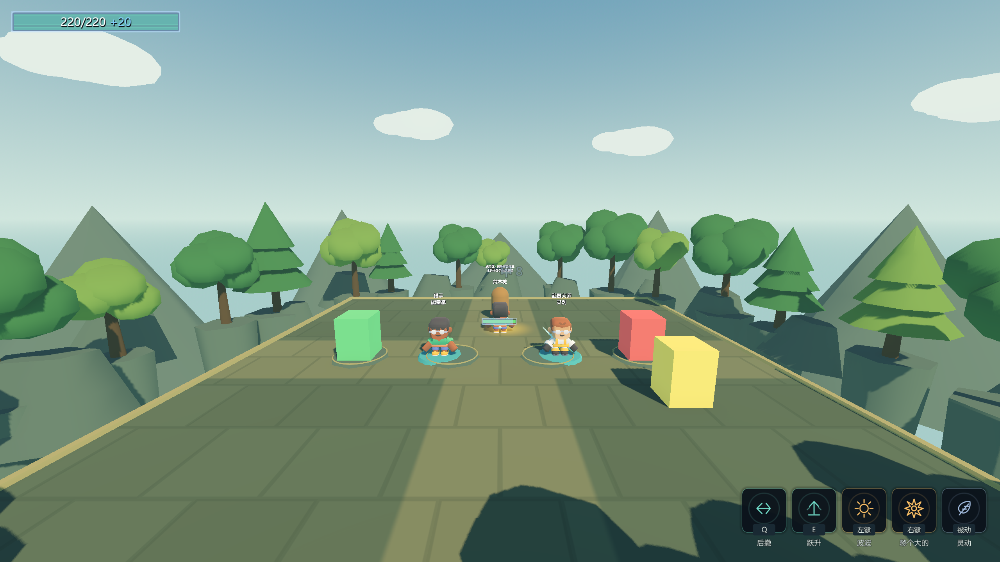
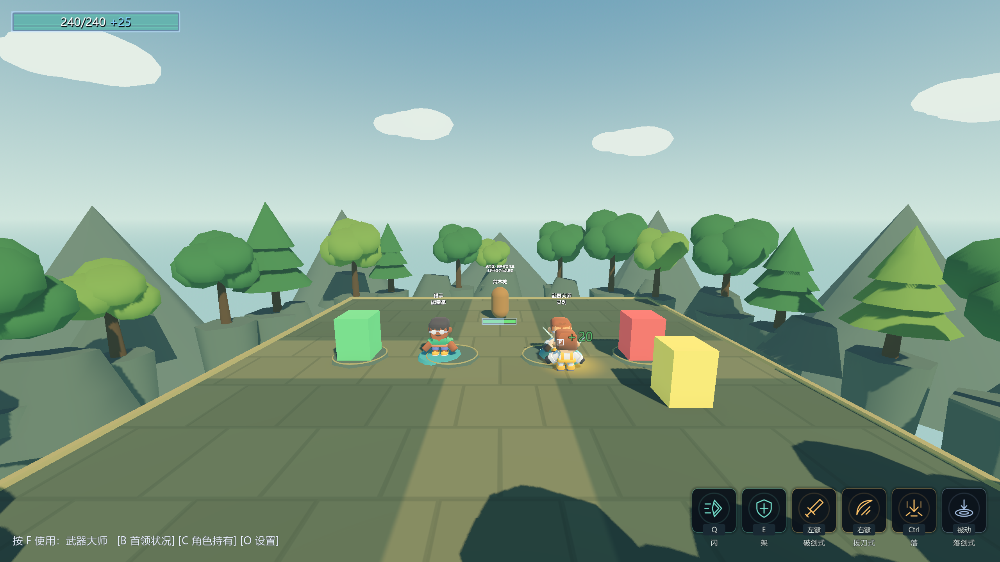
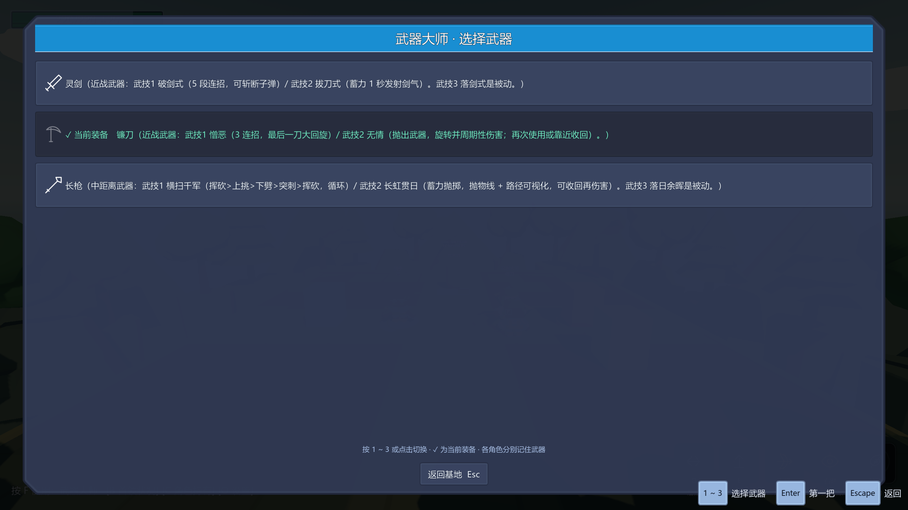
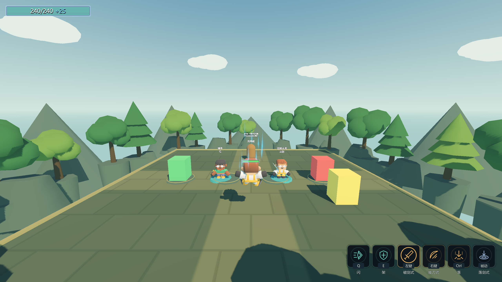
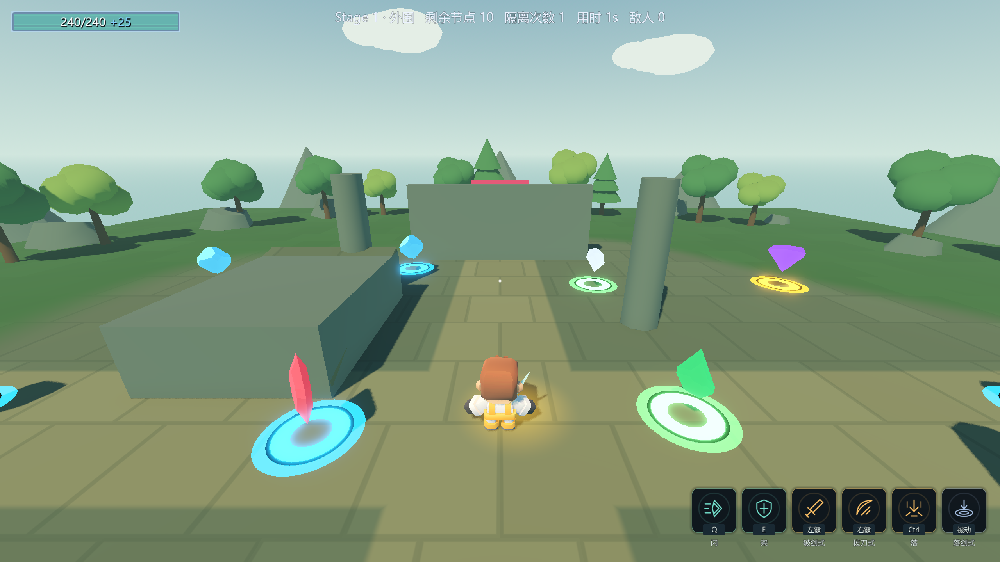

# C批验收 · 2026-10-16

C-1基地真实战斗、C-2独立角色交互与武器归属、C-3角色模型/武器记忆/选中高亮，按依赖顺序实现并分段验证。
ConfigIndex未修改，2角色/6武器/39技能/62增幅保持；本批没有改技能伤害、冷却和碰撞层。

| 验收 | 实测结果 |
|---|---|
| Debug固定构建 | build.ps1 --no-incremental -v minimal，0 warning / 0 error |
| ExportRelease构建 | dotnet build ActRoguelike.csproj --no-incremental -v minimal -c ExportRelease，0 warning / 0 error |
| C-1阶段探针 | 10 PASS / 0 FAIL，真实远程/近战扣木桩生命与护甲 |
| C-2阶段探针 | 21 PASS / 0 FAIL，真实F直接切角色，每角色只列自己的3把武器 |
| 最终C渲染探针 | 59 PASS / 0 FAIL，退出码0 |
| 新进程持久化探针 | 5 PASS / 0 FAIL，退出码0；两个角色分别读回武器，基地启动恢复实际模型 |
| Main完整自测 | 退出码0、到达结束标记；8条硬指标与E批基线逐字一致 |
| A/B/E无头回归 | A 23/0，B 74/0，E 39/0；跳过拍摄，不覆盖此前截图 |
| 存档 | meta.cfg、ability_cards.cfg、settings.cfg、正式loadout.cfg前后不变；flag不存在 |

原始输出、8条硬指标全文、存档和7张截图哈希见 [c-batch-evidence.log](c-batch-evidence.log)。
装备应用、数据归属、存档与模型替换契约见 [base-loadout.md](base-loadout.md)。

## 真实链路

- 左键通过InputEventAction进入生产输入消费者，再由真实动画事件发射/开判定；猎手能量掌和灵剑都扣除了木桩护甲。
- Q后撤有真实CD；空格跳跃、下落攻击和落地均实跑；Shift奔跑实测10.2，基础速度6.8，松手退出。
- 真实F与各角色对象交互：立即切角色，列表每人3把；跨归属选择被拒，当前配置不变。
- 猎手选弓，武器大师选镰刀，再切回猎手仍拿弓；A交互B时变为B且镰刀高亮、禁用重复选择；改选灵剑后模型和武技组同步。
- 可见重型模型的动画事件继续真实命中；展示子树没有Unit、CollisionObject或分组。
- 基地入站伤害探针直接调用真实ReceiveHit结算入口；高伤测试装备经真实左键击破木桩，自动重建，不发碎片。
- 基地死亡重建练习场并保留选择；真实F出击门把B+灵剑带进Main，GM辅助返回后装备和暂停状态正确。
- GM跨角色run命令拒绝，未留下部分配装修改。完整发行exe尚未导出实跑。

## 实拍













## 复现与边界

```powershell
& 'F:\Godot项目\项目a\_tools\verify_batch_c.ps1'
```

每段构建/运行独占.ai_validation.lock，只管理自己启动的PID；不使用stop_project、不关闭编辑器。
探针使用DEBUG专用 --loadout-test，把选择存档放到独立的batch_c_loadout_test.cfg；序列化、归属校验和新进程读档仍走生产代码。
脚本结束恢复或清理测试文件，正式loadout.cfg和玩家其它存档哈希均复核；B回归的GM资源测试还原meta原始字节。
7张图沿用用户2560×1440设置，没有覆盖分辨率偏好。测试临时调镜头及位置以取证，生产场景相机参数未改。

- ⚠️ 一次完整自测在终结器堆栈出现Godot/GCHandle的Handle is not initialized错误；虽然退出码0，验收脚本仍判失败。
  该次stderr保留于 [中间问题原文](c-batch-intermediate-issue.log)。最终通过记录不豁免这类错误；根因尚未定位，后续若重现需专项处理。
- ⚠️ 原导航空网格/cell_height提示、完整自测退出4 ObjectDB / 2 resources提示及P4落剑/长枪旧期望偏差仍保留。
- ⚠️ 角色基础数值仍为待用户确认的预设值；角色/握持武器模型仍是阶段性素材，不代表最终艺术品质。
- 下一批D专门处理碰撞层级，特别是敌我物理阻挡与战斗判定分离，必须全量回归。
