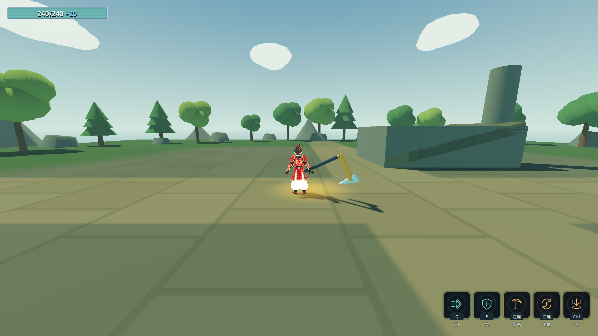
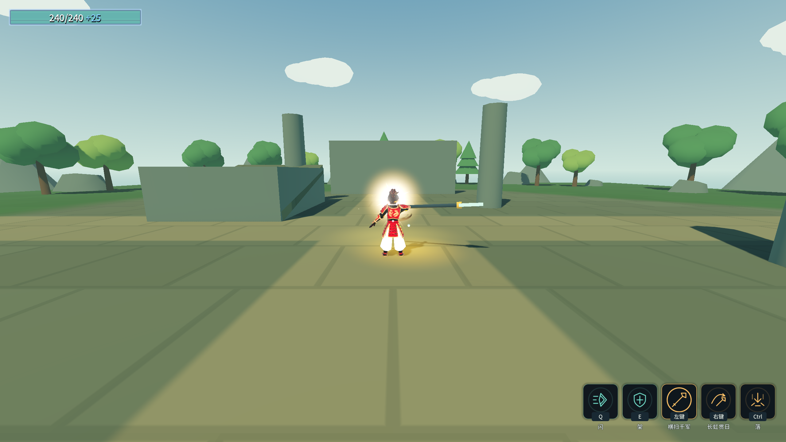

# 原始设计纠偏 J1：朝向与四段循环

2026-10-17。权威为原始《角色设计.txt》及[用户补充裁定](original-design-audit.md)。本轮不宣称整份角色设计已完成。

## 改动与依据

- 六配装均使用技能节点，旧`PlayerWeaponInput`在武器组件禁用时提前返回，导致朝向更新走不到。现把准星朝向更新放在这个分支之前。
- 后撤持有独立来源的朝向锁，从起手保持到结束／取消／换装／退树，期间转镜头不会改变后撤方向。
- 两模型脚尖与角色根前向点积均为1，没有翻转模型。测试六配装、四个水平相机方向，等待转身后根前向点积均大于0.995。
- 落剑式从角色共通技能列表移到灵剑武器行；镰刀和长枪仍有共通“落”，不再错误继承灵剑追加圈。
- 长枪系列表删去重复第五段，各逐段数组同步为四项；真实输入、真实ATK事件、实际受击序列为`0,1,2,3,0,1,2,3`，两轮扣血10000→9804.199。
- 深度加载爆炸场景曾取消旧特效的`_self_destruct`等待协程，留下运行告警。视觉寿命改用原生Timer信号调用原生`queue_free`；新探针刻意深载相同脚本，验证已脱离战斗节点的旧特效仍按时回收。

旧B测试的技能格数、旧角色测试和Main长枪段数按纠正后的设计更新；有修前16通过/20失败及修后真实命中证据，不用改预期代替修正实现。旧H长枪DPS基于五段，现已明确失效。

## 复现与证据

运行`_tools/verify_character_design.ps1`：独占构建／验证锁，四份玩家存档逐进程落盘备份并核对，C探针强制独立测试存档，最后删除`selftest.flag`。
完整原始输出摘要见[character-design-evidence.log](character-design-evidence.log)。
修前16/20和特效重载告警原文见[失败现场](character-design-before.log)。新探针无头44/0、渲染46/0，包含两项特效寿命断言和两张渲染截图。
最终Debug与ExportRelease编译均0警告/0错误；Main完整自测退出0，八条硬指标逐字一致。F33/0、C52/0、D90/0、G50/0、角色61/0、B74/0、A23/0、E39/0、跨进程读档5/0，最终各进程stderr为空。角色探针因长枪删掉重复第五段，少两项旧第五段断言，现为61项。四份玩家存档哈希保持恢复点，`selftest.flag`不存在。

⚠️ 当前近战仍使用阶段性的原生攻击素材；四种挥枪动作的视觉区分、投掷留场／收回、下落定向与高度、九项进化及变奏点按均需后续纠偏。具体开口见[原始设计审计](original-design-audit.md)。
