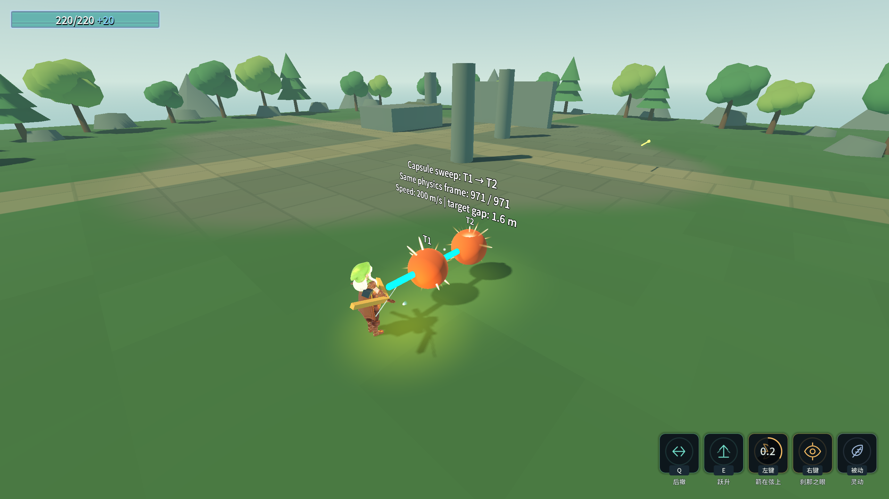

# J12：胶囊扫掠与全局弹速上限（2026-10-18）

用户裁定：先用 `CapsuleShape3D + IntersectShape`；实际弹速上限先试 **200m/s**，后续肉眼调整。

## 行为与配置

- `Projectile.SweepFrame`：胶囊两端球心为当帧 `from/to`，完整高度为线段长度加两倍半径，局部 Y 轴对齐弹道。`SweepRadius` 为世界米，默认 **0.08m**，可在投射物场景检查器调整；纯视觉的大箭缩放不放大查询半径。
- 常规每帧一次 `IntersectShape` 收集候选，然后按单位位置沿弹道的投影排序。同距离先处理 World，单位间以实例号稳定排序。候选达到初始容量 256 时扩容重查，避免无序结果被截断后跳过目标。
- 胶囊接触 World 时，用同半径球的 `CastMotion` 求最早阻挡距离；另用起点重叠查询覆盖“出生已经在墙内”。墙按近面阻挡距离排序，避免长墙中心比墙后目标更远时穿墙。撞墙立即消失。
- 同目标多形状、同帧及后续帧均按 RID 排除并由 `HitTracker` 约束；每帧预算耗尽时停在最后命中投影位置，下帧继续，不跳到帧末漏怪。
- `SweepMaxHits <= 0` 仍走原有单次射线路径。全局限速是本批明确裁定的行为变化，与扫掠开关独立。
- **全局调节入口**：`Config/ConfigIndex.tres` → `ProjectileMaxSpeed = 200.0`；定义在 `ConfigIndexData` 的 `[Export]` 属性中，≤0 表示不限速。这里只新增标量，未增删表行或资源引用，所以 ext_resource、数组与 load_steps 均无变化。
- `Launch`、弹射重新定速、每帧追踪/重力之后都对真实速度向量夹取，再据此计算位移。`Projectile.Speed` 与技能 `LastShotSpeed` 保留原始发射值；新增只读 `ActualSpeed` 表示限速后的读数。弓基础 **160→160**、普通满蓄 **220→200**、龙之箭满蓄 **320→200**。

## 接入审查

`ArrowVolleyAbility`（含 `SwordQiAbility` 继承）、`EnergyWaveAbility`（含 `ProjectileAttackAbility` 继承）以及 `Weapon.TryFire` 生成的弹体均进入 `Projectile.Launch`，所以技能、蓄力和表参数算完后统一限速。当前符文不直接给弹体增加速度；既有符文的施效方式保持不变，五探针包含 `_RuneProbe` 回归。投掷长枪/飞镰的独立 `WeaponThrowAbility.FlightVelocity` 不属于 `Projectile`，本批未改其运动学。

未改 `Weapon.cs`、共用技能子类、伤害/暴击规则、敌人表或技能表。`project.godot` 的既有用户改动保留。

## 验收

复验命令：`& .\_tools\verify_projectile_capsule.ps1`。独占验证锁，构建前核实已有游戏进程，只结束本脚本启动的 PID；存档逐进程比字节，并在结束清理 `selftest.flag`。无 C 探针或独立 fixture 操作。

最终输出见 [完整证据](character-design-j12-evidence.log)，其中保留每个进程的真实 stdout、耗时、退出码、stderr 字节数、双构建、8 条硬指标和存档 SHA256。

| 项目 | 最终结果 |
|---|---|
| Debug / ExportRelease | 均 0 warning / 0 error |
| `_BowSweepProbe` 无头 / 渲染 | **39/0 / 40/0**（旧 23 条 + 新 16 条；渲染另加截图 1 条） |
| `_ChargeReleaseProbe` | **80/0** |
| `_CharacterDesignProbe` | **115/0** |
| `_DragonArrowProbe` | **42/0** |
| `_RuneProbe` | **83/0** |
| Main / 8 硬指标 | 退出 **0**，68.83s，stderr **0 字节**；与 J11 基线逐字一致，索引 14 个数，末尾符文 11 |
| 存档、flag | 四存档 SHA256 前后相同；rune.cfg 前后均不存在；selftest.flag 不存在 |

本轮七个游戏进程全部退出 0、stderr 0 字节；Godot 编辑器 PID 13560 保持运行。Main 的五条历史红色读数标记仍原样保留，本批不把它们写成新失败或宣称修复。

旧 23 条弓探针断言保留；因实际速度从 260 限至 200、60Hz 单帧长度从 4.333m 降至 3.333m，双靶改为 **z=18.2/16.6，间距仍为 1.6m**，完整覆盖在枪口约 z=19.4 到帧末约 z=16.067 的线段内。原位置 z=17.6/16.0 会让限速后的帧末落在第二个球体内部，下一帧 `HitFromInside` 能补中，失去原对照组的“同帧跳过”几何条件。

新增 16 条无头检查：基础箭实际 160、普通满蓄实际 200、龙之箭实际 200、两种半径擦边、逆序创建与多形状去重、预算跨帧续扫、竖直弹道、长墙、墙内出生、侧墙擦边、龙之箭满蓄 320→200、不开扫掠的初速、重力后实际位移、弹射后实际速度、全局配置改 120。渲染额外一条截图检查。原始技能快照期望没有为变绿而改写。

截图在真实双靶命中后保存，文字记录真实命中顺序与物理帧号；青色胶囊是依据已验证线段重建的只读几何示意，不参与命中。⚠️ 本批未做胶囊与旧逐段射线的性能基准，不宣称速度提升。

API 边界按官方文档确认：[PhysicsDirectSpaceState3D](https://docs.godotengine.org/en/stable/classes/class_physicsdirectspacestate3d.html)（IntersectShape 无命中点、CastMotion 忽略起点重叠）和 [CapsuleShape3D](https://docs.godotengine.org/en/stable/classes/class_capsuleshape3d.html)（Height 含两端半球）。命中点取弹道投影位置，属于路径结算点，不冒充形状表面接触点。

首轮编译因把 `CollideShape` 返回的 `Godot.Collections.Array<Vector3>` 写成 `.Length` 而失败；改用 `.Count` 后通过。失败原始记录保留为 `character-design-j12-failure-20261018_111342.log`，首次已通过专项输出另存为 `character-design-j12-probe-20261018_111358.log`，不覆盖历史。

## 下一批

继续 `SESSION-SNAPSHOT.md` §5.3 / `DEEPSEEK_HANDOFF.md` 第 4 项：逐项补原文进化，先核对真实表行 Id 与原文，再按小批实现、实测、文档、commit/push。J12 不代表进化、异化、统一暴击或终版美术已完成。
