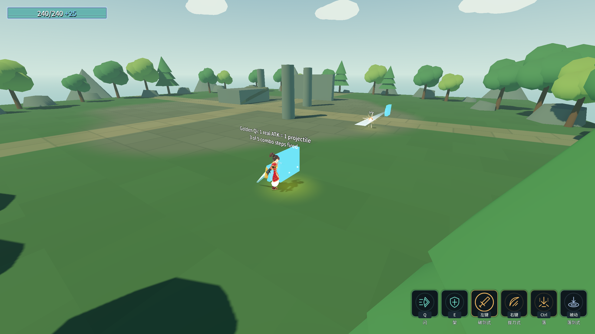
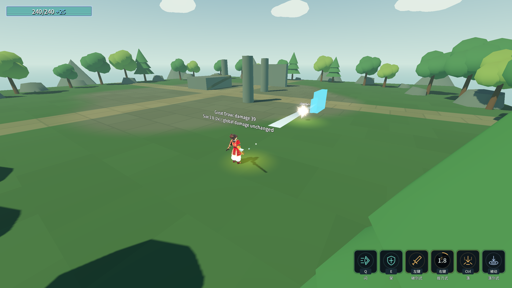
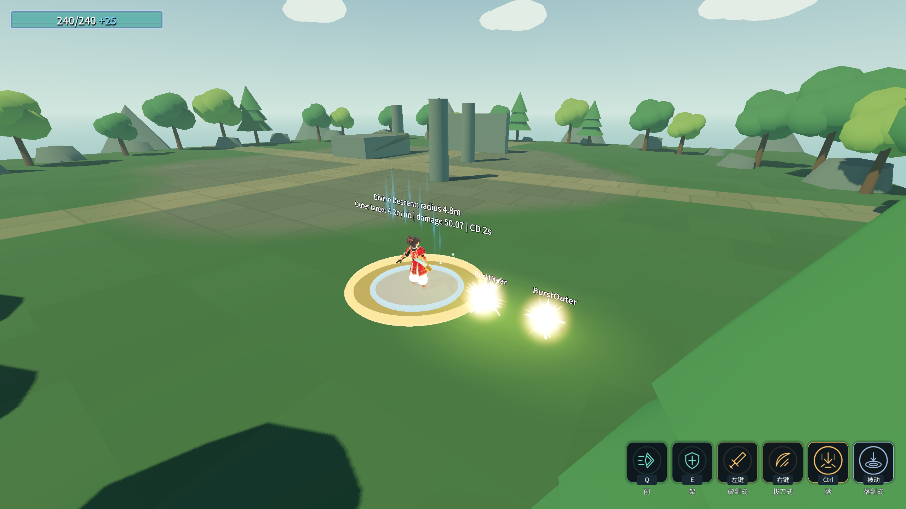

# J13：灵剑进化三项（2026-10-18）

范围：原文灵剑进化的金光术、大拔刀术、神降术。用户要求在当前对话继续；自动创建的接续对话已中断并归档，未改文件。

## 三条真实链路

| 进化 | 原问题 | 当前实现与实测 |
|---|---|---|
| 金光术 `evo_golden_qi` | 表行存在、没有效果 | `MeleeProjectileTuning` 强类型参数 → `MeleeProjectile` handler → 破剑式每段真实 ATK 后出一道 SwordQi。五段额外剑气真实命中远靶，伤害快照 **20/23/26/29/36**，来源仍为 `skl_b1_w1_1`；挥空也出，前摇被闪打断则不出。 |
| 大拔刀术 `evo_great_draw` | 错加全局伤害；模型尺寸在发射前被重算覆盖；射线没有粗细 | `SkillEnhancementTuning` → 只改拔刀式自身伤害及尺寸倍率，发射前重算后再乘尺寸。真实伤害 **26→39**、模型尺寸 **1.4→2.8**，全局伤害乘区保持1。仅增强拔刀式启用半径 **0.16m** 胶囊，真实命中偏轴0.15m、半径0.05m的小靶；基线射线未命中。破剑式额外剑气仍 **20→20**，不串技能。 |
| 神降术 `evo_divine_descent` | 未扩大范围 | 同一强类型增强资源 → 只改落剑式额外一圈：实际独立球体半径 **3.2→4.8m**，伤害为本次上游伤害 **×1.6**（实测 **31.292→50.067**），CD **2秒**。真实下落与World碰撞后命中4.2m外圈靶；2秒内再次落地被CD拦住，经过CD后再触发。 |

金光术复用当段近战攻击快照，玩家伤害倍率只乘一次；原文未给额外剑气的独立伤害，先按交接约定继承当段伤害。大小按当前段命中盒最长边×0.5，60m/s、0.45秒、穿透8、每帧8次扫掠。斩弹在出额外剑气之前执行，已有斩弹名单不变。

⚠️ 原文没有给幅度的参数均为可调预设：大拔刀术伤害×1.5、模型尺寸×2、胶囊0.16m；神降术伤害×1.6、半径×1.5。神降术CD2秒是原文明值。本批不擅自定稿这些预设。

资源入口：三条 `Config/Tables/Upgrades/evo_*.tres` 的 `MeleeProjectile` 或 `SkillEnhancement` 子资源。目标技能用 `AbilityConfig` 资源引用；新参数不使用 Godot.Get/Set 字符串反射。未增删任何表行，ConfigIndex 的 ext_resource / 数组 / load_steps 均不改，索引仍14个数、末尾符文11。

换装会清除额外投射物配置、恢复拔刀式扫掠与尺寸倍率、还原落剑式原始形状。神降术创建独立球体，未修改共享场景资源；新实例仍为3.2m，换镰刀后额外落剑式关闭。落圈表现继续只读真实形状半径。

## 验收

命令：`& .\_tools\verify_projectile_capsule.ps1 -SpiritSword`。`-ProbeOnly` 另存带时间戳的专项记录，不覆盖完整证据。独占验证锁、逐进程核对五份存档状态、清理flag；只结束本脚本的子进程。现有五回归全部保留原断言。

| 项目 | 最终结果 |
|---|---|
| Debug / ExportRelease | 均0警告／0错误 |
| `_SpiritSwordEvolutionProbe` 无头 / 渲染 | **71/0 / 74/0** |
| 五回归：蓄力／原文／龙之箭／弓／符文 | **80/0、115/0、42/0、39/0、83/0** |
| Main / 八硬指标 | 退出**0**，68.8s；八条与J11逐字一致，迁移后的P5b契约探针✅ |
| 存档、flag、编辑器 | 四存档SHA256前后相同；rune.cfg未生成；flag已清理；编辑器未关闭 |

最终八个游戏进程均退出0、stderr 0字节。原五条历史红色读数标记保留，不伪装成已修复。

真实链路专项通过71条，渲染另加3张截图。旧Main的P5b表参数探针原先把拔刀式构造成 `ArrowVolleyAbility` 并断言全局×1.5，已迁移为真实 `SwordQiAbility` 类型，核对自身伤害39、扫掠8/0.16、全局1；真实发射尺寸由专项验证。八硬指标口径不改。

截图均来自渲染进程的真实战斗；文字是只读诊断，没有额外碰撞体或伤害逻辑。神降术截图时冲击圈尚在扩散，不能据截图那一帧的可见半径替代实际碰撞体读数。

## 中间失败与主动结束

- 两次初始构建失败：Godot Array 的 `ToArray` 需 LINQ 命名空间；随后补齐 Launch 的方向实参。原始构建输出保留。
- 初版专项39/2：下一次近战在冷却未结束时按下；探针改为等待真实就绪，不改生产冷却。
- 第二版67/2：上一发拔刀式尚在飞行，命中串入金光术采样；增加真实飞行等待窗口，不改伤害期望。
- 首次专项69/0、渲染72/0；随后补上偏轴靶验证真实宽度，增加2条成为71/0、74/0。
- 第一次完整运行在已通过71/74、弓39、蓄力80后，为迁移Main旧探针，主动按PID结束自己启动的原文探针子进程（PID1544，退出-1，stderr空）。此轮是主动中断，不作为完成的回归；记录保留，最终完整运行另做。

完整原始输出见 [最终证据](character-design-j13-evidence.log)，所有 `character-design-j13-failure-*.log` 与早期专项日志一并保留。

## 剩余顺序

本批只完成灵剑三项。下一步怜悯／普渡／喜爱，随后气贯长虹／金光大道／浮光跃金／地爆与其他进化；异化原文审查、统一玩家暴击、动作美术、六配装平衡及符文未完项仍保持待办。
