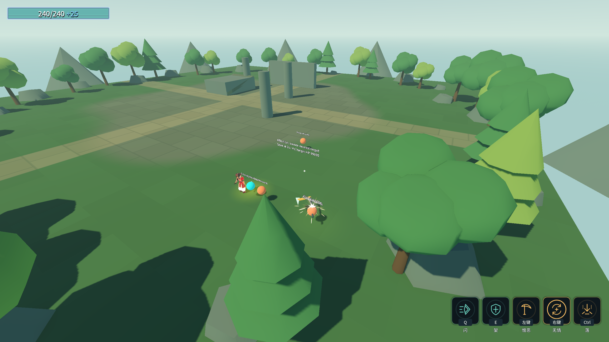
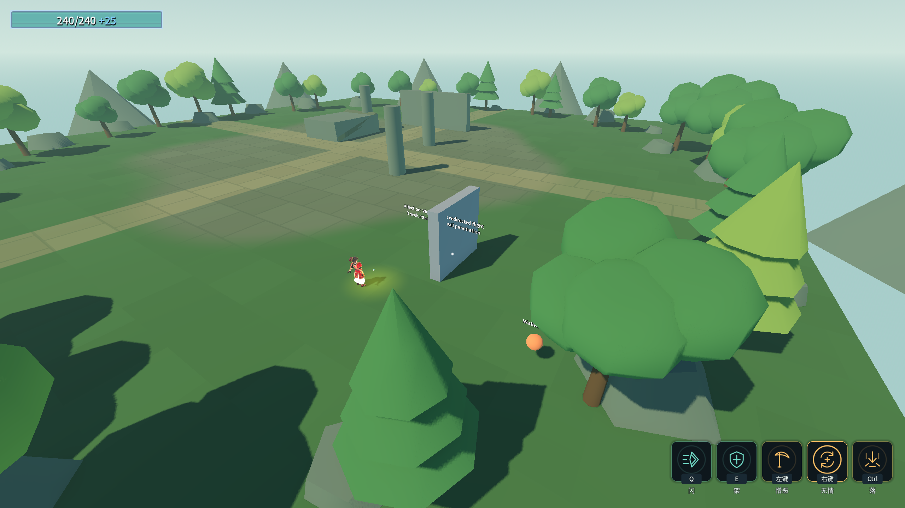

# J15：喜爱的真实飞镰索敌（2026-10-18）

原文：武技2武器飞出去后每2秒飞向离玩家最近的敌人。喜爱已从无效果占位行接入真实飞行、周期伤害与回手链路；下一项气贯长虹。

## 实现与边界

- `WeaponSeekTuning` 以资源引用指定 `skl_b2_w1_2`，`WeaponSeek` 处理器在真实入构筑时配置飞镰，间隔2游戏秒。默认间隔0关闭，重新配装清除配置与计时。
- 从真实离手开始计时，每个周期以玩家位置选择最近的有效敌对单位。友军、死者跳过；不会误选离飞镰最近的单位。实测在2／4／6秒触发，计时误差小于0.025秒。
- 悬停时可以重新开始飞行，按原投掷速度飞向这次索敌时的目标点；到点或达到每段原8m水平射程后停留，下一周期再选目标。不是逐帧追踪移动目标。目标高度0.9m是可配置预设，原文未给高度。
- 沿用原World检测、周期伤害、武技1离手锁门及真实回手解锁。重定向飞行段启用起点在World内的射线检测，覆盖墙面连续重新出发；没有目标时只检查，不伪造飞行方向。回程和回手后停止索敌。

真实场景把A放在离玩家6m、B放在离玩家8.6m但离飞镰更近的位置：第2／4秒选择A并实际命中，A生命100000→99890；把B移到离玩家4.5m后第6秒切换B。连续三次向墙后目标索敌，武器停在墙前 `(22.7, 0.9, 13.97999)`，墙后目标零伤害。手动召回、靠近召回、回手后武技1真实ATK与换装清理均覆盖。

未增删表行，ConfigIndex引用／数组／load_steps不改。长枪未配置该功能，默认投掷路径保持。

## 验收

命令：`& .\_tools\verify_projectile_capsule.ps1 -Affection`。验证独占，逐进程保护存档、清理flag；渲染只抓真实场景状态。

| 项目 | 最终结果 |
|---|---|
| Debug／ExportRelease | 均0警告／0错误 |
| `_ScytheSeekProbe` 无头／渲染 | **42/0／44/0** |
| 灵剑／镰刀末刀回归 | **71/0／36/0** |
| 原五回归 | 蓄力80/0、原文115/0、龙之箭42/0、弓39/0、符文83/0 |
| Main／八硬指标 | 退出0，69.46s，八条与J11逐字一致；索引14个数、末尾符文11 |
| 存档／flag | 四存档SHA256前后相同；rune.cfg未生成；selftest.flag清理 |

10个游戏进程全部退出0、stderr 0字节。编辑器保持运行，Main原五条历史红色标记仍保留，不宣称本批修复。

首轮专项即42/0、渲染44/0，未发生本批构建或运行失败；先行记录见 [首轮专项](character-design-j15-probe-20261018_120504.log)。最终双构建、完整stdout、退出码、八指标逐字比对和存档SHA256见 [完整证据](character-design-j15-evidence.log)。截图用于场景取证，非终版美术。
