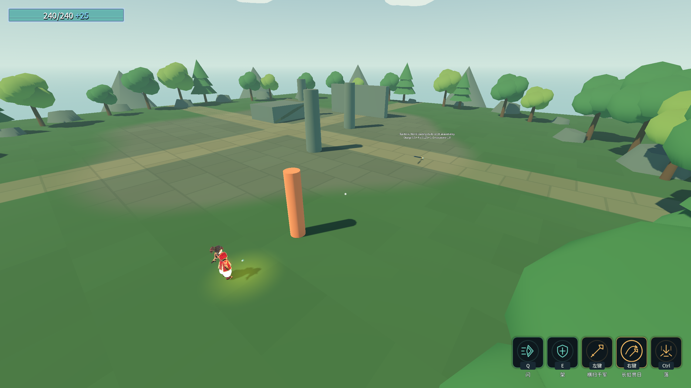

# J16：气贯长虹的召回与全部蓄力缩时（2026-10-18）

原文：武技2不再能主动收回，落地后立刻收回，蓄力时间缩短50%。本批补齐原行遗漏的召回策略与总蓄力上限；下一项金光大道。

## 实现与真实链路

- `WeaponRecallTuning` 强类型引用 `skl_b3_w1_2`，替换旧字符串 `AbilityOverride`。基础1→0.5秒、每档0.25→0.125秒、总上限2→1秒，仍四档、按基础加算20%、满档1.8倍。每次从原技能行计算，不会重复叠乘缩时。
- 飞行中真实再次按键不进入回程。沿用投掷状态机的 `AutoRecallOnSettle`，实际碰World停下的同一物理帧进入原回程，武技1直到真实回手才解锁。没有增加计时召回或瞬间回手。
- 默认长枪仍落地停留、再次按键收回、基础／每档／上限为1／0.25／2秒。重新配装恢复原策略与全部时间，不污染其他武器。
- Main旧P5b参数探针把长枪构造成了通用 `ChargeAttackAbility`，本批改成真实 `SpearThrowAbility`，额外检查总上限1秒、手动false／落地自动true。真实按键与物理链路由独立专项覆盖。

专项实测：未满0.5秒松手零出手；约0.55／0.70／0.83／0.95／1.12秒分别0／1／2／3／4档，对应1／1.2／1.4／1.6／1.8倍；继续按到1.5秒仍四档。每次首次观察到落地时已经回程，且仍锁武技1；自然回手后解锁。长枪真实往返各命中同一目标一次，出程43.203、总计86.406。

未增删表行，ConfigIndex引用／数组／load_steps不变；原八硬指标保持。

## 退出失败与处理

首轮无头89/0且退出0；渲染机制90/0，但退出时发生原生 `0xC0000005`，堆栈为 `GodotObject.Finalize → Dispose → godotsharp_internal_object_get_associated_gchandle`，并报告临时物理查询和截图资源的unsafe reference。**该渲染进程不算验收通过。** 完整现场见 [首轮失败](character-design-j16-failure-20261018_121404.log)。

长枪蓄力预览每帧产生多次射线查询，本批将预览、真实投掷与命中扫掠的临时查询参数及时Dispose，预览射线结果与截图Image同样及时释放；不禁GC、不延长退出等待、不保活所有资源。修正后先行无头89/0／渲染90/0均退出0、stderr空，见 [先行复验](character-design-j16-probe-20261018_121602.log)，随后完整回归再次验证。

⚠️ 这是项目侧临时资源释放与本场景复验，不能据此宣称Godot终结器问题根治；早期SetGodotObjectPtr变体仍按 [资源生命周期记录](resource-lifetime.md) 保留。

## 最终验收

命令：`& .\_tools\verify_projectile_capsule.ps1 -Rainbow`。验证独占，11个游戏进程顺序执行，逐进程核对存档字节并清flag。

| 项目 | 结果 |
|---|---|
| Debug／ExportRelease | 均0警告／0错误 |
| `_SpearRecallProbe` 无头／渲染 | **89/0／90/0** |
| 喜爱／镰刀末刀／灵剑回归 | **42/0／36/0／71/0** |
| 原五回归 | 蓄力80/0、原文115/0、龙之箭42/0、弓39/0、符文83/0 |
| Main／八硬指标 | 退出0，68.22s，八条与J11逐字一致，索引14个数 |
| 存档／flag | 四存档SHA256前后相同，rune.cfg未生成，selftest.flag清理 |

最终各进程退出0、stderr均0字节。编辑器保持运行，Main原五条历史红色标记仍保留。完整stdout、双构建、逐字比较、存档哈希见 [完整证据](character-design-j16-evidence.log)。

