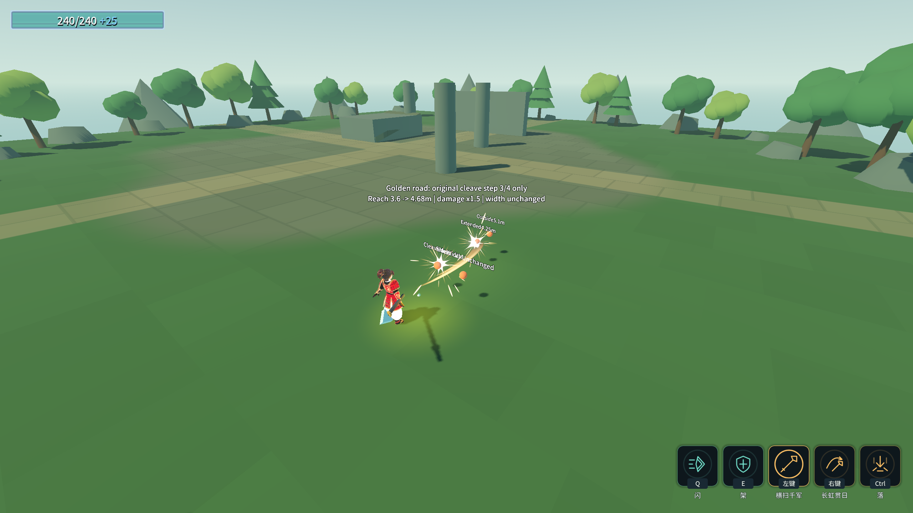

# J17：金光大道只出原下劈（2026-10-18）

原文：武技1只能使用下劈，延长下劈攻击距离，伤害增加50%。本批去掉旧全局伤害／范围修饰，复用J14的近战单段模式，强类型指定长枪四段连招的index2。

## 真实行为与预设

- 沿用 `Skill_B3_Spear3`、原动画ATK、原判定窗口与盒形，只出第3段；施法内连点不推进其他段，下次施法仍第3段。闪可在前摇真实打断，未到ATK不产生伤害。
- 下劈伤害独立乘1.5，真实快照 **27.5→41.25**。玩家全局DamageMultiplier／AttackRangeMultiplier均保持1；武技2真实出程 **24→24**，手动回手保持。
- 新增强类型 `ForwardReachScale`，只沿前方延长盒子长度并同比前移中心，靠近玩家的一端保持原位。真实长度 **3.6→4.68m**，宽1.2／高1.8不变；默认1，怜悯与其他技能不变。距离×1.3沿用原行可配预设，原文未给距离数值。
- 同一位置的4.25m、半径0.12m小靶：原下劈够不到，增强后真实命中；5.1m和侧方1m小靶不命中。换装恢复普通首段4m盒形及四连顺序。

未增删表行，ConfigIndex引用／数组／load_steps不变；参数来自SkillEnhancementTuning资源，没有字符串反射。

## 验收

命令：`& .\_tools\verify_projectile_capsule.ps1 -GoldenRoad`。独占验证、12个游戏进程顺序执行，逐进程核对存档、清flag。

| 项目 | 结果 |
|---|---|
| Debug／ExportRelease | 均0警告／0错误 |
| `_SpearCleaveProbe` 无头／渲染 | **31/0／32/0** |
| 气贯长虹／喜爱／镰刀末刀／灵剑 | **89/0／42/0／36/0／71/0** |
| 原五回归 | 蓄力80/0、原文115/0、龙之箭42/0、弓39/0、符文83/0 |
| Main／八硬指标 | 退出0，68.22s，八条与J11逐字一致，索引14个数 |
| 存档／flag | 四存档SHA256前后相同，rune.cfg未生成，selftest.flag清理 |

最终各进程均退出0、stderr 0字节，编辑器保持运行；Main原五条历史红色标记保留。首轮即31/0／渲染32/0，无本批构建或运行失败，见 [首轮专项](character-design-j17-probe-20261018_122334.log)；完整输出、双构建、八指标逐字核对和存档哈希见 [完整证据](character-design-j17-evidence.log)。

下一项浮光跃金：按用户裁定将每份额外跳跃次数换成一份完整地面基础跳高，并直接瞬移；不能沿用普通额外跳0.5高度比例。
