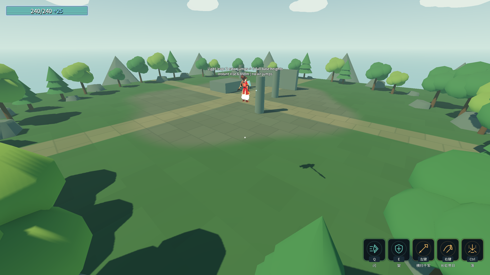

# J18：浮光跃金的次数换高度与真实瞬移（2026-10-18）

按原文及用户裁定：每份额外跳跃次数增加一份完整地面基础跳高，跳跃直接瞬移到目标高度；不能使用普通空中跳的0.5高度比例。本批移除旧全局跳速×1.25占位修饰。

## 机制与实测

- 真实入构筑经 `TeleportJump` 开启 `CharacterMovement` 的地面瞬移跳跃；当前地面高度按实际地面跳速平方／两倍重力计算，再乘 `1 + ExtraAirJumps`。额外次数保留为高度来源，`AirJumpsLeft=0`，空中不能再跳。
- 当前武器大师跳速12、重力缩放3.2；额外 **0／1／2／3** 次真实输入分别瞬移 **2.296／4.592／6.888／9.184m**。同一输入周期即到目标高度，清除垂直上升速度，随后自然重力下落；重置物理插值，避免视觉从地面缓动上去。
- 空中连按不再次瞬移，落地后重新可用；获取进化后再增加额外次数，下一跳按新次数计算，不冻结获取时的次数。其他动作持有速度覆盖时仍拦跳。
- `TestMove` 使用真实角色碰撞体检查向上World净空；天花板测试将原目标6.888m截到 **1.448m**，角色未进入墙体。净空不足以脱离地面吸附时不消耗本次跳跃。
- `PlayerLoadout` 清除模式、计数与地面状态。默认与换装后保持普通跳跃和真实额外空中跳，原0.5空中高度比例不变；全局JumpVelocityMultiplier不被该进化修改。

只改玩家获得此进化时的分支，默认关闭。未增删表行，ConfigIndex引用／数组／load_steps不变。

## 验收

命令：`& .\_tools\verify_projectile_capsule.ps1 -LightLeap`。独占验证、13个游戏进程顺序执行，逐进程核对存档字节并清flag。

| 项目 | 结果 |
|---|---|
| Debug／ExportRelease | 均0警告／0错误 |
| `_TeleportJumpProbe` 无头／渲染 | **64/0／65/0** |
| 金光大道／气贯长虹／喜爱／镰刀末刀／灵剑 | **31/0／89/0／42/0／36/0／71/0** |
| 原五回归 | 蓄力80/0、原文115/0、龙之箭42/0、弓39/0、符文83/0 |
| Main／八硬指标 | 退出0，68.18s，八条与J11逐字一致，索引14个数 |
| 存档／flag | 四存档SHA256前后相同，rune.cfg未生成，selftest.flag清理 |

最终各进程均退出0、stderr 0字节，编辑器保持运行；Main原五条历史红色标记保留。首轮即64/0／渲染65/0，无本批构建或运行失败，见 [首轮专项](character-design-j18-probe-20261018_123051.log)；完整输出、双构建、八指标逐字比较和存档哈希见 [完整证据](character-design-j18-evidence.log)。

下一项地爆：改接共通下落攻击的真实落地击退，覆盖灵剑／镰刀／长枪，不只灵剑额外落剑式。
