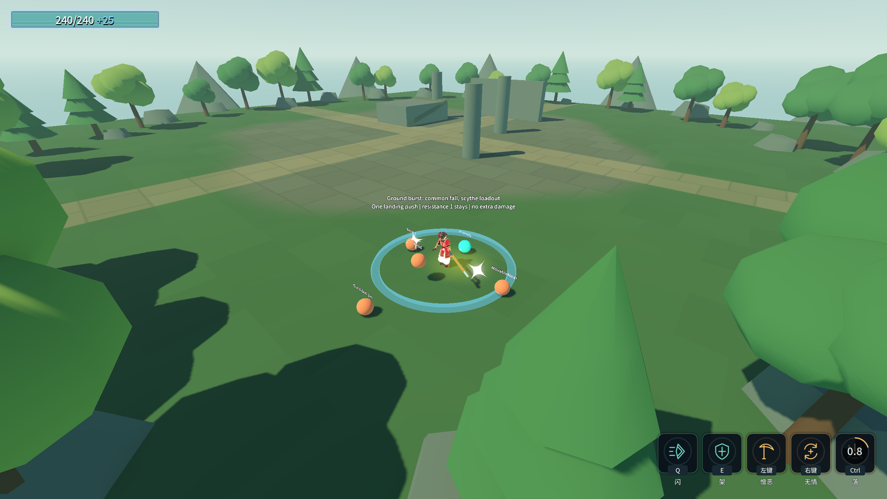

# J19：地爆接入三配装共通落地（2026-10-18）

原文：下落攻击落地时将周围命中的敌人击退。旧表只改灵剑额外落剑式，本批迁至强类型SkillEnhancement，目标为武器大师共通 `skl_b_fall`，覆盖灵剑／镰刀／长枪。

## 机制与实测

- 只在FallAttackAbility真实World落地时，复用共通落当前命中体形状与世界变换查询敌人。当前球体半径3.2m，与原额外落剑式基线一致；形状来自场景，击退强度来自进化表的 `LandingKnockback=6`。强度6沿用旧行预设，原文未给数值。
- 一次落地每名有效敌人只施加一次向落点外的纯击退；查询填满时扩容重取、单位去重。`Unit.ReceiveKnockback`保留无敌／单位乘区，移动组件继续消费击退抗性与真实物理移动；不追加伤害或命中事件。
- 三配装均真实按键→Action→下冲→World落地；空中无提前地爆，落地一次查询命中两名敌人。可动靶X从22推到约23.04～23.42，抗性1靶水平位置保持；友军、死者和4.2m范围外靶不受地爆。
- 同位置抗性靶的真实总伤害：灵剑 **72→72**、镰刀 **36→36**、长枪 **36→36**。保留原下冲命中与灵剑额外落剑式，不靠新增伤害实现击退。
- 普通自然落地、Action前被闪打断均不触发；换装清除强度和计数。Main旧P5b参数探针改验共通落强度6、额外落剑式击退0，不再把只增强灵剑当作地爆接入。

未增删表行，ConfigIndex引用／数组／load_steps不变。技能的范围、强度与后续数值继续通过场景／表资源调整。

## 验收

命令：`& .\_tools\verify_projectile_capsule.ps1 -GroundBurst`。独占验证，14个游戏进程顺序执行，逐进程核对存档、清flag。

| 项目 | 结果 |
|---|---|
| Debug／ExportRelease | 均0警告／0错误 |
| `_LandingKnockbackProbe` 无头／渲染 | **53/0／54/0** |
| 浮光跃金／金光大道／气贯长虹／喜爱／镰刀末刀／灵剑 | **64/0／31/0／89/0／42/0／36/0／71/0** |
| 原五回归 | 蓄力80/0、原文115/0、龙之箭42/0、弓39/0、符文83/0 |
| Main／八硬指标 | 退出0，68.87s，八条与J11逐字一致，索引14个数 |
| 存档／flag | 四存档SHA256前后相同，rune.cfg未生成，selftest.flag清理 |

最终各进程均退出0、stderr 0字节，编辑器保持运行；Main原五条历史红色标记保留。首轮构建把不支持IDisposable的泛型查询结果数组放进using，产生一次CS1674；移除该using后双构建0/0、专项与完整回归通过，查询参数本身仍及时释放。未改断言期望，现场见 [构建失败](character-design-j19-failure-20261018_124008.log)、[先行专项](character-design-j19-probe-20261018_124019.log)。最终全部stdout、双构建、八指标与存档哈希见 [完整证据](character-design-j19-evidence.log)。

用户新要求：优先接技能动画移动许可，默认地面技能动画锁主动移动，明确允许的逐技能配置；角色A边移动边攻击写入灵动被动。后续平衡重测先后置，继续保持数值易从表调整。
