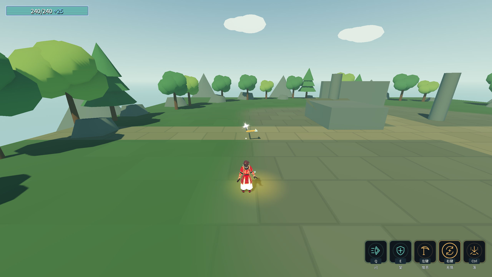
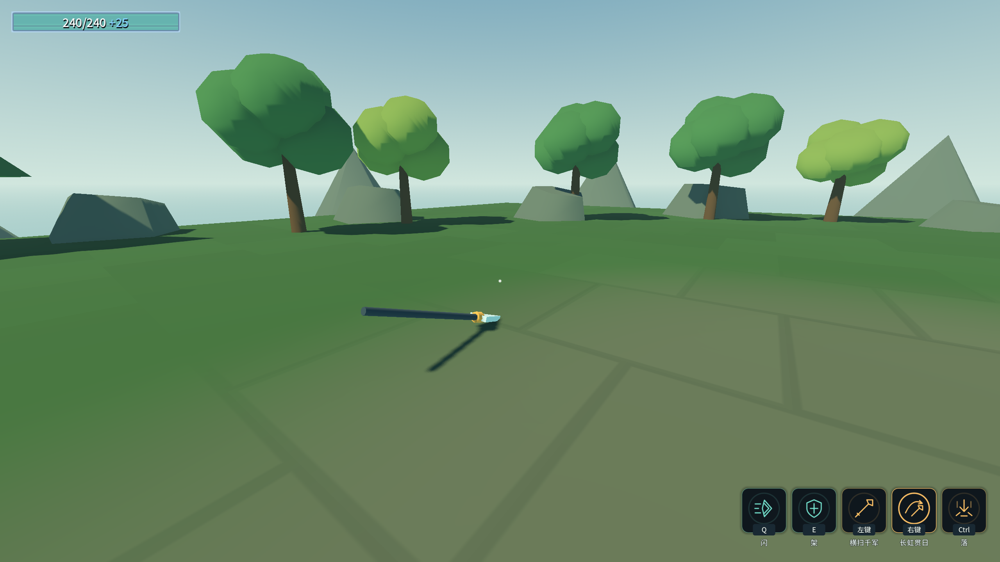

# 原始设计纠偏 J2：投掷留场与蓄力加算

2026-10-17。用户确认：镰刀飞到前方留场、再次使用或靠近收；长枪真实落地静止、再次使用收；抛枪准星选落点，超出蓄力射程则截在同方向最远处。后置蓄力按基础加算。

## 实现

- `WeaponThrowAbility`分出飞出、停留、回手。`InFlight`始终表示尚未到手，`WeaponGate`直到真正回手才解锁武技1。
- 镰刀不再以手持高度判落地，达到前方射程后停留，持续旋转、按0.5秒周期命中。手动召回与离开手边后靠近召回均保留。
- 长枪基础1秒加额外最多1秒，四档为1.8倍；伤害、水平速度、水平射程同倍率。近落点使用较短飞行时间；远落点截到本次射程。真实World扫线决定停下，落地后无持续刺伤、不自动返回、不靠近召回。
- 蓄力预览与实际飞行用同一组抛物线参数；离散飞行使用包含半重力项的积分。路径遇World提前截断。`TargetPoint`是计划落点，实际遇墙时可提前停下。
- 飞出和回程各持有一次独立命中追踪；Box攻击体两端16点的凸包覆盖两帧之间的完整平移体积。常规Area重叠与扫掠共用同一HitTracker，不重复结算。
- 投掷必须有实际动画和ATK事件。蓄力阶段ATK不抛出，合格松手后等释放动画ATK；缺事件超时只取消。当前使用既有镰刀末刀／长枪突刺动作作为临时释放素材，独立投掷动作仍待后续美术适配。
- 出手后释放动作占用，回手收尾不停止其他技能的动画。飞出模型与手持模型同源，手上不再同时留另一把；显示脚本只读逻辑。
- 共通蓄力倍率为基础加算；弓真实五档发射快照为伤害60、弹速370（表基础24伤／220速）。未擅改角色基础数值。

## 验收

命令：`_tools/verify_character_throws.ps1`。证据见[character-design-j2-evidence.log](character-design-j2-evidence.log)。
首轮较小覆盖无头99/0、渲染103/0；最终覆盖无头115/0、渲染120/0。详细回归计数以证据日志为准。
中间失败摘录见[character-design-j2-failures.log](character-design-j2-failures.log)，包括自测死亡与存档恢复、音频退出依赖、同帧输入边沿及E的旧数值断言。

最终Debug/ExportRelease均0警告／0错误；Main完整自测退出0，八条硬指标逐字一致。F33/0、C52/0、D90/0、G51/0、角色61/0、B74/0、A失败0、E39/0、跨进程读档5/0。12个进程stderr均为0字节。四存档哈希与恢复点一致，selftest.flag不存在。Main仍保留部分历史红色前缀／旧探针边界，不声称旧日志每条断言均全绿；本批新增蓄力契约已输出绿色1.9倍断言。

新探针走真实输入、动画与物理。覆盖五档抛枪、近落点、远射程截断、真实地面停留、0.5秒镰刀周期命中、回手锁门、同源显示与600m/s窄目标回程扫掠。旧Main同步投掷探针无法等待动画，已改为核查配置与加算，不再手推几个时间步就宣称完成真实投掷；真实结果由本探针负责。G的旧自动回收／乘方预期同步按用户新裁定修正。

首次编译有一个`Target`隐藏继承属性的CS0108告警，方法已重命名，未将该次构建计为通过。

中间完整自测曾随机被敌人击杀，死亡流程切回基地使旧探针找不到Stage而超时。该次死亡结算把碎片20写成35；已依据落盘字节备份和前后日志恢复，哈希回到`6C295F398153205ABAFD39F186979AD7034D04EF7CD99EC6B976AF3202647EA7`。其余三份存档未变。自测的流程段现临时持有无敌并在战斗探针前还原，另为完整自测增加局外数据仅内存模式，收益与消费不再写玩家文件；验证脚本备份追加唯一时间戳，避免重跑覆盖旧备份。

随后一次Main退出0但有6个Ogg／WAV播放对象泄漏告警，未计为清洁通过。退出改为先撤销音乐淡出Tween和回调，再提前释放声部节点，等待混音线程回收。最初提前释放声部漏掉淡出回调，F33/0但出现ObjectDisposedException，原文保留；已按退出依赖顺序修正，最终结果以证据日志为准，不将旧警告或中间失败隐藏。

一次渲染探针在同帧松开再按下时失败111/9：旧释放沿取消了刚开始的新蓄力，后续投掷断言级联失败。输入转发现以最终按住状态判断释放；探针刻意复现这一输入边沿，最终无头115/0、渲染120/0。没有通过延长等待或删除断言掩盖问题。

E旧探针38/1：实际箭已命中，日志伤害60，但基础加算快照为59.999992，60血靶子剩微量生命，旧“必须击杀”断言不成立。改用1000血靶后，下一次随机暴击实扣120，暴露测试还需区分基础快照和暴击命中。最终探针订阅真实HitReceived，核对技能身份、命中暴击事实及实际扣血（误差小于0.01），并成对退订；不调整正式伤害或关闭暴击迁就测试。

⚠️ 本批不代表整份原文已经对齐：共通落起手离地高度、长枪专属定向突击、四种挥枪动作、九项进化及变奏点按仍见[待办审计](original-design-audit.md)。
