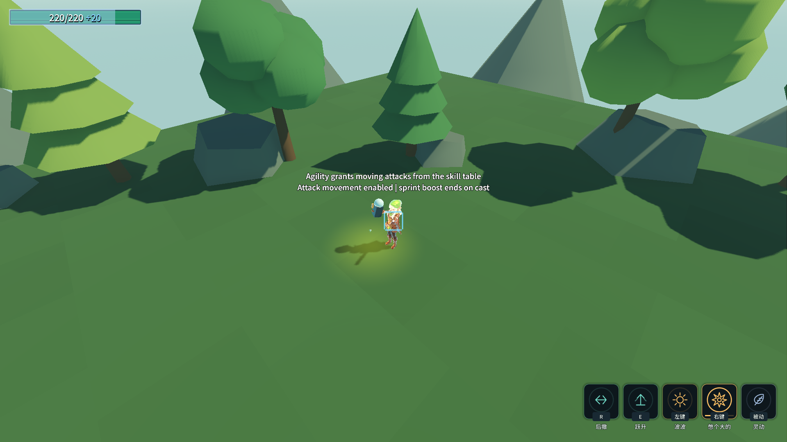

# J20：动作移动许可与灵动（2026-10-18）

技能动画默认锁定地面主动移动；空中方向移动保持。角色A的边移边攻击授权来自真实「灵动」被动，不按角色名写特例。

## 配置入口与生命周期

- `AbilityConfig.ActionMovement`：`0=Locked`（默认）、`1=Allowed`（明确允许）、`2=Attack`（由灵动授予）。15条攻击技能行标为Attack；其余未声明的前台动作保持Locked。
- `skl_a1_passive.GrantAttackMovement=true`，灵动描述补入“可以边移动边攻击”。改为false立即撤销攻击移动授权；将技能行改为Allowed则不需要灵动。
- 只消费启用且IsBusy的前台动作。武器离手实体与弓的后台瞄准效果不继续占前台。初次收集一次能力，运行期新增／退出由能力注册／注销，不每帧扫描模型树。
- 进入锁定动作立即收住主动惯性，方向、Shift及真实跳跃按键不能绕过。技能自身速度覆盖与外力击退仍走原物理链；不冻结身体，不拦技能内部起跳。
- 可移动攻击仍按既有规则退出奔跑加速；速度消费当帧检查前台动作，避免吃上一帧奔跑速度。自然收招、闪打断、回手与换装均清理授权／锁状态。

技能资源的`script`赋值必须先于自定义字段。首轮将新字段写在script之前导致Godot静默忽略，专项62/12；调整资源顺序后74/0。弓武技2是后台瞄准效果，前台移动攻击由武技1验收，不把后台效果当作前台动画。

## 验收

先行专项：`& .\_tools\verify_projectile_capsule.ps1 -ActionMovement -ProbeOnly`。无头74/0、渲染75/0，双构建0警告／0错误；真实按键覆盖B三近战、A三远程、单改表允许／撤销、空中、飞镰离手／回手、闪交接、架、击退与换装。

完整命令：`& .\_tools\verify_projectile_capsule.ps1 -ActionMovement`。16个游戏进程顺序执行，全部退出0、stderr 0字节。移动74/75、地爆53、浮光跃金64、金光大道31、气贯长虹89、喜爱42、镰刀36、灵剑71、D批AI／碰撞90，以及原五回归80／115／42／39／83，均0失败。Main退出0、69.01s，八条硬指标与J11逐字一致；原五条历史红色标记保留。四存档SHA256保持、rune.cfg未生成、selftest.flag已清理；编辑器连接保持。共享CharacterMovement同时影响敌人，因此本批增加D批AI／碰撞回归。

双构建、全部stdout、八指标与存档哈希见 [完整证据](character-design-j20-evidence.log)。CodeGraph强制重建后229文件、6624节点、14560边；未做性能基准。

存档边界：settings在J20第一轮测试之前已是1920×1080、skill_1=R（文件时间16:10:31，SHA256 `9FD4787436FD4EAFAEA11372C2745276A7D35D4FCF192456825E7C1ADDFD02B4`），不同于J19旧设置；本批所有BEFORE／AFTER均为此新值，未回写旧设置。其余三份存档仍等于J19。

失败与先行现场保留：[首轮字段顺序问题](character-design-j20-failure-20261018_162506.log)、[首次专项](character-design-j20-probe-20261018_162647.log)、[调整取景后的专项](character-design-j20-probe-20261018_163134.log)。第一轮完整回归因截图被树遮挡，主动停止本轮所属子进程重新取景；[中断日志](character-design-j20-failure-20261018_162831.log)退出-1，不计成功，也不是金光大道机制回归结论。

未增删配置行，ConfigIndex三处保持不变。最新后续构筑的B2风之领域和前置已核对，见 [接收清单](followup-build-updates.md)；23项仍未创建生产行。继续专注／专一／花心／心流／乱金柝，平衡重测后置。
