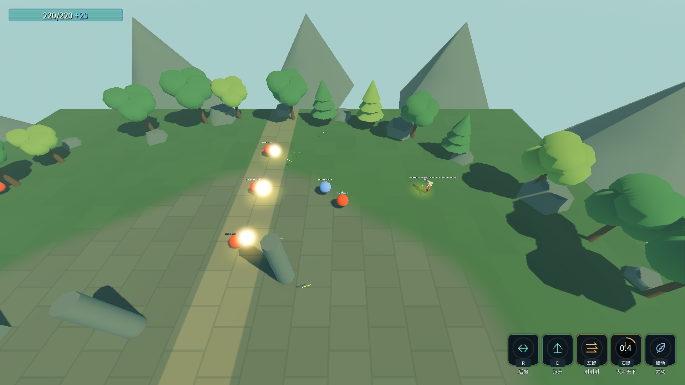
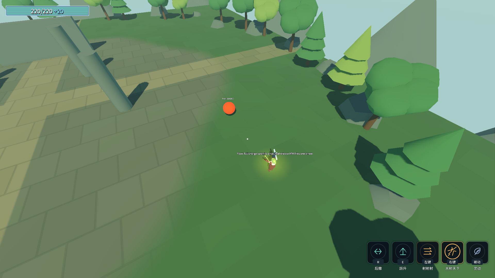

# J21：专注、专一、花心、心流与乱金柝（2026-10-18）

四条进化迁至强类型`ChargeBehaviorTuning`，以技能资源寻址；修改对应增幅行的子资源即可调冷却、基础／后置蓄力、发数、少箭补偿、完美／自动释放开关、追踪范围和转向速度。未增加角色全局覆盖，未增删表行，ConfigIndex三处不变。

## 机制与真实读数

- **专注** `evo_perfect_focus`：仅能量掌武技2冷却×0.5，明确`AlwaysPerfectRelease=true`，不再把完美窗口写成3600秒。实际按住1秒越过原窗口后仍发完美波，命中快照40伤害／400原始弹速；实际弹速继续受全局200上限。基础未满仍中止，重复施效不重复折半，换装还原。
- **专一** `evo_focus`：仅短弩武技2一箭，补偿公式`1+少箭数×0.8`。基础／一档／满三档实际单箭命中伤害31.2／50.4／88.8；武技1仍实际三箭。两方向真实候选池互斥已验，已获得项不再出现。
- **花心** `evo_philander`：基础0.4秒保持，后置0.2→0.1秒，仍三档、最多九箭。实际九箭分给三个无标记敌人，各三支，三个目标都真实受伤；友军、死者、40米外目标排除。目标实际退树后重新索敌，没有目标时仍原散射；实体撞World消失，墙后目标满血。武技1保持原三箭与原追踪设置。40米／720度每秒为原文未给的表内预设。
- **心流** `evo_flow`：仅短弩武技2基础和每档后置覆盖0.1秒，保留三档，所以当前约0.4秒满蓄。满蓄共用松手的一次性快照，重播释放动画，真实ATK出一箭；并非基础0.1秒一到就跳过后置。原速率的释放动画仍有前摇，进表的`ChargeReleaseAnimSpeedScale`可调。
- 心流单独、与专一两个获取顺序、与花心两个获取顺序均实测。固定覆盖优先于缩时，均约0.4秒满蓄；专一组合一箭88.8，其余12。持续按住越过收招及CD不重复施放；提前松手、缺ATK、真实后撤打断和换装都通过。
- **乱金柝** `evo_stall_kill`：既有TablePulse实现本批未修改。真实跃升授予滞空、真实按住跳跃减缓下降，时间消耗至不足1.4秒后，本人真实能量波击杀刷新一次到约2.98秒。无滞空击杀不凭空授予，其他单位真实击杀不刷新，松键停止减速，换装清理。

## 验收

专项`& .\_tools\verify_projectile_capsule.ps1 -ChargeEvolution -ProbeOnly`：双构建0警告／0错误，无头151/0、渲染153/0，stderr均0字节，存档保持。两张真实渲染截图可见三靶受击和单箭释放；准确发数／时序以完整stdout与真实命中快照为依据。

完整命令`& .\_tools\verify_projectile_capsule.ps1 -ChargeEvolution`：17进程全部退出0、stderr 0字节；本批151/153、移动74、地爆53、浮光跃金64、金光大道31、气贯长虹89、喜爱42、镰刀36、灵剑71、D批90及原五回归80／115／42／39／83，均0失败。Main退出0、69.59秒，八指标与J11逐字一致，原五条历史红标保留。四存档前后相同（settings沿用J20的新9FD4…02B4），rune.cfg未生成、selftest.flag清理。双构建、全部stdout、指标和哈希见 [完整证据](character-design-j21-evidence.log)。

先验失败保留：[首轮构建](character-design-j21-failure-20261018_164718.log)中一处可空警告与漏传cap，定点修复；[第一次机制测试](character-design-j21-failure-20261018_164803.log)128/3，三项均为专注冷却：技能行0代表保留场景倍率，误作数值相乘变成0。改为捕获真实基线、资源有正值则优先，重复应用不累计，换装成对还原。其余机制当轮已通过。修复后[专项131/133](character-design-j21-probe-20261018_164921.log)，再补目标退树／World阻挡／技能隔离与清晰取景，[最终专项151/153](character-design-j21-probe-20261018_165140.log)。没有修改既有回归断言期望。

第一轮完整回归在浮光跃金停下：[日志](character-design-j21-failure-20261018_165322.log)中额外2次的落地后再按跳出现一次62/2，其余条件通过。只增加输入／物理帧和移动状态诊断后，独立[无头64／渲染65](character-design-j18-probe-20261018_165902.log)通过，未稳定复现；不能据此认定生产逻辑或引擎问题已根治。夹具改为松键经过完整物理帧再注入新按下沿，保留原64条断言与诊断；完整回归重跑通过。此处只改测试输入相位，没有修改浮光跃金生产逻辑，也没有改低期望。独立复验重拍的J18旧图已精确还原，J21仅交付本批两图。

平衡重测继续后置。最新后续构筑23项仍待生产，原文异化、统一玩家暴击快照、独立动作与美术、符文选择UI等仍未全部完成，不把本批通过写成全项目完成。
