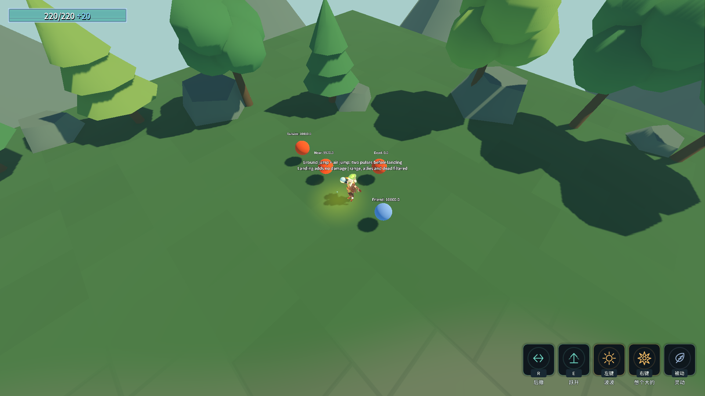

# J22：杀戮践踏回归原文的起跳触发（2026-10-18）

原文“跳跃时伤害周围，空中跳跃同样享受”此前被误解为落地践踏。本批改为成功起跳事实，保留半径3米／伤害15的原表预设，不做平衡调整。

- `CharacterMovement.JumpStarted`携带起跳前的世界位置。地面／空中跳的成功分支、浮光跃金成功瞬移、跃升真实Action通过统一入口发出；单纯设置垂直速度、自然离地／落地不发事件。瞬移在移位后发事实但保留起点圆心。
- `JumpPulseRule`成对订阅／退订拥有者的起跳事件，复用既有PulseDamage命中链。移除旧落地轮询、最小落高和未在原文出现的0.2秒隐藏冷却，快速空中跳不会被吞。默认没有规则时，移动数值不变。
- `mut_stomp`改`JumpPulse`处理器，Radius／Damage继续在HandlerParams，描述使用参数占位；复制真实表行改为1.5米／7伤害，经真实注册表编译后，实际起跳只命中内靶且快照为7，证明不是写死3／15。
- 无增幅不产生伤害；成功起跳且身体仍上升时已命中近敌，地面跳＋空中跳两次共30伤害；第三次次数耗尽的按键、自然下落、架动作锁、其他技能速度覆盖、友军／死者／范围外均不误触发。浮光跃金命中原地近敌，不攻击到达点敌人；移除规则后不残留旧订阅。
- Main旧P6b同步入口验参数与一次伤害；日志明确说明其直接调用Execute，真实起跳链路由新专项覆盖。移除旧0.2秒／最小落高检查，不伪称Main完成真实按键验证。

## 验收

最终`& .\_tools\verify_projectile_capsule.ps1 -JumpStomp`：Debug／ExportRelease均0警告／0错误，完整18进程均退出0、stderr 0字节。起跳践踏无头39/0、渲染40/0；蓄力进化151、动作移动74、弓39、灵剑71、镰刀36、喜爱42、气贯长虹89、金光大道31、浮光跃金64、地爆53、D批90、蓄力80、原文115、龙之箭42、符文83，全部0失败。Main退出0、68.69秒，八条硬指标与J11逐字一致，原五条历史红标仍保留，不称Main全绿。[最终完整输出](character-design-j22-evidence.log)。

四存档跑前／跑后SHA256一致（meta 6C29…7EA7、ability_cards 594B…99CA、settings 9FD4…02B4、loadout CD92…5462）；rune.cfg未生成，selftest.flag已清理。保留用户现有设置与编辑器。完整回归期间仅补正`LeapAbility`一处缩进，无语义变化，随后双构建再次0/0。

先验失败均保留：[旧机制28/11](character-design-j22-failure-20261018_170955.log)复现起跳无伤、落地误触发等偏差；[改机制后34/5](character-design-j22-failure-20261018_171147.log)暴露夹具只替换RunBuild变量、没有移除挂在玩家上的旧规则，多个独立用例叠加。夹具明确RemoveChild／QueueFree旧规则后，五项恢复，验证了真实退订。没有让PlayerLoadout额外清空局内构筑，未把卸除规则误写成换武器必定丢弃构筑。[专项完整输出](character-design-j22-probe-20261018_171249.log)。

第一轮完整回归的弓机制39/0，但退出发生0xC0000005，堆栈为GodotObject.Dispose／Finalize→get_associated_gchandle，不能算成功，见 [退出失败现场](character-design-j22-failure-20261018_171340.log)。检查发现普通弹道每帧的PhysicsRayQueryParameters3D与返回Dictionary未及时释放，已改为using；弓截图Image也及时释放。没有禁用GC、修改退出码或延长计时遮盖错误，不推断与此前资源缓存复活竞态完全同源。新增`-JumpStomp -ProbeOnly -BowExitAudit`独立连续三次弓退出审计：[三次39/0](character-design-j22-probe-20261018_171803.log)，均正常退出、stderr空。随后重新完整回归；最终结果以证据为准，不能宣称引擎问题根治。

本批不增删行，ConfigIndex三处不变。最新B2风之领域及其余23项特化构筑仍待生产；统一玩家暴击快照、独立动作美术与符文界面等继续在清单中，平衡重测后置。
