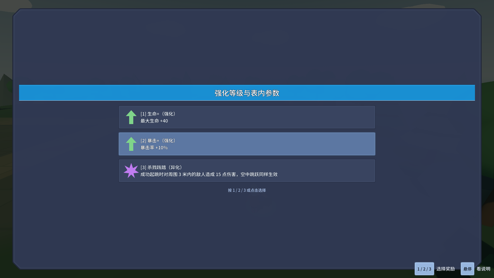

# J24：补齐八条强化等级（2026-10-18）

最新后续构筑要求生命／暴击／爆伤／坚硬各有`+`和`++`，必须取得上一级且每级只获得一次。本批补内容与可调整入口，平衡收敛后置。

| 系列 | 基础每次增量（保持） | `+`每次增量（预设） | `++`每次增量（预设） | 三阶累计增量 |
|---|---:|---:|---:|---:|
| 生命 | 20 | 40 | 60 | 120 |
| 暴击率 | 5个百分点 | 10个百分点 | 15个百分点 | 30个百分点 |
| 暴击伤害倍率 | 0.25 | 0.50 | 0.75 | 1.50 |
| 减伤 | 5个百分点 | 10个百分点 | 15个百分点 | 30个百分点 |

新等级沿用现有StatSet叠加规则，取得后追加该级增量；未替换已取得的基础修饰器。数值只在每条`.tres`的`Modifiers.Value`配置，`Requires`与`MaxStacks`同样在行内。新等级说明用`{Modifiers.属性键:格式}`共读该Value并支持数字格式，不另配一份说明数字。暴击／爆伤此处只补真实属性入口，不能据此宣称所有近战／落／闪／投掷的暴击消费已统一。

八条资源已接ConfigIndex引用与数组，实际生产目录从62行（9强化／23进化／30异化）变为70行（17／23／30）。核查发现原load_steps=208已低于原236个外部引用；本批新增8个引用后按244个外部引用、0子资源重算load_steps=245，不仅在旧错误计数上加8。增幅数组实际70个引用，其他十四项索引基线不改。

奖励编译此前直接把DescriptionTemplate交给卡片，J22杀戮践踏的HandlerParams模板因此未被解析。本批统一在`RewardEffectRegistry.Compile`用ConfigText编译说明，合并真实HandlerParams／Params；ConfigText增加强类型奖励修饰器取值，不求表达式、不用字符串反射赋值。普通既有纯文字说明保持。改副本的半径／伤害或修饰器Value后，实际属性与说明一起变化；真实RewardScreen三卡片已检查无残留花括号。

## 验收

专项保留J23原39条覆盖范围，并增加八条等级前置的16条、四系列真实属性与参数副本的20条、既有处理器说明2条、真实卡片1条，共无头78/0；渲染另1张截图79/0。[先行专项输出](character-design-j24-probe-20261018_174427.log)。每级生命还核实真实MaxHealth，坚硬核实真实CombinedDamageReduction响应；未把暴击属性读数称为所有攻击已经统一暴击。

补充消费者断言时误把CombinedDamageReduction方法写成属性，第一次完整回归在编译阶段失败，未运行游戏；[编译失败现场](character-design-j24-failure-20261018_174615.log)。按真实签名修正后双构建0警告／0错误，专项仍78/79通过。

随后完整回归在旧ChargeReleaseProbe停于78/2，见[原始失败现场](character-design-j24-failure-20261018_174658.log)：灵剑两条断言先于真实释放动画日志，过早读取的ChargeTime又在重按后从1.0897变1.1191。夹具原来松键后只等固定30ms；现改为跨两次ProcessFrame信号，保证输入节点完整消费过一次后再读播放序号／冻结快照，再次按住与松开也经过完整输入帧。保留原80断言、快照精度和ATK前不得出弹要求，新增输入帧／按住状态／播放序号诊断，不改生产输入或释放逻辑。不能据此认定Godot底层原因已查明。

`-RewardTiers -ProbeOnly -ChargeInputAudit`独立两次均80/0、正常退出、stderr空，[完整审计](character-design-j24-probe-20261018_175426.log)。四配装的输入帧诊断均为松手后跨2个Process帧、按住False／蓄力False、播放序号增加。

最终`& .\_tools\verify_projectile_capsule.ps1 -RewardTiers`完整19进程均退出0、stderr 0字节；Debug／ExportRelease均0警告／0错误。[最终完整输出](character-design-j24-evidence.log)。获取规则无头78/0、渲染79/0；起跳39、蓄力进化151、动作移动74、弓39、灵剑71、镰刀36、喜爱42、气贯长虹89、金光大道31、浮光跃金64、地爆53、D批90、蓄力80、原文115、龙之箭42、符文83全部0失败。旧蓄力因此独立两次及全轮一次均80/0，未删除原断言。

Main退出0、69.39秒，八条硬指标与J11逐字一致；原五条历史红标仍保留，不称Main全绿。四存档SHA256跑前=跑后（meta 6C29…7EA7、ability_cards 594B…99CA、settings 9FD4…02B4、loadout CD92…5462），rune.cfg未生成，selftest.flag已清理，保留用户现有设置与编辑器。

RuneProbe两处真实目录数量从62改为70，83条断言不删；Main增幅说明同步70=17/23/30，八条硬指标仍按J11逐字比较，不能随意改绿。数值平衡后置，23项特化与其余机制仍待继续。

