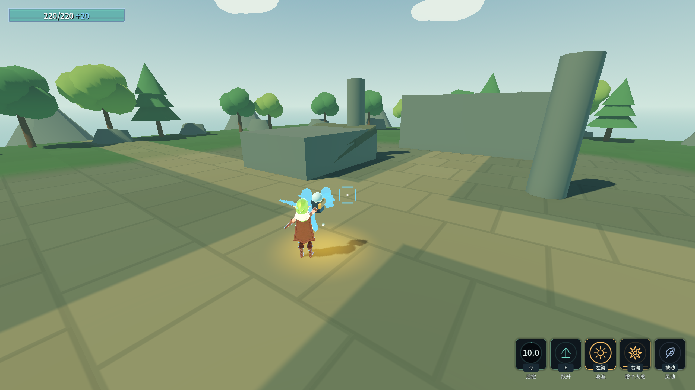
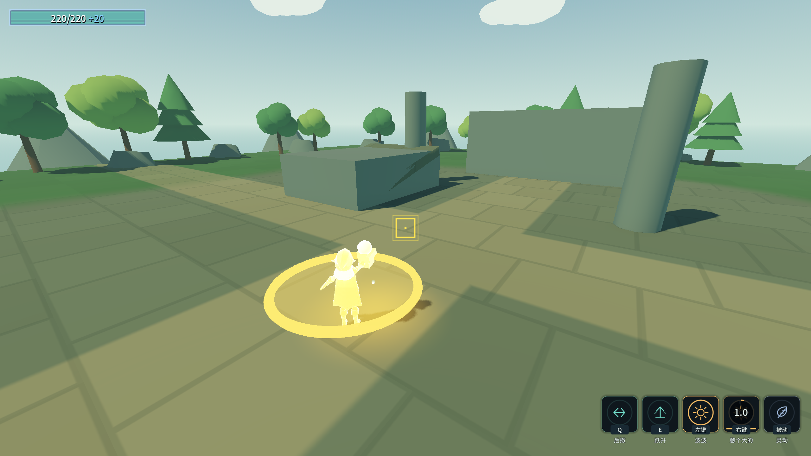

# 原始设计纠偏 J3：动作打断与动画事件归属

2026-10-17。用户裁定：没明确说明不可打断的动作默认可被后来的动作打断；允许为部分技能设置前摇，区分锁定与可打断阶段。后台效果和已离手武器继续独立运行。

## 接入契约

- `AbilityConfig.CanBeInterrupted`默认true；false表示该次前台动作全程不可打断。
- `InterruptLockSeconds`默认0，表示起手阶段锁定的动画秒数；达到该时间后允许打断。它独立于旧`Windup`，不会更改攻击事件或自动发伤害。播放加速时锁定同步缩短；多段连招每次新动画重新起算。
- 当前正式表默认仍为可打断、0秒锁定；未自行指定哪些招式必须霸体。需要例外的技能行可直接配置上述两列。验收使用真实技能行副本写盘再读回，覆盖0.5倍与2倍动画。
- 新请求先验证自身可用性及动画，再检查旧前台动作。被锁定时拒绝新请求；允许交接时结束旧技能并进入其原有冷却／回层，未到事件帧的效果不补发。普通技能的这类失败请求不跨帧排队；连招原有输入缓冲保留。
- 每单位动画实例分发事件，并携带单调增长的播放序号。技能只接收自己的单位和自己那轮播放；旧动作的收尾不停止新动画。回调内换段／停止后，不用旧播放位置继续驱动新事件表。
- 玩家同帧按下多个键时按真实输入事件顺序交接，避免场景子节点顺序决定结果。蓄力按住与松手仍服从最终按键状态，保留J2的同帧松开再按下修复。
- 后台眼、已离手的镰刀／长枪及事件触发的落剑式伤害圈不占前台动作。禁用、死亡和换装会清理活动状态、无敌、朝向锁和命中盒。
- 历史`UnitAnimator.AnimationEvent`全局口仅保留给旧自测计数；战斗技能已经切到实例事件，不依赖“场上只有一个技能使用者”的假设。

表内示例：

```ini
CanBeInterrupted = true
InterruptLockSeconds = 0.12
```

这表示动画前0.12秒拒绝打断，后续允许；2倍动画实际约0.06秒。全程锁定则填写`CanBeInterrupted = false`。未改变角色数值、技能数量或ConfigIndex条目。

## 修前证据与专项覆盖

有效修前基线3通过／4失败：右键蓄力没有被后来左键结束，松手仍补发30伤能量波；后撤无敌／朝向锁未清；另一单位的同名ATK使慢动画提前发射。最初探针的命名空间、节点名和初始化等待错误在建立有效基线前已修正，不计作项目逻辑失败。

接入交接后扩展探针26/1，进一步发现同帧按键结果依赖节点顺序；按真实事件顺序转发后专项无头32/0、渲染34/0。覆盖前摇内拒绝且不耗新技能CD、前摇后允许、动画加速、全程例外、禁用清理、冷却中请求不打断、同单位同名另一轮播放隔离、跨单位隔离、后台并用、回手并用与死亡清理。

追加闪的中断清理验收后33/2：被架势打断后，旧持续速度仍移动3.672米／0.1秒，且配置的无敌没有还原。现所有收尾统一停冲刺并清理无敌／碰撞；普通移动不继承强制冲刺输入速度，修后实测0米。

编辑器MCP临时原生动画实验发现同名`Play`继续停在0.3秒，实际单位也复现0.0138→0.0138；它会跳过新动作前摇。另有重复长按事件被输入队列误认成新按下，两项补验36/2。新播放改为`Play`后`Seek(0)`，保持不调用有崩溃历史的`Stop`；队列只接收本机Godot API的`IsActionJustPressedByEvent`真实边沿。修后专项无头38/0、渲染40/0。

完整渲染回归另暴露旧弓探针按墙钟超时：游戏蓄力只到0.92秒便被探针提前松开，产生117/3。改用游戏ProcessFrame时间等待，保留原五档断言，实际发射伤害59.999992、弹速370，原文回归最终无头115/0、渲染120/0。

最终Debug与ExportRelease均0 warning / 0 error；Main完整自测退出0，八条硬指标逐字一致。F33/0、C52/0、D90/0、G51/0、角色61/0、B74/0、A失败0、E39/0、跨进程读档5/0。14个验证进程stderr全部0字节，四存档SHA256与保持点一致，selftest.flag不存在。旧Main历史红色前缀与未完成项仍保留，不将其描述为全部原文断言全绿。

命令：`_tools/verify_actions.ps1`。完整自测、八条硬指标、回归、双构建与存档结果见[证据日志](character-design-j3-evidence.log)。中间失败见[摘录](character-design-j3-failures.log)。





⚠️ 本批不是整份角色设计验收结束。共通落高度与长枪定向、进化缺口、变奏、统一暴击及独立挥枪／投掷动作继续按审计清单执行。截图中的角色、描边、场景仍是阶段素材。
