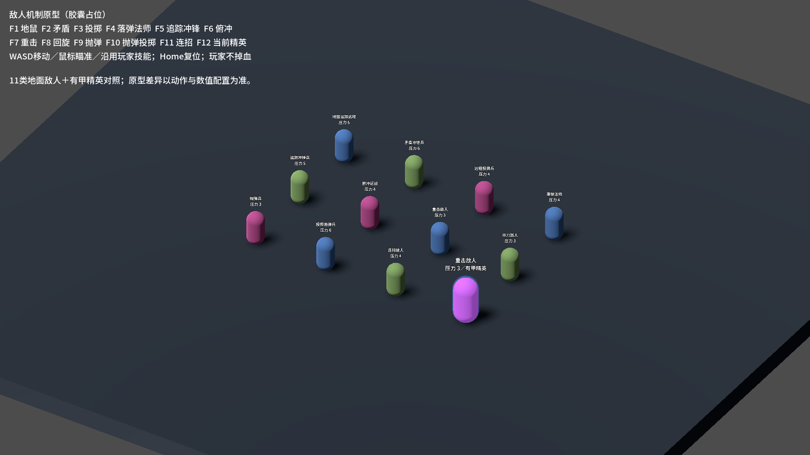
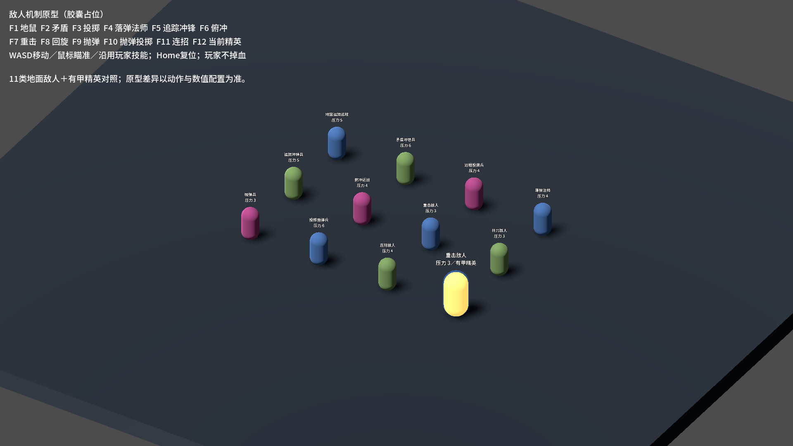

# J36 · 地面敌人机制原型与共通反应

按用户要求在J35地图／导航／压力基础后，实现11种新地面敌人原型。敌人表由10增至21行（1全局＋20敌种），其中19种可随机生成、1种为专用首领护卫。第一／二关保留原白名单，第三关无限制池自动读取新表行。新敌人采用胶囊占位模型和事件动画；最终模型、独立动作、音效和特效美术尚未制作。

## 已接入机制

- EnemyActionPlan通过Opening／Near／Far／Closing组合EnemyActionStep。举盾后才判断远近；所有伤害动作等待实际EnemyAction动画ATK事件，缺动画／事件取消。共用追踪弹、抛射、落弹、冲锋、突进近战、回旋、三段连招、起跳／滞空／俯冲、后跳、等待／遁地；收招和打断归还速度、格挡、模型状态并关闭命中体。
- 11种配置及压力详见[清单](enemy-roster.md#十已接入的新敌人与生成压力)。Cost兼容旧资源，生成实际扣SpawnResourceCost；Weight只影响抽取概率。组合压力初值为5／6／4／4／5／4／3／3／3／6／4。生成失败不扣费；尚未解锁的类型不耗尽波次，未来可负担条目也不被误当余额无用。精英附加词条压力为0。
- Projectile按真实累计航程截断本帧位移，航程结束可消失／掉落／爆炸。爆炸弹体接触玩家、地形或耗尽航程后仅爆一次；ExplosionOnly阻止叠加直击伤害，旧弹体默认行为保留。
- 全部敌人成功攻击起手身体金黄闪0.12秒，组合攻击逐段闪，举盾与等待不误闪。受伤闪色、攻击闪色与底材由UnitPresentation统一恢复，精英底材不被结束闪色清掉。
- CombatReaction对无甲敌人的有效非DoT普通命中施加0.18秒受击硬直，停止自主移动、打断允许中断的动作；有甲免该反应，破甲当击仍保护、下一击可打断。物理质量、击退抗性、ControlImmune独立。护甲外壳随甲量显示，精英1.35体型和身份在破甲后保留。
- BlockComponent与主动“架”成功挡伤各自给格挡者0.15秒硬直，可配置；背击、破防、穿透格挡和无实际减伤不触发。一次性护罩Negated路径无此硬直，不把攻击者弹刀混入。
- 自爆前摇在场景和技能行统一为0.9秒，前摇中无伤害；无甲自爆能被打断，取消后不留爆炸判定。有甲自爆遵循共同护甲规则。

## 复验与试玩

完整验证入口：

```powershell
.\_tools\verify_projectile_capsule.ps1 -EnemyRoster
```

脚本独占验证锁、顺序双构建，均0警告0错误。敌人专项95、导航39、D批91、身体31、飞行42、弹道56、特化194、弓39、蓄力80、角色115、龙箭42、符文83，共907项通过、0失败。EnemyRosterProbe使用真实场景、动画事件、物理碰撞和生产生成入口；包含全部11原型、远近分支、移动目标追踪、导航出土／后跳、一次爆炸、破甲前后打断、自爆、实际GuardOn挡伤和资源计费。

最终Main69.17秒完成，stderr为0；八指标仅有意变更敌人行数10→21，其余保持J11基线，J8的18项命中断言通过，原5条历史红标如实保留。真实存档SHA256逐一不变，rune.cfg仍不存在，selftest.flag清理。见[分阶段完整证据](character-design-j36-evidence.log)。失败日志保留，主要修正验证场导航组、缺失死亡动画查询和配置索引延迟时机；弹道伤害验收必须等实际飞行时间，不能在施法收招时提前判断。

Main初次增加了两条下落攻击红标：早期探针在成功格挡后同一帧要求玩家起跳／下落，新格挡硬直会拒绝该动作。SelfTest现等待格挡硬直自然结束才开展下一项独立测试，原起手、高度、落地和落剑式断言保留并恢复通过；验收脚本进一步拒绝五条已知历史项之外的任何新增Main红标。完整907项回归后仅改了此探针时序、索引说明及验证场显示／相机，最终双构建、渲染和Main再次验证，原失败现场没有删除。

试玩场景：[Scenes/Debug/_EnemyRosterLab.tscn](../Scenes/Debug/_EnemyRosterLab.tscn)。Godot选中场景按F6运行；F1至F11切换清单中的原型，F12生成当前原型的有甲精英，Home复位；沿用玩家操作，玩家不掉血。截图模式仅展示占位体型、压力标签和有甲／攻击闪色对照。





未包含精英附加词条设计、飞行敌人设计和最终美术。压力、生命、速度、前摇与动作参数都是可调初值，后续仍需实战平衡。
