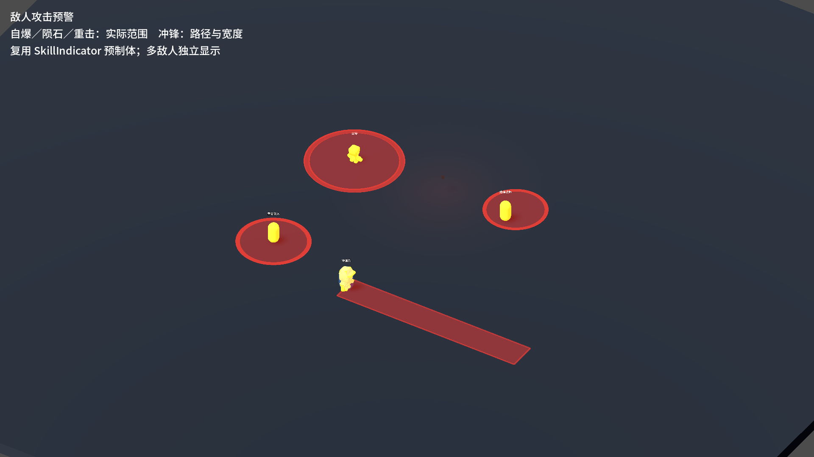

# J37 · 敌人攻击范围与路径预警

找到了此前实现的SkillIndicator：预制体为`Scenes/Combat/SkillIndicator.tscn`，脚本为`Scripts/Combat/SkillIndicator.cs`，接入契约为[skill-indicator.md](skill-indicator.md)。此前Main下只有默认隐藏的共享实例，实际敌人攻击未调用，所以游戏中看不到。

本轮复用现有圈和矩形样式。EnemyAttackWarning为每个能力与已发射爆炸弹体创建独立预制体实例，避免多敌人互相覆盖。预警不参与伤害、碰撞、单位计数或寻路；身体短闪继续提示攻击来源，红色地面范围提示危险区域。

| 攻击 | 预警时机与形状 |
|---|---|
| 自爆、尖啸及其他AreaAttack | 前摇中跟随实际命中体，球形用红圈，盒形用矩形；实际伤害开始时隐藏，取消／打断／死亡清理 |
| 重击 | 蓄势显示以实际命中中心为圆心的范围，真实ATK到达后结束预警 |
| 普通直线冲锋 | 起手锁定方向，路径矩形包含命中体宽度与前后端，不把角色身体宽度当攻击宽度 |
| 持盾冲锋、追踪冲锋 | 举盾本身不画；进入冲锋准备后显示路径，跟随实际当前方向和剩余最大行程更新；追踪转向时更新，不伪造固定终点 |
| 地面跳跃近战、跳起滞空俯冲 | 起跳开始显示预计落地区域，持续投影到地面；按真实盒形或球形命中体画，落地执行或取消后隐藏 |
| 突进回旋 | 显示带攻击半径的突进威胁区域 |
| 陨石 | 蓄力时跟随目标位置；真实ATK释放后停止追踪玩家，预警交由陨石弹体管理，保留到碰撞／爆炸／失效；已出手后不随施法者收招或死亡消失 |
| 直投炸弹、抛物线炸弹 | 前摇与飞行时显示预计爆炸区，半径来自本弹攻击快照；爆炸后清理 |

普通命中体读取实际CollisionShape、世界变换与缩放，所以精英自爆从4米随命中体放大到5.4米；独立弹体爆炸则读世界空间ExplosionRadius，不因施法者放大而额外扩大。抛射发射与预览共读同一初速解算。落点预测以当前速度、重力、航程和场景碰撞采样，10Hz更新；真实命中仍以现有物理与弹道结算为准。路径是当前方向的剩余最大威胁段，实际移动仍受地形和身体阻挡；本轮未将指示器改为导航或修改攻击平衡。

修复现有指示器的多实例问题：两个可变ImmediateMesh设为resource_local_to_scene，避免Show／Hide清除其他实例描边；连续更新保留呼吸相位。UnitPresentation与EliteModifier跳过预警子树，防止身体短闪、受伤或精英底材把红圈染色。旧冲锋与跳跃取消时补齐关闭命中体、结束冲刺和隐藏预警的共同收尾。

验证入口：`_tools/verify_projectile_capsule.ps1 -EnemyWarnings`。新专项核对实际敌人前摇、ATK、半径／宽度／缩放、预测落点、释放锁点、已出手弹体生命周期、多实例隔离与打断清理；渲染截图见下。完整结果见[证据](character-design-j37-evidence.log)。

双构建0警告0错误；新专项最终40项、渲染41项均0失败，包含500原始发射速度／200实际速度上限的边界契约，浮点向量读数为499.99997／199.99998。相关回归：敌人95、D批91、弹道56、弓39、蓄力80、原始角色115、龙箭42、符文83，全部0失败。Main68.73秒，八指标保持J36后的21条敌人行口径，18项J8通过，仅保留原5条历史红标，stderr为0；真实存档指纹不变、rune.cfg仍不存在、selftest.flag清理。

完整回归后补充了原始Speed保留的边界核对，预览采用实际限速、发射仍交给Projectile处理实际速度；最终40／41专项重新构建、运行并渲染，原始日志追加到同一证据。失败现场保留，包括初次编译警告以及边界用例最初对浮点速度做精确相等的检查；最终按向量运算精度比较并打印实际读数。

试玩沿用[敌人场景](../Scenes/Debug/_EnemyRosterLab.tscn)，F1至F11切换原型；新增预警已随对应能力自动显示，无需手动调用指示器API。旧自爆、跳跃、直线冲锋也可在原关卡和TestEnemies中观察。

