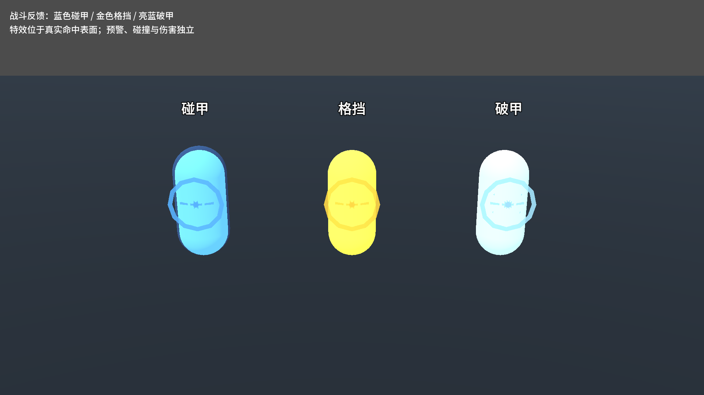

# J38：战斗流程研究与打击反馈框架

## 交付

完成从输入／AI决策、真实动画事件、出手快照、命中判定到防御／伤害／反应的梳理，并将《哈迪斯》1／2、Capcom对hitstop的说明和Vlambeer的Game Feel思路转化为本项目的首版反馈框架。来源、设计判断与精确实现分开记录，见[完整分析与接入文档](combat-feel.md)。

核心变化：

- Unit.ReceiveHit在结算后统一调度CombatFeedback；判定端不再无条件播放同一命中火花和音效。近战将几何命中表面坐标写入HitInstance，远程仍用真实查询命中点。
- DamageResult保留本击ArmorBroken快照；技能招架独立Parried事实。打肉、碰甲、破甲、护盾、格挡、招架、效果护罩分别表现，无敌不冒充成功伤害。
- 玩家附着近战的ImpactPause共同暂停动作计时、真实动画播放、运动与后续命中盒物理步。输入与冷却保留，弹体和外部世界继续；有甲防御者不停顿，不产生额外打断。取消、换装、死亡、关闭功能可恢复。
- 重量与伤害独立，普通段／尾段、暴击、破甲、击杀有强度差异。音效和镜头按时间及物理帧限频，接触特效每帧有预算；DoT、派生和召唤物有各自反馈边界。
- CameraImpact只给画面内玩家相关命中叠加有上限的投影冲击；不写跟随、角度或FOV。AimUtil剔除视觉偏移，瞄准求交保持稳定。
- `Config/CombatFeedback.tres`为全局调参资源；`Scenes/Combat/CombatImpactFx.tscn`为防御材质效果入口。已有攻击预警及精英底材恢复继续生效。

## 试玩

运行`Scenes/Debug/_CombatFeedbackLab.tscn`：F1～F6依次切换灵剑、镰刀、长枪、弓、能量掌、短弩；F7总反馈、F8局部停顿、F9镜头，Home复位。原有WASD、鼠标、左右键与技能输入保留。

靶子依次为无甲、80护甲、正面完全格挡；可打破护甲、绕到盾后。开关只改当前进程，退出恢复，不写用户存档。

## 验证

使用`_tools/verify_projectile_capsule.ps1 -CombatFeedback`，独占验证锁、保护5个存档路径、串行双构建和真实Godot探针，要求每个进程stderr为空。

| 验证 | 结果 |
|---|---|
| Debug／ExportRelease | 均0警告、0错误 |
| 新反馈专项 | 无渲染41／渲染42，均0失败 |
| 敌人预警／敌人清单 | 40／95，均0失败 |
| 碰撞／弹道查询 | 91／56，均0失败 |
| 出手快照／持续伤害归属 | 45／26，均0失败 |
| 弓／蓄力／原始设计／龙之箭／符文 | 39／80／115／42／83，均0失败 |
| Main整体自测 | 69.64秒、stderr为空，8条硬指标通过；18条J8实际命中通过，无新增红标 |

以上专项实际运行合计795项（含独立渲染复验），Main整体自测另计。完整证据为[主验收日志](character-design-j38-evidence.log)。最后只调整了截图相机布景和清理旧粒子的等待，重建Debug／ExportRelease并再次通过渲染42项，见[最终渲染复核](character-design-j38-probe-20261020_201910.log)。

Main原有5条历史红色打印标记保留（其实际数值均符合预期），没有以“全绿”替代如实记录。5个存档路径跑前／跑后完整SHA256一致，rune.cfg仍不存在，selftest.flag已清理；`project.godot`外部改动指纹保持不变。

专项覆盖：实际ATK→命中→扣甲→局部停顿；动画事件不前进也不重发、突进无滑步；外部弹道和全局时间继续；格挡者硬直／效果护罩区别；同刀群体命中不叠加；镜头射线隔离、关闭和归零；取消、死亡、暂停恢复；30／120Hz按秒运行；真实远程／爆炸／召唤物不暂停射手。

## 修复与失败现场

原始失败日志保留，不替换为最终成功日志：

- `200616`：新增胶囊靶缺显式Animator，表现组件在父节点就绪阶段补兄弟节点失败；补齐调试场节点。隔离断言起初漏计原有30%护甲减伤，改为验证10伤耗7甲。另将音效／镜头预算加上物理帧约束，解决同帧大量特效创建消耗墙钟时间后重复申请的问题。
- `200855`：新增专项的两个nullable警告，修正后双构建0／0。
- `200914`：既有精英底材测试在新护罩短闪结束前截取材质；先等该瞬态结束再记录实际底材，原恢复断言保留，95项通过。
- `201145`：切换物理频率后，新请求仍处上次冷却；等待频率稳定和冷却结束，并新增“请求已接受”断言，再验证120Hz的持续时间。

## 当前边界

这是可调的机制首版。命中火花、胶囊靶、材质音效与最终武器／敌人模型没有一起验收为最终美术；目前材质声音使用同一CC0样本的临时音高变体，可分别替换SoundId。局部停顿会有意延长出手者的动作占用，物理步存在时长量化。输入、伤害数值、判定尺寸与护甲／格挡规则没有因视觉强度改变。

原`project.godot`外部节顺序变化和无关美术文件保留，不纳入此批。提交、推送状态以Git记录为准。
