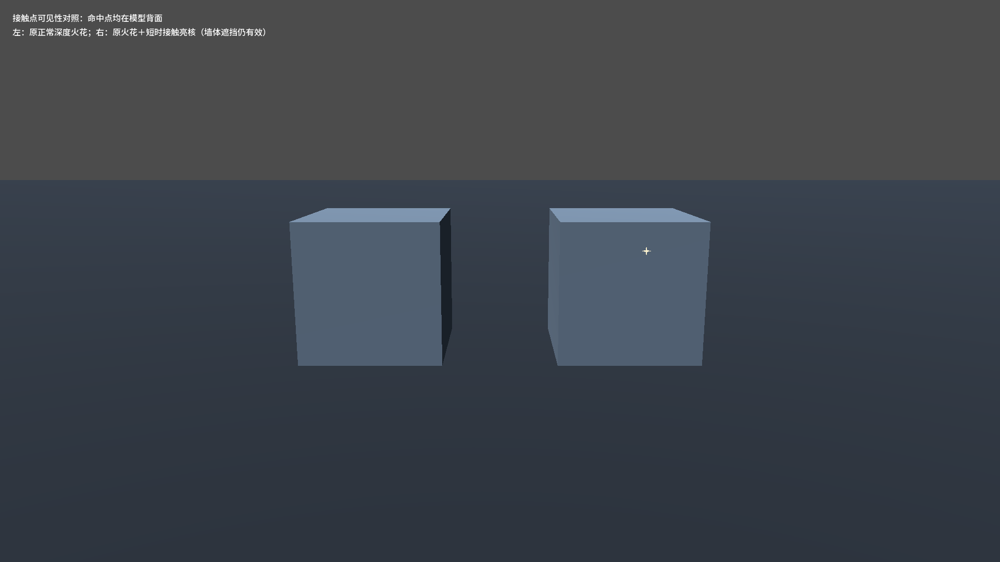

# J39：技能槽、切换残留、长枪路径和接触可见性修复

## 原因与修复

用户在六武器对照场发现长枪右键路径偏离、镰刀切长枪后收回像旋转镰刀、远程技能混合。定位到两层问题：

1. 对照场每次新建PlayerLoadout，原应用器会把当时已修改的Enabled／InputAction当作“场景基线”，留下上次配装。此次移除该恢复方式；默认物理／额外跳跃由玩家实例持有，换装先取消所有能力、停用仓库与旧输入，再仅安装当前角色／武器声明的技能。对照场也复用应用器，但回归仍故意每次新建，验证共用入口已修好。
2. PlayerAbilityInput原来遍历所有能力，逐个执行InputAction相同的技能；PlayerWeaponInput还有一条重复触发左键技能的路径。现改为`Unit.AbilitySlots`存储“槽名→技能行Id＋唯一实例”，输入只查当前槽。仓库里有多少其它角色技能、是否也写了skill_1，均不参与路由。技能驱动左键只由槽输入层执行一次。

`AbilityConfig.InputAction`现在只表示默认安装槽，InputMap负责真实Q／鼠标键；`AssignToSlot(unit, "skill_1", row)`允许把任意技能索引显式放入技能1，技能自身原来的InputAction不决定执行路径。当前武器大师还包含独立fall_attack槽，猎手4个主动输入槽、武器大师5个；被动独立在当前装备集合中。HUD共读该集合与实际槽名。

换装清理待处理按下，已按住的旧输入需先松开；由真实输入启动、暂停期间漏过释放沿的蓄力也能按当前松手状态结束。程序接口自行驱动的蓄力不会仅因物理按键未按下而被取消。原有输入事件顺序、蓄力、持续维持、连招TryPress和取消许可保留。

长枪路径接收的是世界坐标点，但原DashPathIndicator又继承角色平移／旋转／缩放，导致二次变换。实际绘制节点现在TopLevel、单位世界变换，并关闭其物理插值；仅增加离地偏移。真实弹道求解和命中位置不变。镰刀／长枪独立状态清理，非当前配装的脱手显示不会借用当前武器模型。

另补充脱手反馈边界：投掷命中体虽然仍在玩家子树中，但已经离手；通过ContactFeedbackEnabled显式排除，不能把远处长枪／镰刀命中当作附着近战顿帧。

## 反馈增强与遮挡

- 轻／重停顿由25／50ms增强到35／60ms，上限65→75ms；不改变伤害数值。
- 镜头基础冲击0.025→0.035米，上限0.065→0.085米，衰减0.13→0.14秒，原限频与强度开关保留。
- 原火花保持正常深度测试。实际命中位置额外增加70ms、0.16米的小亮核，避免侧面／背面火花完全被目标模型吞没。生成前检查World遮挡，不在墙后创建亮核；不挪动命中点、不改共享素材、不让所有粒子透视。

左边正常深度火花大部分被方块遮住，右边短亮核仍能说明命中；World墙体遮挡另由真实物理查询断言验证。长枪预览截图见[j39_spear_preview.png](screenshots/j39_spear_preview.png)；沿瞄准方向观察时抛物线会有透视压缩，世界起点与变换另外按真实顶点断言。

## 验证与证据

入口：`_tools/verify_projectile_capsule.ps1 -LoadoutSlots`。使用独占验证锁、真实Godot场景、串行双构建和存档指纹保护，原始成功／失败日志均保留。

新专项覆盖六武器正反顺序切换，每次重建应用器；100个启用且同键的仓库技能隔离；显式槽索引覆盖技能默认按键；实际输入排队后换槽；fire／weapon_skill_1别名只发一弹；镰刀在飞时换长枪、长枪真实蓄力／ATK／回手；平移后路径世界顶点；蓄力时换角色；背面接触亮核及World遮挡。正式结果以`character-design-j39-evidence.log`为准。

最终[完整证据](character-design-j39-evidence.log)：

| 项目 | 结果 |
|---|---|
| Debug／ExportRelease | 均0警告、0错误 |
| 换装槽位专项／渲染复核 | 57／59，0失败 |
| J38反馈／动作交接／出手快照 | 41／38／45，0失败 |
| 特化／灵剑／镰刀／长枪进化 | 194／71／36／89，0失败 |
| 弓／蓄力／角色设计／龙之箭／符文 | 39／80／115／42／83，0失败 |
| Main | 69.33秒、stderr为空；8条硬指标与18条J8实际命中通过 |

专项合计989项（含独立渲染复验），Main另计。原5条历史红色打印保留，无新增红标；5个存档路径跑前／跑后完整SHA256一致，rune.cfg仍不存在，selftest.flag已清理。外部`project.godot`指纹仍为`1FEE77…AC3A1`。

前两轮失败现场解释：`210242`有11项失败，其中测试把武器大师fall_attack漏算成4槽、未等真实输入消费、长枪0.75秒蓄力未达到表内1秒门槛；修正测试场景条件后仍保留同样行为断言。`210527`余2项是“ParseInputEvent后尚未真正进队列就换槽”和“召回事件未消费就判断”；改为暂停一帧消费者，确认真实队列存在后换槽，并等真实召回状态。清理队列、阻止旧按住输入与恢复释放的共用逻辑同时补齐，没有关闭相关断言。

`210758`完整回归发现Main中7条程序驱动蓄力被输入层误判为松手；新增输入所有权，仅对自己启动的蓄力补偿丢失的释放沿。补了“程序接口启动蓄力不被物理输入取消”的独立断言，Main原有断言未修改。

`project.godot`外部节顺序变化及无关美术／导入文件不纳入该批；不创建新对话。最终模型／动作／独立音效仍按既有美术边界后续处理。
