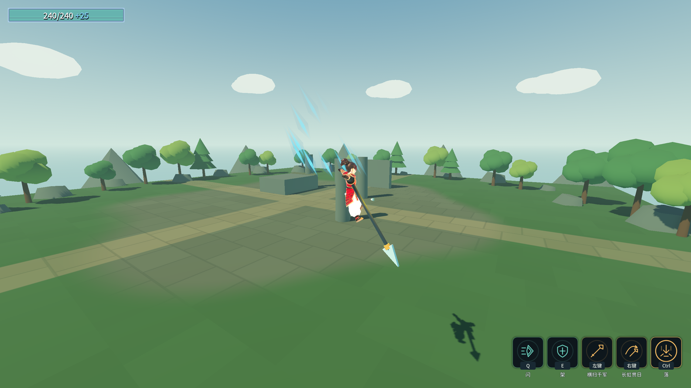
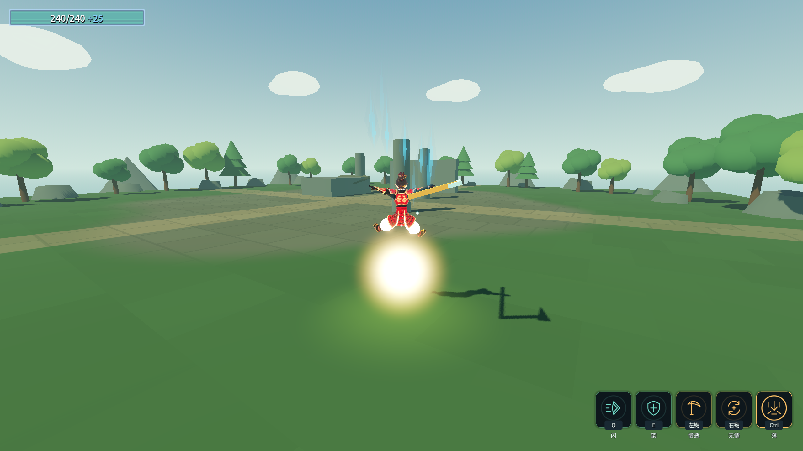

# 原始设计纠偏 J4：下落攻击与额外跳跃

2026-10-17。本批实现、专项与完整跨批验收已完成。

用户本轮更新覆盖旧“每2米增加20%”阶梯规则。普通单跳高度、标准下落速度的倍率为1；二段跳额外增加50%高度，同速为1.5。长枪斜冲取垂直向下分量，水平速度不增加伤害。

```
参考落地耗时 = 起手脚下到World地面的高度 / 标准下落速度
标准距离 = 普通单跳高度
倍率 = min(表配置倍率上限, 垂直下落速度 × 参考落地耗时 / 标准距离)
```

等价于`min(上限, 起手高度/普通单跳高度 × 垂直下落速度/标准下落速度)`。不额外再加1，不将实际落地耗时代入抵消速度差异。标准单跳高度取角色基础跳跃参数，不跟增幅后的跳高一起提高分母；高跳构筑仍能增伤。实际技能伤害只在统一伤害快照中乘一次该倍率和全局伤害倍率。

普通额外空中跳高比例进角色表，默认0.5；对应速度乘`sqrt(0.5)`，直接乘0.5速度会错误变成四分之一跳高。此前浮光跃金“每个额外次数增加一份基础跳高”的独立裁定保留。

同批纠正真实Action事件才开始下冲、真实地面落地才派发落地事件、超时取消不假落地，以及长枪定向与直落换装不残留。高速下冲须扫过两帧之间的整个球体命中范围，表现层只读状态。

## 配置与接线

- `Characters/chr_hunter.tres`和`chr_weapon_master.tres`的`AirJumpHeightRatio=0.5`；角色初载和基地／关卡换装统一走`CharacterConfig.ApplyJumpTo`。敌人不套玩家角色表，组件默认保留原跳高。
- `Skills/skl_b_fall.tres`的`FallAttack`引用强类型`FallAttackTuning`子资源：`DiveSpeed=34`、`StandardDiveSpeed=34`、`MaxDamageMultiplier=2`。实际速度与参考标准速度分开，降低实际速度不会连分母一起降低；上限2倍延续旧+100%的封顶值，可直接改表。
- 普通单跳基准高度由角色固定`JumpVelocity²/(2×项目重力×GravityScale)`计算，不含高跳增幅。武器大师当前基准2.2959m；起手高度由脚下真实World射线取得，不用已下降距离。
- 共通资源明确`Mode=Straight`；长枪武器行`FallAttackAim.TargetAbility`资源引用共通技能，`Mode=Crosshair`、最大角35°。该覆盖只写方向参数，不覆盖共通速度／伤害参数；换回灵剑或镰刀先套共通资源，方向不会残留。没有增加技能行或改ConfigIndex，数量仍39。
- `CharacterMovement.BeginVelocityOverride/EndVelocityOverride`按来源持有完整三维速度。Action之前自然重力继续，Action之后才开命中体与稳定下冲；落地、打断、换装、禁用、死亡及退树释放自身覆盖。超时取消不派发Landed。
- 准星只接受可站立的World表面，墙面／天空不作为地面。目标超角时截到同一水平方向；没有地面目标则直落。
- 球体下冲用胶囊精确扫过两帧之间的平移体积，与Area共用HitTracker，保留同目标间隔且不伤同阵营。落地前先扫最后一段，再关命中体。
- 长枪握持模型只读真实下冲方向，枪尖+Y与方向对齐；下冲期间临时解除骨骼父变换，避免骨骼稍后更新再次转偏。结束或换装恢复原握持变换。未创建单位、碰撞体或额外伤害判定。

## 专项实测

有效修前1通过／4失败：普通单跳与二段跳均错误1.2倍、按下提前下冲、起手高度为0。修后专项无头104/0、渲染108/0；扩展过程的探针时序错误与两次枪尖转偏见[失败摘录](character-design-j4-failures.log)。

| 起手高度目标 | 垂直速度 | 实际倍率 | 实际单次伤害 |
|---|---:|---:|---:|
| 1份基础跳高 | 34m/s | 0.9962 | 17.9317 |
| 1.5份基础跳高 | 34m/s | 1.4962 | 26.9317 |
| 同样1.5份高度 | 17m/s | 0.7481 | 13.4659 |
| 1份基础跳高 | 17m/s | 0.4981 | 8.9659 |
| 5份基础跳高 | 34m/s | 2（封顶） | 36 |

输入被消费前的一个物理步使实际起手高度略低于夹具目标高度，表中保留原始实测值；公式直接以准确输入值计算时为1／1.5／0.75／0.5／2。每个样本都经真实输入→Action→Area／扫掠→目标扣血，同目标只命中一次。600m/s下冲穿过帧间直径0.05m靶子也命中一次。全局1.4倍增伤独立验证只乘一次。

真实跳跃记录：猎手单跳实测2.4461m、额外跳1.1185m，额外／单跳约0.4573；二段总高按连续物理基准折算1.4883倍，包含离散步进和最高点采样误差。武器大师夹具明确授予一次空中跳后，真实两次空格→Ctrl，起手3.4689m、倍率1.5109，伤害实际进入目标。该夹具只验证跳跃与下落组合，不声称“获取次数”的增幅链已经验收。

强类型表资源写盘再读回：下冲速度17、上限1.25实际生效；角色空中跳高比例0.25经生产接线转换为0.5起跳速度比例。临时user资源结束删除，四份玩家存档独立保护。

命令：`_tools/verify_fall.ps1`；`-ProbeOnly`只跑本专项。完整证据见[日志](character-design-j4-evidence.log)。

最终Debug与ExportRelease均0 warning / 0 error；Main完整自测退出0，八条硬指标逐字一致。动作交接38/0及40/0、原文武器115/0及120/0，F33/0、C53/0、D90/0、G51/0、角色61/0、B74/0、A失败0、E39/0、跨进程读档5/0。16个验证进程stderr全部0字节，四份玩家存档SHA256与保持点一致，selftest.flag不存在。C新增一条“起手等待Action”断言，修正对刚体速度提前采样后完成53/0；未降低速度阈值。





⚠️ 闪、架的完整动画驱动与增幅、统一暴击、独立动作仍在后续清单，本批下落验收不代表整份原文已完成。角色与庭院为阶段素材，现有共通落仍复用适配动作，独立下冲／四种挥枪动画和终版美术继续打磨。
