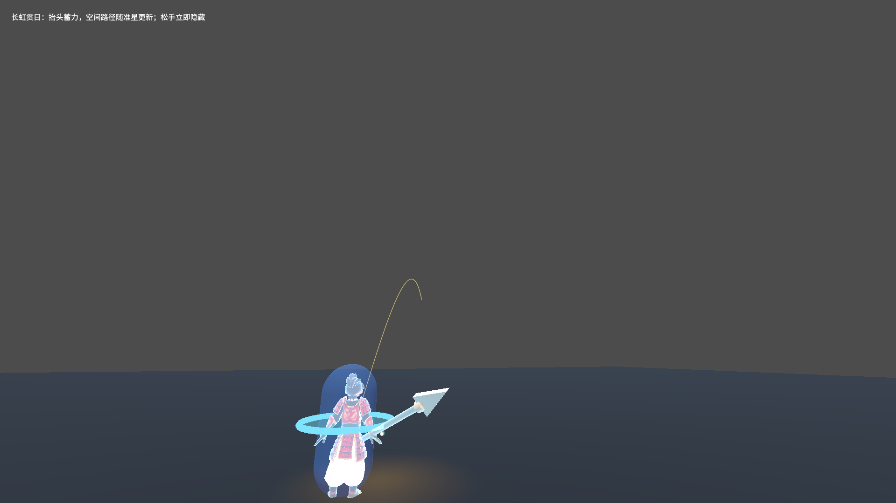
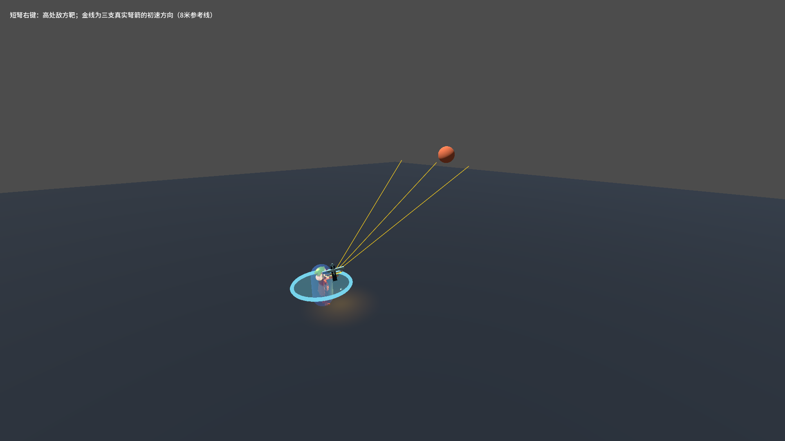

# J40：立体瞄准、输入预览与飞镰路径伤害

2026-10-21，根据用户在J39后的试玩反馈修复共用技能与输入链路，适用于正式配装及六武器对照场。证据文件名保留执行主机的原始时间戳。

## 当前规则与根因

### 长虹贯日

原长枪只用World射线选点，抹去高度后再向下找地；抬头时退回水平射程，无法瞄高处敌人。现从准星取World或敌方身体的最近空间目标，空射取准星远端；由实际出手点朝目标同向截断到蓄力射程，保留高度。射程12米随蓄力每档加算20%、最多1.8倍；现在限制三维目标距离，避免接近垂直时产生无界目标或速度。

预览与真实发射共用同一出手方向、选点和弹道求解（包括身体偏转后的接近垂直瞄准），飞行时间由空间距离及蓄力速度决定，重力22保持。枪尖仍按真实飞行方向显示。目标在空间中不会让武器悬空停止；继续受重力、水平距离上限及真实World碰撞约束，碰地后停留，原手动／气贯长虹自动召回规则保持。

### 玩家路径预览

`PlayerAbilityInput`读取当前槽的实际按住状态，每帧调用`Ability.UpdateInputPreview`；输入阻止、死亡与换装也清理预览。投掷路径只在按住瞄准且武器仍在手时显示，松开当帧隐藏；释放动画、已飞出、停留及召回都不能因`IsActive`长期为真而保留路径。程序调用`TryActivate`及`OnInputHeld`仍可驱动蓄力，但没有玩家输入时不打开玩家指示器。

这次迁移针对玩家投掷预览；敌方落弹／地面危险区是攻击事实的提示，仍由对应能力或弹体生命周期管理。

### 短弩右键

`skl_a2_w1_2.Aim`原为Facing，按最新裁定改为Crosshair，直接复用箭矢齐射的准星世界点链路，保留完整俯仰；中央箭对准目标，散射箭保留向上或向下分量。基础0.4秒、每0.2秒加2支、3至9支、20度散射、下坠和真实ATK发射时机保持。旧文档中“朝角色方向”的说明已明确作废。

### 镰刀无情

旧机制只在每0.5秒的短窗口内扫掠，飞出半程就召回时可能完全没开伤害窗。现在通过共用`WeaponThrowAbility.TravelPathDamage`启用飞出／回程持续Box凸包扫掠：每一段对同一个目标只命中一次，回程重新开段，不能逐帧重复扣血。`TravelDamageScale=0.8`，即移动途中按原周期伤害的80%；停留后恢复每0.5秒原伤害，不叠加移动伤害。

攻击力、暴击和暴伤仍只在出手时冻结；移动／悬停仅在同一原始快照上乘阶段倍率。喜爱索敌续飞也建立新移动段，重新停留后恢复周期；武技1仍直到实际回手才解锁。80%为本轮可调预设，直接配置在镰刀技能资源。长枪持续往返伤害模式保持原倍率，不受此开关影响。

## 验证

入口：`_tools/verify_projectile_capsule.ps1 -AimAndThrow`，独占验证锁、双配置构建，并对真实存档做前后SHA256比对。

新增`_AimAndThrowProbe.tscn`使用真实玩家配装、槽位输入、动画ATK和物理碰撞：天空抬头／转向实时预览、空间射程、身体偏转后的近垂直预览／发射一致性及有限速度、长枪命中空中靶、松手与召回显隐、程序蓄力隔离、按住中换装、短弩三发实际速度及高处靶扣血、向下瞄准、镰刀0.5秒前伤害／半途召回／每程去重／悬停周期及快照。

最终运行`20261021_004304`完成，Debug／ExportRelease均0警告0错误；所有检查exit=0、stderr为空。专项和相关回归共696项通过，完整日志见[最终证据](character-design-j40-evidence.log)。

| 检查 | 通过／失败 |
|---|---:|
| 新立体瞄准与投掷专项 | 33／0 |
| 同专项渲染与截图 | 35／0 |
| 当前技能槽与换装 | 57／0 |
| 攻击快照 | 45／0 |
| 镰刀末刀进化／喜爱索敌 | 36／0、42／0 |
| 长枪气贯长虹召回 | 89／0 |
| 弓档位与扫掠 | 39／0 |
| 通用蓄力释放 | 80／0 |
| 原始角色设计 | 115／0 |
| 龙之箭／符文 | 42／0、83／0 |

Main实际运行68.76秒，八条硬指标与索引14项通过，J8真实命中18条通过；只保留原5条历史红色打印标记，无新增失败，不称Main全绿。真实meta、能力卡、设置、配装及符文存档前后SHA256一致；`selftest.flag`已清理。当前用户已经更新存档和按键偏好，以本次执行前指纹为准，没有回滚到J39之前的旧文件。

失败现场：[初轮构建](character-design-j40-failure-20261020_214053.log)、[首次机制探针](character-design-j40-failure-20261020_214107.log)、[定位靶子初始化](character-design-j40-failure-20261020_214258.log)、[真实发射等待](character-design-j40-failure-20261020_214422.log)、[快照周期等待](character-design-j40-failure-20261020_214537.log)、[真实落地交点](character-design-j40-failure-20261020_214739.log)。

长枪图为真实输入的上扬预览；短弩图的金线从三支真实弹体的初速方向绘制8米参考线，用侧面相机观察。参考线不修改弹体速度、位置或命中判定；截图后恢复相机并验证高处靶实际扣血。

## 旧验收口径迁移及失败现场

- `CharacterDesignProbe`仍为115项，原水平射程检查改为准星实际空间目标及三维射程同向截断；准星可先命中前方敌方身体，不再假定穿过身体只取背后地面。
- `SpearRecallProbe`仍为89项，落地检查根据独立的重力落地方程及水平上限预测真实World交点，并要求地面高度为0；空间截断的目标可能高于地面，不把它误认为已经碰地。
- `AttackSnapshotProbe`仍为45项，移动伤害按80%计算，后续悬停恢复原倍率；等待实际进入悬停并打开周期窗口，替代旧飞行阶段0.65秒固定等待。暴击／暴伤及冻结属性断言保留。
- 初轮新增探针遗漏Config命名空间，构建失败；补齐后双构建0警告0错误。调试轮的靶子入树后才挪走，因最初在玩家脚下注册，产生了移动平台带人效果；改为入树前设置位置，真实空中命中从固定地面玩家重新验证。
- 同轮向下射击检查读到了上一轮`LastShotCount`，改为等待本轮真实三支弹体生成。半途召回扣血使用0.01绝对容差，覆盖大生命浮点减法误差。
- 首轮完整回归指出旧快照探针等待时间未覆盖新的“悬停后开周期”规则；已迁移为实际状态等待，未删除断言或减少数量。下一轮长枪验收的一档指出空间目标水平投影并不等于实际地面交点，改用独立重力方程和水平上限严格比对，保留原0.25米容差及真实地面高度检查。失败日志保留供复核。

本轮没有新增飞行敌种或更改地图、导航、精英词条、美术产线与打击反馈参数。
