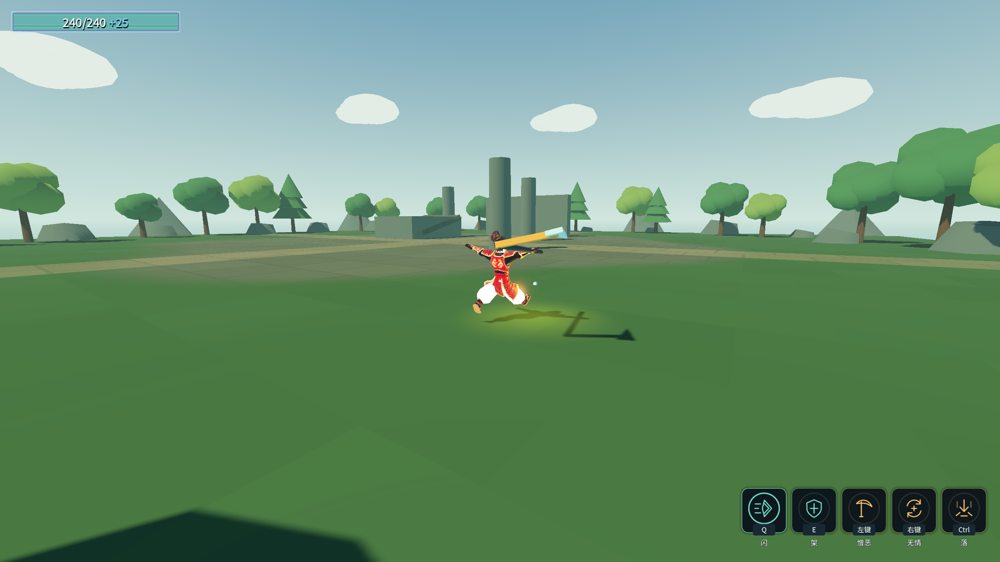
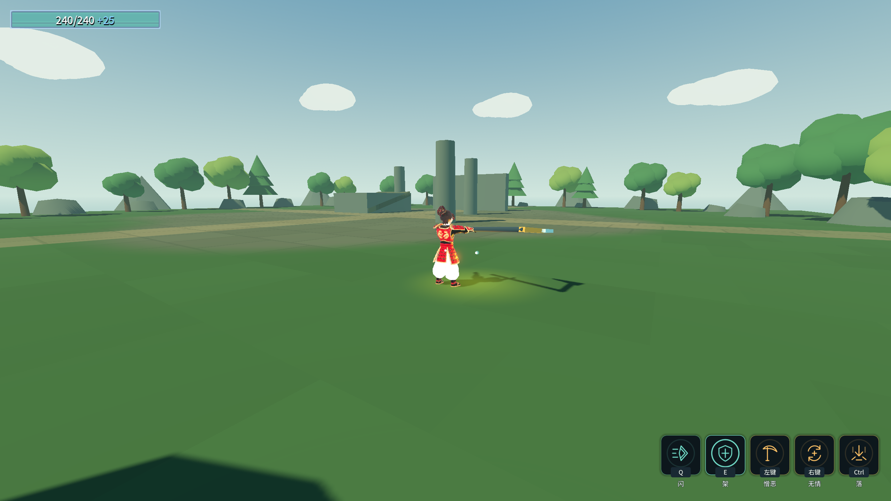

# 原始设计纠偏 J5：闪、架与冷却进化

2026-10-17完成本批范围。专项无头30/0、渲染32/0；Debug／ExportRelease均0警告／0错误。18个进程均退出0、stderr为0字节，Main八条硬指标逐字一致，闪／架旧探针也已改真实动画并通过。四存档保持，selftest.flag不存在。[完整输出](character-design-j5-evidence.log)。

## 接入行为

- 闪实际播放`Skill_B_Blink`，真实`Action@0.25`才开始三维冲刺、打开命中体和显示路径。缺事件只取消，`AbilityConfig.AnimationEventTimeout`为强类型取消上限，默认2秒，不作执行效果的时间兜底。
- 三维速度由`CharacterMovement`按来源持有。冲刺最后不足一物理步时按剩余时长缩短，实际水平距离7m；可以升空、穿过单位且仍被World阻挡。球体胶囊扫掠覆盖600m/s两帧之间的窄目标，与Area共用命中间隔。自然结束、打断、禁用、换装、死亡或退树均释放本次速度、碰撞状态和自身无敌；已有其他来源无敌不被认领或清除。
- 架仅由真实GuardOn开窗口，随后保持表内0.75游戏秒；前摇跟动画倍速，窗口不被加速动画提前截短。0.5倍与2倍均实测，观察者跨物理信号取样为0.7667秒，包含一帧取样延迟。
- 旧源配置两个事件在相同时刻，Godot只保留GuardOff。现原始／Lyra／Samurai三份资源均有`GuardOn@0.15`、`GuardOff@0.9`，长度0.9；生成源配置同步改为不同时刻。旧`GuardStartSeconds`和时间兜底开架已删除。
- 用户明确架可以规避能量波。`HitInstance.Negated`只无效化本次命中，架住后立即退出；同帧第二次命中正常受伤，普通BlockComponent的穿透规则继续保留。非敌方／无来源环境命中不消耗架势，已有其他来源无敌也不消耗架势。
- 真实Kill事件携带`Tag=hit.Attack.Ability`。`evo_dash_reset.RequiredEventAbility`资源引用闪，由表编译成运行期来源限制，其他技能击杀不触发。旧0.2秒触发间隔保留；闪施法期间的80%减CD延后结算到收招，5秒变1秒，不被完整冷却覆盖。
- 成功架住后先完成自身收招，再派发携带原Context的Parried；实际获得招架反击后，冷却立即为0并可再用。Ability同时保留施法期间的比例／秒数／刷新操作到收招，按顺序结算，带层数技能继续走已开始的回层计时。
- Main原来手动Tick的闪／架探针改为跨帧等待真实Action／GuardOn，不手动伪造动画事件。命中与爆炸特效显式预载共享灯光脚本，两类各三次深度重载和强制GC后仍可实例化。
- 退出继续先撤销淡出、卸载音频流并提前释放声部；等待从游戏计时器改为真实异步80毫秒，避免无头不限帧提前结束。具体实际耗时与复验结果写入证据。

## 证据

有效修前5/8：闪未播放动画、提前冲刺且不能升空；架缺事件仍计时开架、同帧第二击错误无敌；招架刷新后CD被写回3；其他技能击杀把闪CD5减到1；闪自身击杀的减CD被收招覆盖成5。首次接来源过滤后12/1，进一步发现原Kill事件根本没有携带技能Id；补真实来源后通过。[原始失败摘录](character-design-j5-failures.log)。

实际链路使用真实输入、角色动画、物理碰撞和`RewardCatalog → RunBuild.Add`获取奖励；未直接调用奖励Execute冒充接入。专项输出包括：

```
闪实际升空：y=3.7586
实际水平距离7m，表值7
600m/s闪扫过帧间窄目标只命中一次：1
其他技能击杀不触发闪身步：5→5
闪施法中击杀的80%减CD保留到收招：1
招架反击真实架住后立即可再用，CD=0
```

命令：`_tools/verify_blink_guard.ps1`；`-ProbeOnly`仅本专项。全量包含下落、动作交接、原文武器、Main八条硬指标、F/C/D/G/角色/B/A/E/读档及双构建，结果见[证据日志](character-design-j5-evidence.log)。

下落104/0及108/0、动作交接38/0及40/0、原文115/0及120/0；F33/0、C53/0、D90/0、G51/0、角色61/0、B74/0、A失败0、E39/0、读档5/0。另做三轮Main退出复验，均退出0且stderr空，实际等待89／87／88ms；正式整批Main实际等待87ms。旧游戏计时器0.08秒在隔离无头实测只经过1.693ms，具体失败与修正未省略。





⚠️ 截图使用阶段动作与场景，独立武器动作和终版美术继续推进；其他进化、变奏快射、蓄力释放ATK和统一暴击仍未全部完成。Main闪／架已改真实动画流程；其他历史探针边界继续保留，不将Main退出0描述为全部旧断言全绿。
