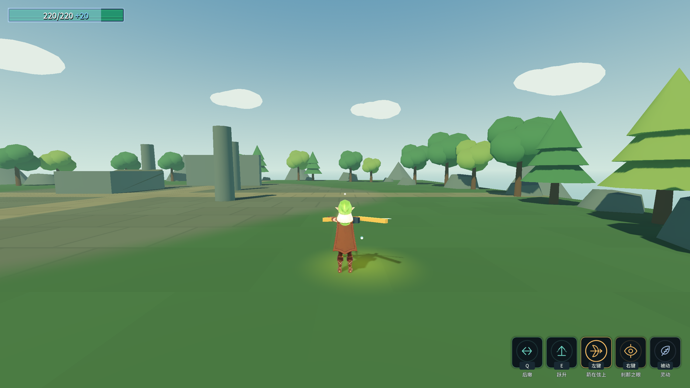
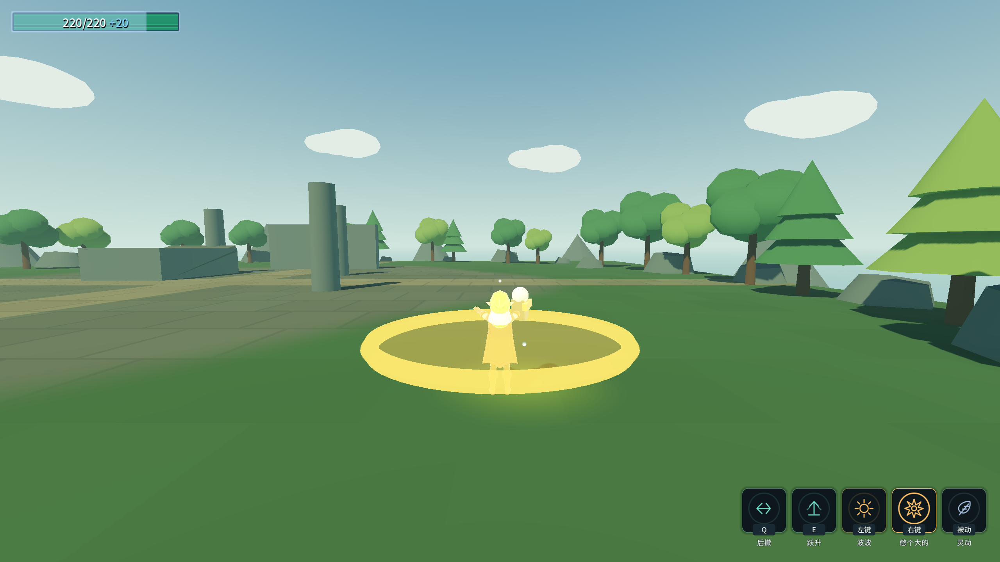

# 原始设计纠偏J6：蓄力释放ATK与变奏

2026-10-17完成本批范围。最终专项无头80/0、渲染82/0。生产代码完整20进程回归后，仅扩展探针再跑2进程，共22进程均退出0、stderr空；Debug／ExportRelease均0警告／0错误。Main八条硬指标逐字一致，四存档保持，selftest.flag不存在。[完整及扩展输出](character-design-j6-evidence.log)。

## 行为与配置

- 能量掌、短弩、弓和灵剑剑气：按住期间越过ATK不出弹。松手冻结完美结果、档位与威力，重播释放段，只在本单位该轮真实ATK生成投射物。等待时再按住不会重新蓄力，重复松手不再提交。缺ATK只取消，不补发；释放前被其他动作打断不发旧弹。
- `AbilityConfig.ChargeReleaseAnimSpeedScale`为强类型列，默认1，弓行显式2；独立于蓄力期慢放。共用现有阶段动画，没有重生成动画库。换装清理蓄力快照，收招／取消清`IsCharging`，防止表现层继续读到蓄力状态。
- 剑气在真正发射时再次读取当前武技1命中盒尺寸；源技能只读，不被发射逻辑改写。
- 变奏使用`RewardConfig.VolleyRamp → VolleyRampTuning`子资源，资源引用目标弓技能。`MaxCount=3`、`WindowSeconds=1.2`、`ShotIntervalSeconds=0.08`都是表内预设；处理器为强类型赋值，删除该行旧的字符串属性反射参数。ConfigIndex没有增删条目。
- 变奏点按免基础0.5秒蓄力，第一箭经真实ATK起动，连续点按按1→2→3循环。二／三连发按用户确认逐箭发射；伤害／弹速沿用首箭快照，后续箭按当前准星方向射出。动作被打断时取消待发箭，已经离手的箭继续运行；自然末箭后进入冷却。长按仍为蓄力单箭，且结束快射序列；超出窗口重新从1开始。
- 后续箭的间隔是首箭真实ATK已经启动的连射过程，不是缺事件补发。短弩仍是同次ATK的散射，未改成变奏的连射。

## 实测

使用真实`PlayerAbilityInput`、角色动画、物理靶及`RewardCatalog → RunBuild.Add`。不直接调用技能发射或奖励Execute代替接入。四种投射物实际命中靶后读到攻击快照：能量掌40、短弩12、弓24、剑气26，与技能报告值一致。

```
变奏点按两轮：1、2、3、1、2、3
逐箭物理间隔：0.0833秒，表值0.08秒（60Hz离散为5帧）
连发中被后撤打断：已出第一箭保留，待发第二箭取消
缺ATK：本次实际完成蓄力后松手，四类均无出弹且取消
普通能量波：伤害30／弹速250；完美：伤害40／弹速400
短弩满三档：真实生成9箭，保持散射
```

修前原始输出和首版探针误读上一轮快照的边界均保留在[失败记录](character-design-j6-failures.log)，没有将误读得到的PASS作为最终证据。

命令：`_tools/verify_charge_release.ps1`，`-ProbeOnly`只跑本专项。全量还覆盖闪架、下落、动作交接、原文武器、Main八条指标、F/C/D/G/角色/B/A/E/读档与双构建。

回归：闪架30/32、下落104/108、动作38/40、原文115/120均0失败；F33/0、C53/0、D90/0、G51/0、角色61/0、B74/0、A失败0、E39/0、读档5/0。证据保留先前专项75/77与最终扩展80/82，不覆盖隐藏先验失败。





⚠️ Main仍有6条同步蓄力旧探针红色输出（完美、普通、后置蓄力、短弩、弓、剑气）：它们在同一帧手动Tick并立即读弹数，未等待真实释放ATK。原始红色行已附证据，必须后续迁移成跨帧等待，不能改战斗代码去迎合旧探针。本批行为由独立真实输入／动画／物理探针验证，不把Main退出0解释成全部断言全绿。

⚠️ 静态截图不能证明连发时序，时序证据来自真实投射物生成的物理帧计数。角色拉弓、握持、投掷及其他独立动作仍是阶段适配，终版美术未完成。其他进化与统一暴击继续审计。用户要求额度将尽时交接DeepSeek，具体续做顺序见[交接](DEEPSEEK_HANDOFF.md)。
