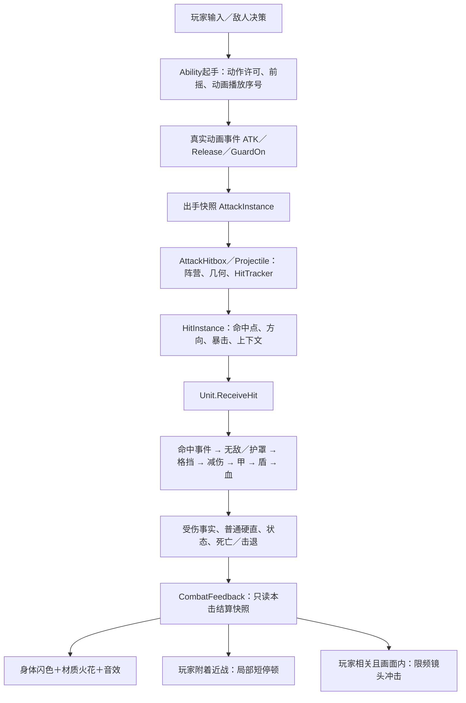

# 战斗流程与打击反馈（J38）

本项目采用快速群战的节奏：优先保证输入、敌人预警和命中结果清晰，再通过短促停顿、材质反馈、音效和镜头表现轻重。此文区分公开来源、设计判断和已经落地的机制；没有参考游戏源码，不推测它们具体用了多少帧或内部伤害公式。

## 当前战斗链路

关键文件：`Scripts/Abilities/Ability.cs`、`Scripts/Combat/UnitAnimator.cs`、`AttackInstance.cs`、`AttackHitbox.cs`、`Projectile.cs`、`Unit.cs`、`CombatReaction.cs`。

- 起手和伤害已经由动画事件驱动，缺少事件会取消，不按计时补伤害；连招窗口、移动许可和打断规则已经存在。
- 近战重叠／扫掠与远程逐帧查询共同走Unit；命中次数由HitPolicy管理，粗细弹道和查询预算独立。
- 伤害前先发Hit事件，允许技能招架或一次护罩无效本击；无敌也算碰到，但不算成功伤害。不能把Hit当成“已经扣血”。
- 护甲当前还提供默认30%减伤；额外减伤按乘法叠加，上限90%。这轮保留公式。护甲、护盾、生命依次扣除；破甲事实在扣甲处唯一产生。
- 有甲敌人免普通受击硬直／前摇打断；破甲当击仍受保护，下一击才可打断。格挡者自身硬直与护甲保护独立；效果护罩不会因这轮视觉反馈被加上硬直。
- 敌人身体起手闪色、J37地面范围／路径预警继续使用原生命周期；有甲不等于免疫质量、击退或所有控制。

原先的反馈缺口：AttackHitbox和Projectile不检查DamageResult就各自播放同一火花和音效；护甲、格挡、无敌很难从命中表现区分。直接伤害没有统一反馈入口；普通受伤闪色无法说明防御状态；没有动作重量、局部顿帧或镜头冲击的共用规则。此次将入口移到结算之后，取消两个判定端的重复播放。

## 参考拆解

以下“借鉴”是本项目的设计选择。参考游戏的视觉节奏可以借用，闭源实现与精确参数不能据此断言。

| 参考 | 公开依据 | 对本项目的启发 |
|---|---|---|
| 哈迪斯1 | 官方补丁分别调整攻击输入缓冲、段间冲刺、特定攻击音效与伤害预览大小，说明反馈与操作节奏需要一起调。[Supergiant更新记录](https://www.supergiantgames.com/blog/hades-updates/) | 快速攻击反馈要短；打空也能完成动作，命中才加冲击；已有连招缓冲和真实事件保留。敌人的起手与范围信号应比装饰效果优先。 |
| 哈迪斯2 | 官方公告分别更新斧头技能特效、不同武器形态的视觉，并单独补了斧头完整连击落地音效。[Supergiant官方公告](https://steamcommunity.com/app/1145350/announcements/) | 普通段、终结段、蓄力释放应有层次；防御材质与攻击重量是两条轴，不能全部用同一个“大火花”。本轮先接连招尾段与重量，蓄力专属曲线留给具体技能调参。 |
| 怪物猎人 | Capcom在发布说明中明确将调整hitstop与提升攻击冲击感相联系；官方社区更新也讨论了重量感与玩家反馈之间的取舍。[Capcom发布说明](https://blog.playstation.com/2025/02/27/monster-hunter-wilds-ready-for-the-hunt-on-feb-28/)、[官方社区更新](https://store.steampowered.com/news/posts/?appids=582010&enddate=1738770098&feed=steam_community_announcements) | 接触瞬间给阻力感；重段比轻段明显。考虑本项目大量敌人与飞行弹体，用出手者局部短停顿，保留外部威胁运行；不搬用大型怪物狩猎的长动作承诺。 |
| Vlambeer的Game Feel演示 | 开发者Jan Willem Nijman的演讲展示给简单原型逐步增加反馈；活动主办方公开了演讲主题。[活动介绍](https://www.control-online.nl/2013/10/18/kort-vlambeers-jan-willem-nijman-spreekt-over-the-art-of-screenshake/)、[开发者演讲](https://www.youtube.com/watch?v=AJdEqssNZ-U) | 组合小反馈并做开关对照，比只堆震屏更容易调。是否舒服最终以本项目试玩为准。 |

设计上将打击感拆为五段：①蓄势让玩家预期力度；②命中帧给明确接触信号；③停顿／材质／音色说明阻力；④受击、击退、破甲、死亡说明结果；⑤收招与下一次输入保持连贯。当前已具备①④⑤的机制基础，本轮重点补②③，连接已有④。最终模型的轮廓、预备姿势、快速发力、过冲和回收动画仍须由美术产线制作。

## 已接入的反馈矩阵

| 结果 | 身体／接触反馈 | 动作与声音 |
|---|---|---|
| 普通打肉 | 暖色短闪，原HitEffect实际表面火花，大小随重量有界变化 | 轻段短促，尾段更重；原普通硬直独立 |
| 碰甲 | 蓝色短闪、蓝色向外碎片与小环 | 较高音色；防御者的攻击前摇继续 |
| 破甲 | 亮蓝短闪、更多碎片，保留破甲事件 | 加重重量与低音；不额外打断破甲当击 |
| 资源护盾 | 紫色防御反馈 | 继续走原Shield损耗规则 |
| 持盾格挡／技能招架 | 金色冲击环与碎片；两种事实分别识别 | 低音格挡声；沿用格挡者自身硬直 |
| 一次性效果护罩 | 紫色防御反馈 | 只说明本击被挡，没有新增防御者硬直 |
| 无敌／已死亡／零有效伤害 | 不播放成功伤害反馈 | 不触发局部停顿与镜头冲击 |
| 暴击／击杀 | 保留材质类别，加重表现，不靠伤害值猜暴击 | 读取真实Critical／Killed；击杀可越过普通目标限频 |
| DoT | 不重复闪色、火花、停顿、震屏或命中声 | 伤害和原跳字照常 |
| 派生伤害 | 降低火花重量 | 不抢命中音、镜头与局部停顿预算 |

技能招架通过HitInstance.Parried标记；护罩只标Negated，两者不会混同。ArmorBroken新增到DamageResult，避免护甲事件引发补甲后再用当前Armor误判刚才那一击。分类以防御材质优先，暴击与击杀作为强度叠加；一次结果只走一个反馈入口。

## 局部停顿的边界

`ImpactPause`只由玩家附着在身上的近战命中申请；弹体、脱手爆炸、召唤物与DoT不暂停射手。只停出手者：

- UnitAnimator保持真实播放位置，保存／恢复原SpeedScale；不Seek、不重播、不补发ATK。
- Ability暂停动作StateTime和Tick；冷却／回层继续，输入仍接收，既有取消与交接可以清理停顿。
- CharacterMovement暂停该单位的运动步，突进与动作一起停；附着AttackHitbox暂停后续物理步的重叠检查。同帧群体判定仍完整处理。
- 有甲防御者继续自身动作；敌人预警、弹体、其它单位、状态计时、HUD与全局时间继续。没有设置Engine.TimeScale、SceneTree.Paused或定时sleep。
- 请求处有冷却，同刀多目标不累计；动作取消、换装、死亡、关闭功能均恢复。物理步会量化短暂停顿，25ms不等于所有帧率上精确25ms。

这是明确的局部战斗时序能力，和纯VFX分开。会略微延长近战命中后的动作占用，是有意的手感变化；并非所有玩法时序都与关闭时逐帧相同。伤害公式、控制免疫和判定尺寸没有随之改变。

## 相机、预算与配置

入口：`Config/ConfigIndex.tres → CombatFeedback → Config/CombatFeedback.tres`。编辑独立资源即可调参数，无需改共享模型或动画原资源。

| 参数 | 当前预设 |
|---|---|
| Enabled／LocalPauseEnabled／CameraStrength | 总开关／顿帧开关／镜头强度，镜头0关闭 |
| LightPauseSeconds／HeavyPauseSeconds／MaxPauseSeconds | 0.025／0.05／0.065秒；本项目预设，非参考游戏数据 |
| PauseCooldownSeconds | 0.12秒，同刀／密集命中不累计 |
| FinisherWeight／CriticalWeight／BreakWeight／KillWeight | 1.45／1.25／1.6／1.2，最终有界 |
| CameraSeconds／CameraMaxOffset | 0.13秒／0.065米上限，方向冲击快速归零 |
| SoundCooldownSeconds／CameraCooldownSeconds | 0.045／0.07秒，且每物理帧各最多一次 |
| TargetCooldownSeconds／MaxEffectsPerFrame | 0.035秒／每物理帧12个独立命中特效；身体提示仍各自处理 |
| FlashSeconds／BurstSeconds | 0.075／0.18秒 |
| FleshSound／ArmorSound／BlockSound／BreakSound | 独立SoundId，可直接换音效表；当前复用CC0命中样本，以临时音高区分占位 |

AttackHitbox.FeedbackWeight和AttackInstance.FeedbackWeight与伤害独立。当前灵剑1、镰刀1.2、长枪0.9、下落攻击1.8；MeleeCombo在出手快照中保留重量，连招尾段再使用统一倍率。远程默认1，后续技能可显式设置。

相机只动HOffset/VOffset，不写CameraRig跟随、鼠标角度、FOV或角色变换。AimUtil使用扣除本组件偏移后的准星射线原点，方向不变；HUD不随之移动。只给玩家本人相关、当前相机画面内的事件申请冲击；召唤物与远处后台命中不冒领镜头。

`ShowHitEffects`仍控制接触特效，预警保持原独立配色；它不控制伤害、身体起手警告或机械硬直。纯视觉预算与伤害次数没有互相依赖。

## 试玩与后续美术接入

打开`Scenes/Debug/_CombatFeedbackLab.tscn`运行：F1灵剑、F2镰刀、F3长枪、F4弓、F5能量掌、F6短弩；F7总反馈、F8局部顿帧、F9镜头，Home复位。三种靶分别为无甲、80护甲、正面全挡，格挡靶可以绕背。保持原鼠标／左右键／WASD／技能输入；开关只改当前进程，不写存档。

建议先关镜头，只比较轻段和尾段；再打开镜头到能察觉但不妨碍瞄准；最后调音色和模型发力。后续具体模型要提供起手、命中发力、收招、普通受击、格挡回震、破甲与死亡动作；护甲仍不能通过播放普通受击动画打断攻击。最终材质音效、独立武器命中特效和专属动作没有因机制验收而视为美术完成。
