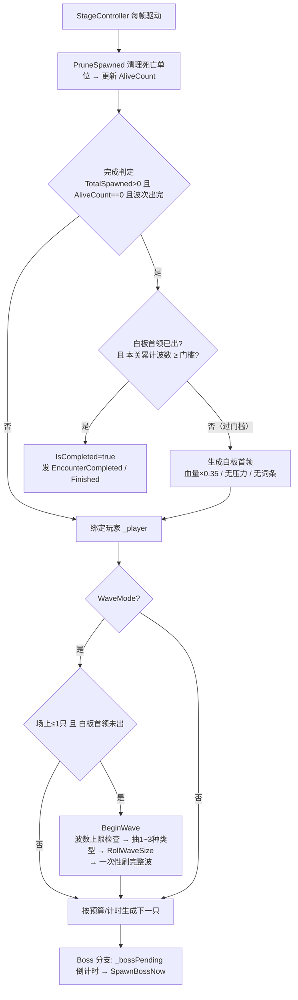
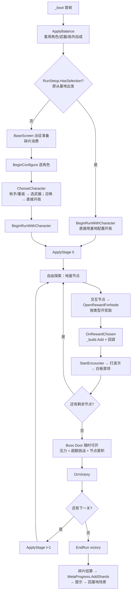

# 两个核心控制器的架构与流程

> 本文只讲 `EncounterController`（一场战斗）和 `RunController`（一局游戏）。
> 其它系统见 [architecture.md](architecture.md)。

---

## 一、EncounterController —— 一场战斗的完整生命周期

**职责**：一次 Encounter（节点触发的挑战 / Boss 战）从开始到结算的全部过程。
**位置**：`Scripts/Encounter/EncounterController.cs`（716 行）
**依赖**：`SpawnPlanner`（数量·类型·落点）、`MapManager`（可行走点）、`ConfigIndex`（缩放）、`BossPhaseController` / `BossPressure` / `BossPerkCatalog`（Boss 侧）

### 状态一览

| 分组 | 字段 | 含义 |
|---|---|---|
| 生命周期 | `IsRunning` / `IsCompleted` / `_started` | 是否在跑 / 是否结算完 / 是否已启动 |
| 波次 | `WaveMode` / `WaveCount` / `_waveIndex` / `_waveRemaining` / `_waveEntries` | 波次模式、上限、当前波、本波未出数、本波类型 |
| 生成 | `_entries` / `_spawned` / `AliveCount` / `TotalSpawned` | 可生成项、已生成单位、存活数、累计生成 |
| 预算 | `RemainingBudget` / `_spendable` / `_spawnTimer` | 总预算 / 可支配余额 / 生成间隔 |
| Boss | `BossScene` / `Boss` / `BossActive` / `_bossPending` | 最终首领（Boss Door） |
| 白板首领 | `EliteBossScene` / `_eliteBossSpawned` / `EliteBossHealthScale` / `MinWaveForEliteBoss` / `WavesOpenedBefore` | 弱化首领（**过了波次门槛才会出**，见下） |

> **白板首领的波次门槛（需求包 #5，2026-10）**：判定量是 **本关累计波数**
> （`WavesOpenedBefore` 由 `StageController` 每次开战前写入 + 本场 `_waveIndex`），
> 门槛来自关卡表 `EliteBossMinWave`（三关都是 8）。
> 一场 Encounter 的波数只有 1～4，按单场算门槛取 8 永远到不了，所以必须按本关累计。
> 门槛没过时本场照常结算，累计波数在下一场继续长。

### 主循环（每物理帧）



### 三条进入路径

| 入口 | 谁来调 | 用途 |
|---|---|---|
| `Start()` | `StageController.StartEncounter(node)` | 节点触发的挑战（`WaveCount` 按节点价值 3/2/1） |
| `SpawnBossNow()` | `StageController.OpenBossDoor()` | Boss Door 的最终首领（带压力、带词条） |
| `ForceComplete()` | 自测 / 流程特例 | 直接结算 |

### 关键约定（踩坑得来的）

1. **完成判定必须由 `StageController` 每帧驱动**（`TryCompleteIfClear`）—— 放在生成循环里会被 `AliveCount >= MaxConcurrent` 的提前 return 挡住。
2. **`ResetEncounter()` 必须清波次状态**（`_waveIndex` / `_waveRemaining` / `_waveEntries`）—— 漏了就会出现"第二个节点直接出白板首领"。
3. **一波一次性刷出**，不要按 `SpawnInterval` 逐只滴灌。
4. **落点一律走 `SpawnPlanner` → `MapManager`**，保证不在建筑里、不掉出地图。
5. **白板首领出场后不再开新波**（`!_eliteBossSpawned`），否则首领和杂兵一起打。

---

## 二、RunController —— 一局游戏的编排

**职责**：把「基地配置 → 逐关推进 → 结算回基地」串起来，本身不做战斗与奖励规则（那些在 `RewardPool` / `StageController` / `EncounterController`）。
**位置**：`Scripts/Rewards/RunController.cs`（655 行）
**依赖**：`RewardPool` / `RunBuild`（构筑）、`UiService`（界面）、`MetaProgress`（局外存档）、`RunSetup`（跨场景配置）、`StageController`

### 状态一览

| 分组 | 字段 | 含义 |
|---|---|---|
| 构筑 | `_build` / `_pool` / `_current` | 本局加成、奖励池、当前三选一候选 |
| 关卡 | `_stages` / `_stageIndex` / `_stage` | 关卡序列、当前关、关卡控制器 |
| 角色 | `_character` / `_weaponKind` / `_player` / `_weapon` | 选定的角色与武器 |
| 流程 | `_boot` / `_runEnded` / `_awaitingAdvance` / `_restartOnDismiss` | 首帧引导、本局结束、等待推进、结算标记 |
| 界面 | 通过 `UiService` 惰性获取 | 不再持有硬编码路径 |

### 主流程



### 节点类型 → 奖励分派（`OpenRewardForNode`）

| 节点 | 行为 |
|---|---|
| 强化池 | 强化三选一 |
| 进化池（= 旧称"武器池"，用户 2026-10-12 拍板：没有"武器池"这个类型） | 进化三选一（改攻击方式） |
| 异化池 | 异化三选一 |
| 特殊奖励 | **稀有池（进化/异化）连开两次** |
| 局外资源 | +5 碎片 |
| 恢复状态 | 先免费回 30% 血，再进战斗 |
| 商店 | 花碎片买回血 / 强化 / 进化（强制选择，不能退出） |
| 降临节点 | **不弹面板**，直接进下一关 |

### 关键约定

1. **武器选定后本局不可更换**（配置台决定的，节点只改攻击方式）。
2. **奖励选择是强制步骤**（除降临节点），不能打开界面直接退出。
3. **关卡完成不自动推进**，必须走 Boss Door → 降临节点。
4. **结算一定落盘**（`MetaProgress.AddShards` 即使收益为 0 也写 `user://meta.cfg`）。
5. **界面交互一律走 `UiService`**，业务代码不出现节点路径。
6. **「挑战者状态」= `StageController.ChallengerActive`**，交互物按它决定"弹菜单还是拒绝"。
   它现在的定义是 `!IsVictory && (_encounterRunning || (_bossFight && !_bossCleared && Boss 还活着))`
   —— ⚠️ **Boss 战不算节点挑战**：Boss 一阵亡就立刻解除挑战者状态，否则降临节点会被自己的闸门拒掉
   （需求包 #12 的死锁，见 [boss.md](boss.md) 的「打 Boss 之后的挑战者状态」）。

---

## 三、两者的边界（为什么还没合并/拆到底）

```
RunController          一局：配置 → 关卡序列 → 结算 → 回基地
    └── StageController      一关：节点布置 / 挑战计数 / Boss 门 / 关卡完成
            └── EncounterController   一场：波次 / 生成 / 白板首领 / 结算
                    └── SpawnPlanner / MapManager   往地图上放东西
```

- **`RunController` 仍偏胖**：流程编排 + 奖励分派 + 商店 + 结算挤在一起，`EndRun` / `OpenRewardForNode` 各自还带一段业务。下一步建议拆 `RewardService`（奖励池与分派）与 `RunSettlement`（碎片结算）。
- **`EncounterController` 仍偏胖**：生成、波次、Boss、白板首领、完成判定五种关注点。下一步建议拆 `WaveDirector`（波次状态机）与 `BossPhaseRunner`（最终首领/白板首领两种模式）。
- 两者的共同点是**都持有大量可变状态且被帧驱动**，所以拆分手法应该一致：把**纯逻辑与无状态计算**先抽成静态类（`SpawnPlanner` / `NodePlacement` / `RewardService` / `RunSettlement` 已经这么做了），状态机部分等 UI 定型后再动。
- 区域杀**已经不是静态类**：`KillPlane` 那个「每帧遍历 4 个组查 Y」的实现已删除（2026-01），改为 `Scripts/World/KillZone.cs` 的 `Area3D` 碰撞区域，由 `MapManager.EnsureKillZone()` 创建，进入即杀。`ConfigIndex.KillPlaneY` 仍保留，含义变成「区域杀中心的高度基准」。

