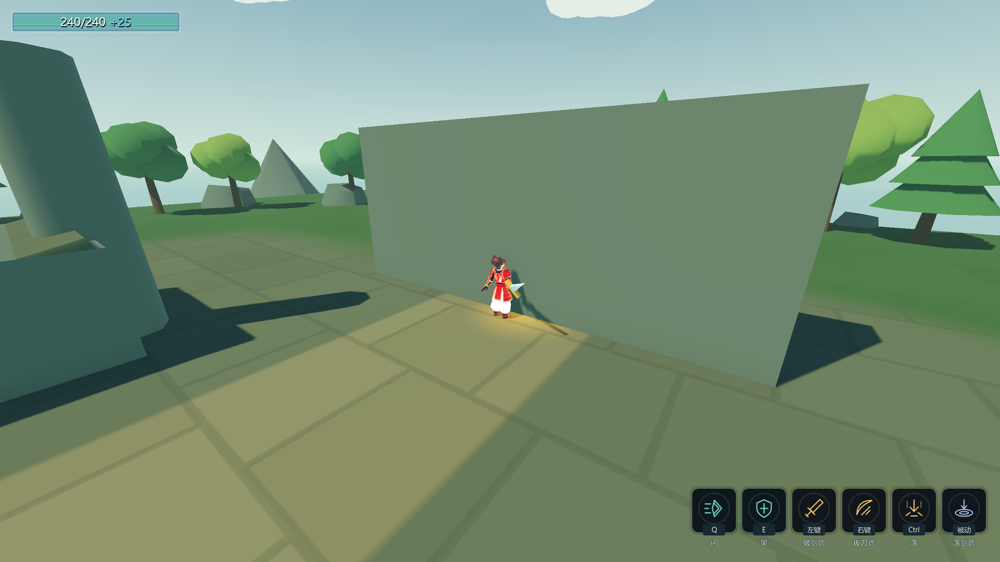
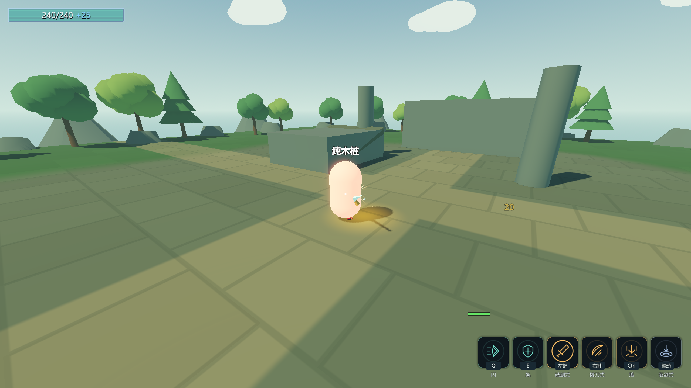
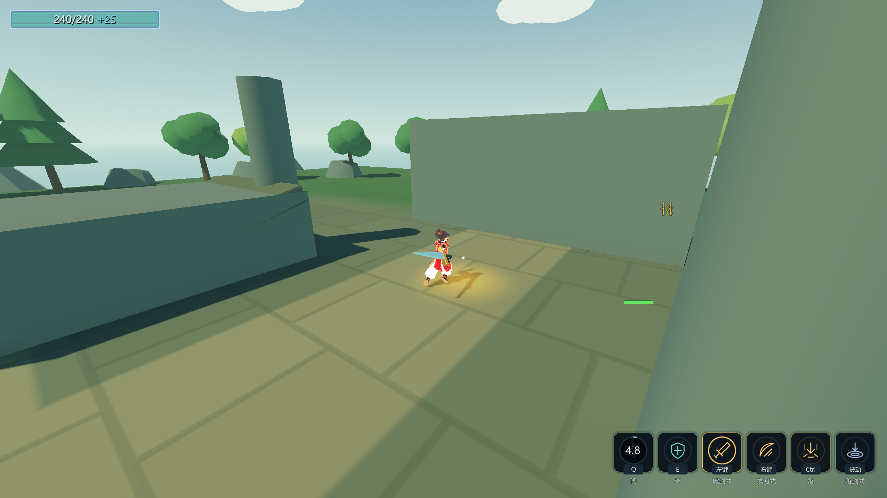
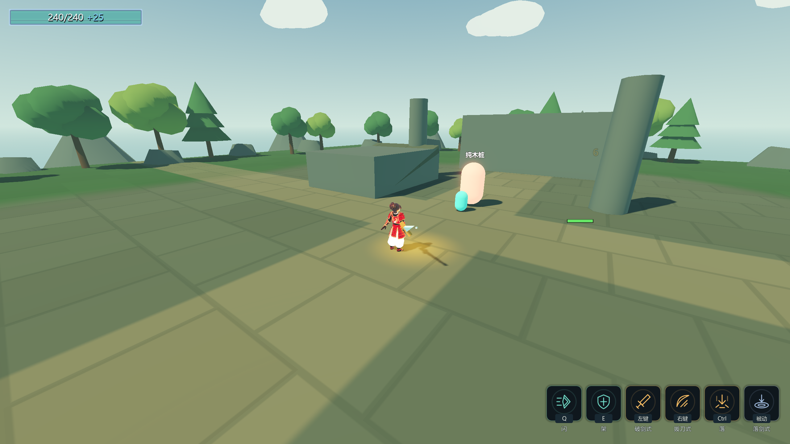

# 第二轮D批：碰撞层级验收（2026-10-17）

范围：HANDOFF §5 D的①～⑤，独立执行最终World-only方案。
全体Unit的身体只检测地形，攻击Area与弹道按阵营检测敌方；不添加软推挤，不改技能行数值或ConfigIndex。
代码改动基于C批之后的共享工作区，未纳入另一个角色美术任务的素材、角色表或动画改动。

## 最终实测结果

| 检查 | 结果 |
|---|---|
| 固定Debug构建 | 0个警告 / 0个错误 |
| ExportRelease额外构建 | 0个警告 / 0个错误 |
| Main完整自测 | 退出码0，走到“自测结束”；八条硬指标去时间戳后逐字一致 |
| D渲染专项 | 94 PASS / 0 FAIL，退出码0 |
| C基地回归 / 新进程读档 | 52/0、5/0，均退出码0 |
| B / A / E回归 | 74/0、23/0、39/0，均退出码0 |
| 存档与清理 | meta/ability_cards/settings哈希不变，loadout仍不存在；selftest.flag不存在 |
| 证据 | 4张2560×1440截图，逐项结果和SHA-256已写入evidence日志 |

## 实现与验证对应

| 要求 | 实现与真实验证 |
|---|---|
| ①②命名与对照 | project.godot九层名称；[architecture.md](architecture.md)列出层号/位值/mask |
| ③战斗分类 | 攻击盒8/16，四弹体32；Ready及激活时按实际来源阵营配置，离树生成爆炸同样覆盖 |
| ④单位互不阻挡 | 实际MoveAndSlide分别穿过Player与Enemy身体，x=4.3；三把近战在身体完全重叠时由真实动画事件命中，队友不受伤 |
| ⑤身体只撞地形 | 所有敌人/首领/召唤物mask=1；高速位移与闪被关卡墙阻挡，z约-15.10；真实弹道不能击穿墙 |
| 弹道过滤 | 两阵营×Bullet/Arrow/SwordQi/EnergyWave，略过同阵营身体并命中敌方；枪口位于敌人体内也命中 |
| 穿透与弹射 | 已命中RID加入排除；双阵营各两目标恰好受击1/1次，不重复消耗穿透；弹射只挑敌方 |
| 爆炸与区域杀 | 双阵营爆炸仅伤敌方；KillZone检测召唤物，死亡身体layer=0 |
| AI与表现安全 | 九种敌人+Boss真实索敌并移动/施法；召唤物实际索敌；五类外部特效及残影/风线无单位、碰撞对象和分组 |

投射物根改为Area3D用于实际层分类，**没有碰撞形状、不监测重叠**；原每物理帧扫线仍是唯一命中来源。
发射前公共mask=7，Launch后玩家弹mask=5、敌方弹mask=3；准星查询、移动身体mask分开。
Interactable/Pickup层预留，当前距离交互/拾取继续使用Node3D；VfxOnly只命名，生产纯表现不创建CollisionObject3D。

## 复现与原始输出

```powershell
& 'F:\Godot项目\项目a\_tools\verify_batch_d.ps1'
```

脚本逐段持验证锁，只管理自己的PID；使用命令行`-- --selftest`，不创建全局flag。
依次运行固定Debug构建、Main完整自测、D渲染探针、C基地及新进程读档、B/A/E回归、ExportRelease额外构建。
逐段核对四个玩家存档；B的GM资源测试仅还原其明确写入的meta原字节，其他意外写入直接失败并保留现场。
完整输出在本地`.ai_d_*.log/.err`；可提交的原始摘录和截图SHA-256见 [d-batch-evidence.log](d-batch-evidence.log)。

## 截图（实际2560×1440）









## 中间问题与已知边界

- 一次中间Main自测进程退出0，但有两条`Animation not found`，脚本拒绝通过。
  原因是替换角色模型后，旧探针固定读隐藏Model；四处动画取证改读CharacterDisplay.ActiveModel。
  C探针同样改为比对角色表的ModelPath，避免把旧占位文件名当作功能契约。
  原stderr保留于 [d-batch-intermediate-issue.log](d-batch-intermediate-issue.log)，没有扩大错误豁免。
- 仍有既有导航空网格/cell_height告警及完整自测退出的2个资源未释放日志；构建0/0与这些运行期遗留问题分别记录。
- 旧P4的落剑1→1/旧期望+1、长枪4层/旧期望3与12m/旧期望20.74仍是历史探针期望偏差，不能声称旧日志全绿。
- C批记录过的偶发GCHandle终结器异常根因仍未定位；本批通过必须以最终日志为准。
- 画面截图是阶段性表现，终版美术、平衡、字体、破甲环和导航专项不计作本次碰撞层已解决内容。

18条需求与全部批次的当前核对见 [roadmap-2-completion.md](roadmap-2-completion.md)。
