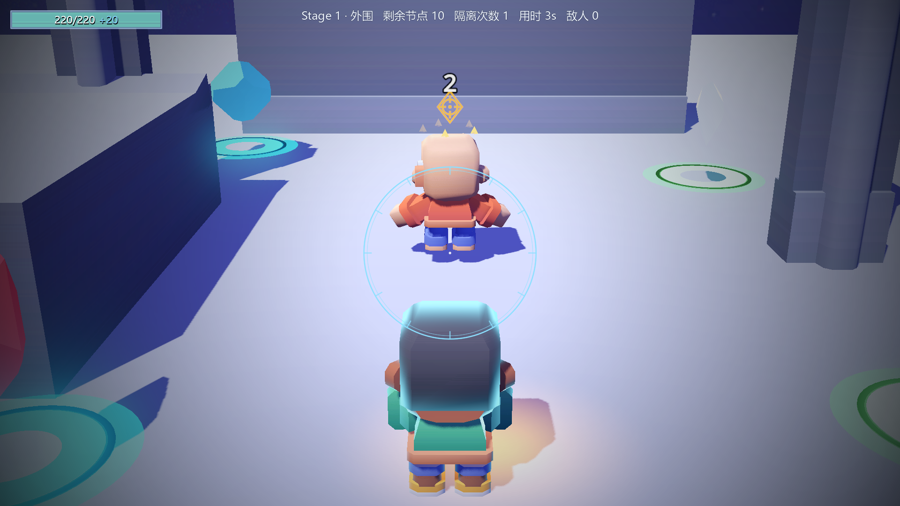
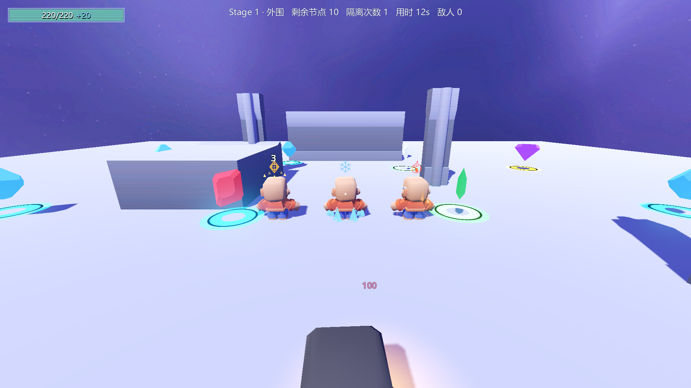
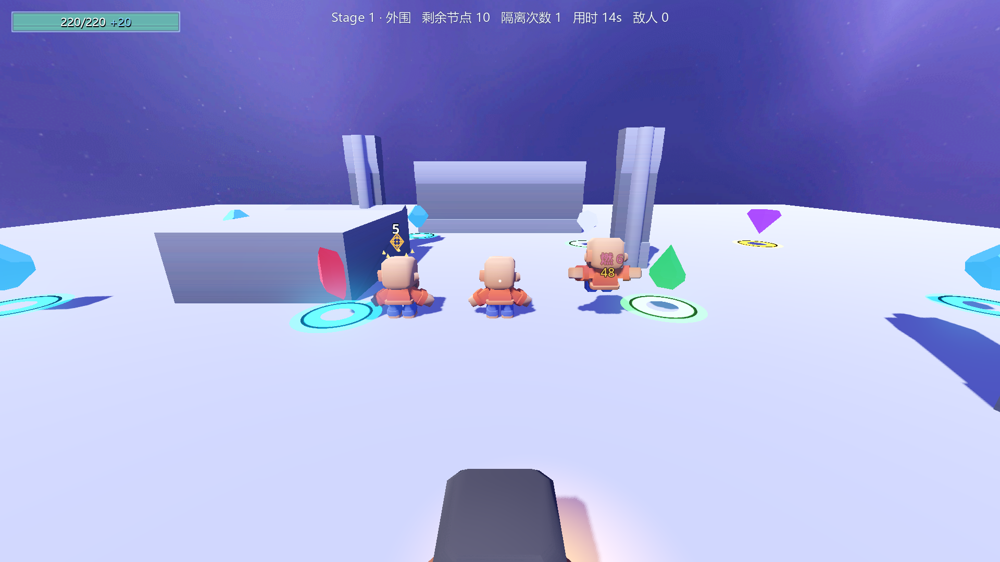

# E 批验收（2026-10-16）

本轮实现 HANDOFF 的 E-1 / E-2，基线为已推送的 A 批提交 `5ca3953`。
玩家明确选择：刹那之眼保留 **0.3 秒无动画软启动，以及原有免伤与免费后撤**。

## 实现与实测

| 内容 | 实测结果 |
|---|---|
| 编译 | 指定 `build.ps1 --no-incremental -v minimal`，0 warning / 0 error |
| 完整自测 | 退出码0，到达 `=== 自测结束 ===`；ConfigIndex已加载，8条硬指标去时间戳后与A批证据逐字一致 |
| E批渲染探针 | **43 PASS / 0 FAIL，退出码0**，4张真实视口截图 |
| A批回归 | 无头模式 **23 PASS / 0 FAIL，退出码0**，原A批截图不覆盖 |
| 存档 | meta.cfg / ability_cards.cfg SHA-256不变，settings.cfg仍不存在；selftest.flag已确认不存在 |

E-1 使用 `IsBackground / HoldToMaintain / MaintainStartupSeconds` 强类型表列。
`IsActive` 管效果存活，`IsBusy` 管动作占用；后台效果不驱动、订阅或停止技能动画。
P2原蓄力路径保持，其他技能三列默认false/0。刹那之眼不进入蓄力，不显示能量掌专用方形圈。

探针通过生产输入组件转发按键动作，验证了以下实际结果：

- 按住右键：0.3s后瞄准，FOV由78收至约32，周期标记写入真实敌人。
- 同时按左键仍能蓄力；松开右键当帧、后台Finish时另一武技动画均继续；随后真实发箭、命中标记靶子并击杀。
- 松手停标记并还原FOV78，保留2s冷却；短按不标记、不蓄力。
- 软启动受40点命中：生命不变，免费后撤1次、层数1→1，结束后不残留无敌。
- 暂停期间松手、禁用、拥有者死亡均清理；再次开镜能捕获新的FOV90并正确还原。

E-2 使用 `StatusEffectFx.tscn`，由 `UnitPresentation` 延后挂载到单位，避免子树Ready阶段新增兄弟失败。
只读 `GetStatusIds / GetStatusStacks / IsDead`，效果行配置图标、颜色、形态及尺寸/速度/数量。
`ConfigIndex.tres` 未修改，没有新增效果行，14行和全部战斗数值保持。

- Mark真实3层→封顶5层，与Slow并存；图标、数字、逐层点亮的金色菱形同步。
- Freeze、Burn、FreezePlus、BurnPlus、Slow、Stun、Empowered、Weaken均实际生成、到期清理。
- 状态消失最多0.08s后清理；死亡在下一物理帧清理，不等尸体退树；完整子树无碰撞体/Unit/分组。
- 生成前后单位组计数1/3/0不变，模型材质引用不变；MissileBeacon保持既有隐形语义。
- 按实拍放大了图标与层数字号，燃烧增加亮色火芯，保证与暖色敌人模型的区分。

## 截图








## 原始证据与复现

输出摘录和截图哈希见 [e-batch-evidence.log](e-batch-evidence.log)。
在项目目录执行（脚本保存完整本地日志、验证退出码/结束标记/8项精确比对/存档/截图，finally清理flag）：

```powershell
& 'F:\Godot项目\项目a\_tools\verify_batch_e.ps1'
```

场景 `res://Scenes/UI/_BatchEProbe.tscn` 只供验收，未挂入正式Main或基地。
输入使用 `Input.ParseInputEvent(InputEventAction)` 通过真实输入消费者，不调用技能释放方法代替并用验证。
标记靶子在开镜构图稳定后摆到真实准星附近；状态生命周期测试通过真实 `ApplyStatus` 进入结算容器。
近景截图固定验收相机，不修改生产特效参数或敌人材质。只关闭脚本自行启动的进程，不使用stop_project，不关闭编辑器。

## 已有问题与边界

- ⚠️ 完整自测退出仍有基线已有的 **4 ObjectDB instances leaked / 2 resources still in use**，
  以及导航空网格、cell_height不匹配提示。本批未修导航和旧资源退出问题；E渲染探针无新运行错误。
- ⚠️ 旧SelfTest包含红色日志前缀，退出码0不等于每条旧探针的期望均满足。
  P4「落剑式触发1→1（期望+1）」和「长枪上限4（期望3）、路径12m（期望20.74）」与A批日志相同，
  是既有测试/机制偏差，本轮未处理。A批真实Ctrl下落回归仍验证落地及落圈生成。
- ⚠️ 本轮完成状态视觉的一致性和辨识度，整体场景、材质、角色和UI尚非终版艺术品质；后续仍需专项打磨。
- CodeGraph仅做低成本健康检查：167文件、4611节点、8431边，未重建索引，不阻塞计划。
- 下一批为 B：技能HUD与可插拔GM；之后C、D，遵循HANDOFF顺序。
