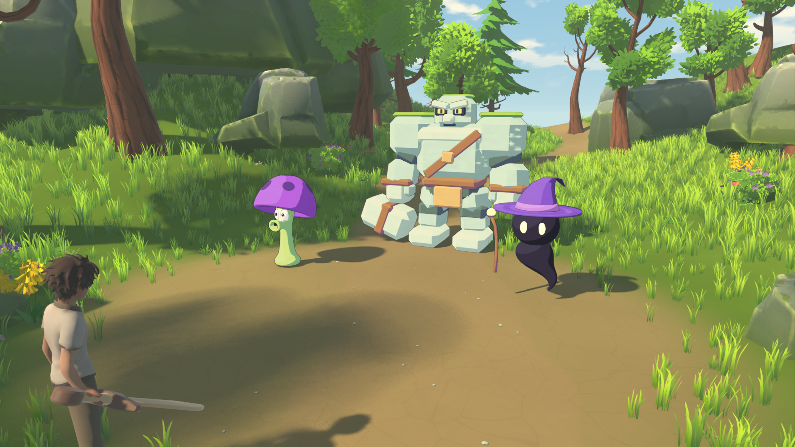

# 胆小菇与小法师 3D 样件

日期：2026-10-21。按用户要求，蘑菇交给混元图生 3D，小法师通过 Blender MCP 直接建模，两个样件都放入既有森林美术样板。

后续上色修订：用户明确希望采用明亮的动漫三渲二风格。森林样板中，蘑菇、小法师与石人已接入[统一上色材质](../Assets/Materials/EnemyAnime/README.md)，包含清楚的明暗色块、有色阴影、轻微涂绘变化和细描边；模型外形及骨骼未改。按 F12 可与原材质对比。

蘑菇增加由现有静态网格生成的固定 UV 区域遮罩，清理菌盖内侧串绿、眼白杂色及菌柄底部浅色碎斑。配色不再随缩地变形重新判断位置；原 GLB 不变。当前涂绘变化仍由程序生成，尚未绘制人工笔触贴图。

| 样件 | 方式与消耗 | 最终三角面 | 骨骼 | 动作 |
|---|---|---:|---:|---|
| 胆小菇形 E10 | 混元 3.0 LowPoly，单次 25 积分；Blender 整理 | 9,594 | 4 | 待机、缩地、出土、射击 |
| 黑圆头 E13 | Blender MCP 建模，0 生成积分 | 4,584 | 7 | 漂浮待机、悬浮法杖施法 |

混元原件保存在 `ArtSource/Generated/scaredy-shroom-v1/`，任务号 `1504328840385544192`，下载文件有 SHA-256 记录。参考图的菌盖斑点未完整生成，因此用少量贴合表面的圆形网格补回；4K 贴图保留原件，运行时使用 2K 副本。小法师采用无贴图的简单材质，法杖可独立维护。按用户后续圈图要求，已去掉手掌与短臂，法杖悬浮在身旁。非人形动作均为自制，不套人形 Mixamo 骨骼。

## 查看

运行 `ArtSource/Tools/Start-NatureArtLab.cmd`，或在 Godot 中运行 `Scenes/Debug/NatureArtLab.tscn`。

- 蘑菇在石人左前方，小法师在右前方；进入时保留原有玩家镜头。
- **F10**：依次切换双模型、蘑菇、小法师、玩家跟随镜头。
- **F11**：演示蘑菇缩地／出土，以及小法师悬浮法杖施法。
- **F12**：动漫三渲二上色／原材质对比。
- 原有石人的 F7／F8／F9 展示功能继续可用。

## 文件与维护

- 蘑菇外观场景：`Scenes/Enemies/Art/ScaredyShroomVisual.tscn`；[模型说明](../Assets/Enemies/ScaredyShroom/README.md)。
- 小法师外观场景：`Scenes/Enemies/Art/GhostMageVisual.tscn`；[模型说明](../Assets/Enemies/GhostMage/README.md)。
- `.blend` 源工程、建模脚本与生成记录放在 ArtSource；Godot 使用 Assets 下的 GLB。
- 两个 GLB 的 `.import` 保留 `animation/fps=60`；修改导出后运行 `ArtSource/Tools/Sync-EnemyModelPreviews.ps1`，通过现有 Godot MCP 扫描和重新导入。
- `Scripts/Testing/EnemyVisualPreview.gd` 负责样件动作；`EnemyModelShowcase.gd` 仅负责森林样板的镜头、地面摆放和演示。

本轮交付模型与演示动作，尚未替换正式 E10／E13 的 Unit 场景、伤害事件或 AI。现有敌人逻辑和生成表保持原配置；后续正式接入需将射击／施法与实际攻击事件对齐。

## 验证

真实 Godot 图形运行已验证两个模型可加载、4／7 骨正确、所需动作齐全。缩地动画在 0.60 秒时根骨下降约 1.17 米，法杖施法枢轴相对待机转动约 0.294 弧度。截图运行退出码为 0、标准错误为空，五份玩家存档逐次核对未变化。

最终上色复核更新了合照、同机位原材质对照、蘑菇近景、小法师近景和蘑菇缩地截图；23 个表面使用动漫材质，完整动作演示后返回待机。`enemy_models_mage-cast.png` 仍是上色前的旧施法截图，不作为本版材质证据。

自动记录：`docs/screenshots/enemy_models_validation.json`。截图脚本为 `ArtSource/Tools/Capture-EnemyModels.ps1`，持独占验证锁，仅管理自己启动的进程。
