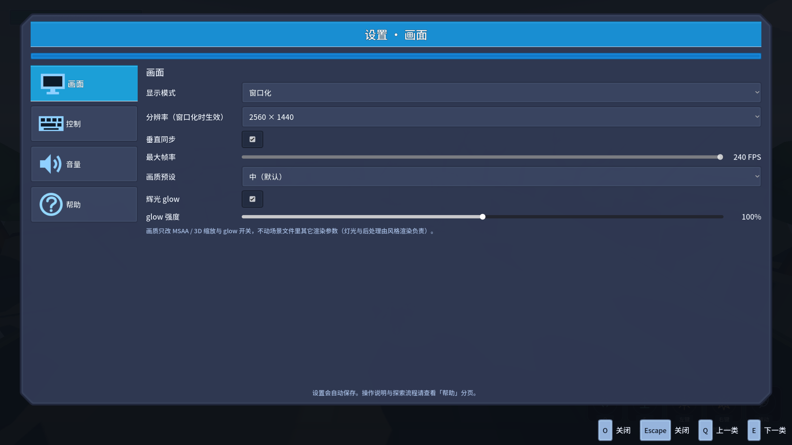
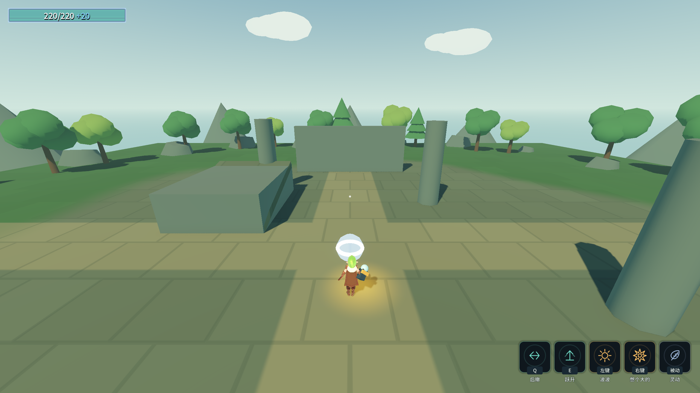

# F专项：字体、导航与退出稳定性

## 改动与边界

- 自带Noto Sans SC及OFL原文，UI/Label3D共用500字重，关闭系统字体回退。1104个项目中文字符全部有字形；来源和二进制哈希见Assets/Fonts/NotoSansSC/SOURCE.md。
- Godot 4.7.2本机实测：FontVariation的字符串`wght`键未进入原生坐标；使用整数OpenType tag `2003265652`，TextServer读回500，不能只看资源文本认定字重正确。
- 破甲环圆周32段/截面8段，保持原0.42秒寿命和战斗行为。
- 导航采集从组内根节点改为递归子节点，只采World静态碰撞；单元尺寸遵从地图，显式量化Recast代理尺寸。删除原空导航区域，烘焙计时器成对解绑，重建只销毁自己创建的区域。
- 统一GameExit入口：先停止并卸载全部音频流，阻止退出期间重播，异步等待0.08秒后退出。窗口关闭、C#自测和GDScript A探针均走此入口；不阻塞主线程，暂停/慢时间也可退出。

## 验收

复现：`& './_tools/verify_followup_f.ps1'`。脚本独占验证锁，独立进程，任何ERROR/WARNING均失败；不豁免原Ogg资源告警。完整结果以[原始证据](followup-f-evidence.log)为准。

- F渲染探针33通过/0失败：73个导航多边形，32次刷怪落点有效且分散，墙体绕行9个路径点，重烘73→73且只保留一个区域。
- 12次基地/关卡卸载并强制GC，其中3次在延时烘焙前卸载；未出现旧GCHandle异常。
- 完整Main自测、A/B/C/D/E回归、跨进程读档、5次真实播音乐后退出，以及Debug/ExportRelease双构建由同一脚本检查。
- 最终全部退出码0，stderr无ERROR/WARNING；Debug/ExportRelease均0警告/0错误，A23/0、B74/0、C52/0、读档5/0、D90/0、E39/0。D无头模式跳过4张截图检查，因此为90项，原D渲染验收94项。
- 八条硬指标逐字对照E批证据，存档精确恢复，结束时selftest.flag不存在。

## 保留的问题

⚠️ 旧GCHandle终结器错误根因仍未定位。压力测试未复现不能等同于修复；原文仍保留于c-batch-intermediate-issue.log。
强杀进程、引擎CLI强制退出和外部工具直接SceneTree.Quit可绕过有序回收，不作为正常退出入口。
本批不调整角色基础数值；Loot/Battle接线与长枪问题由G专项处理，平衡实测由H处理。
