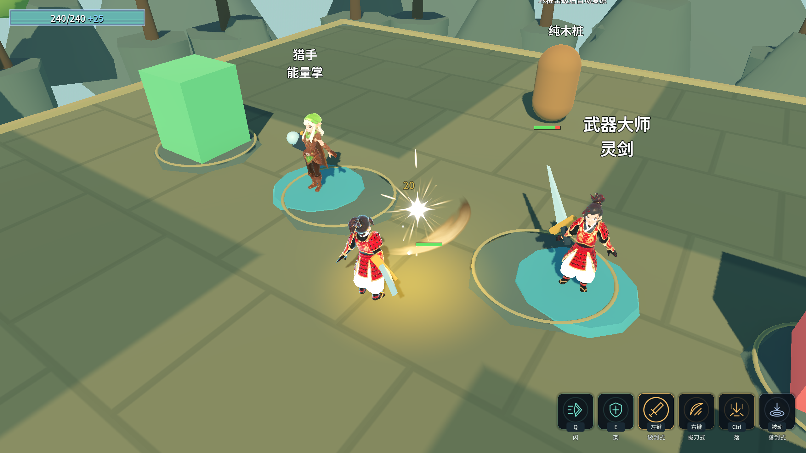
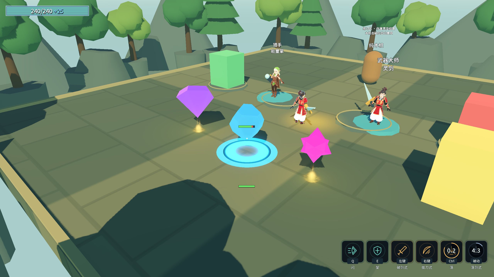
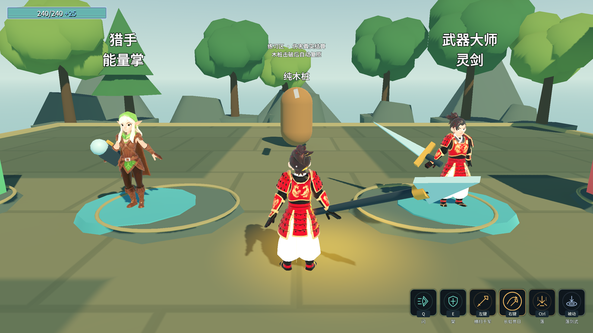

# G专项：生产特效与蓄力机制

## 机制修复

长枪原先按下即Launch，松手回调为空，蓄力只改数字未改抛掷。现在HoldToCharge先等待基础蓄力，提前松手取消；合格松手时才读取倍率并抛出。非蓄力镰刀保持原入口。
近距离自动收回须先离开手边范围，避免刚起手就误收回；长枪实际距离上限随本次蓄力倍率变化。
未改技能、角色或武器表数值。

| 档位 | 水平距离 | 水平速度 | 伤害倍率 |
|---|---:|---:|---:|
| 基础 | 12 | 15 | 1 |
| 3档 | 20.736 | 25.92 | 1.728 |
| 4档（现有表上限） | 24.8832 | 31.104 | 2.0736 |

真实输入覆盖未满不飞/取消、松手才飞、再次按键收回、四档真实飞行超过20米、自动收回、换装取消、武器门清理。
旧Main落剑式探针改为在起手前记录次数，避免真实物理帧已落地后又取新基线；另以真实离地/落地验证伤害、CD内不重触发、CD后再次触发。

## 特效契约

- `MeleeSwingFx.tscn`挂在三把近战武技1下，只消费MeleeComboAbility.StrikeCount。计数在真实ATK开启命中体时递增，不影响伤害、动画或CD。
- Battle实例挂CurrentScene，动画完成信号自毁；先准备私有材质，再进树播放，避免AnimationPlayer缓存旧材质后剑弧停在0。
- `RewardBeaconFx.tscn`只给当前价值层≥2且可用的奖励生成Loot表现。价值色沿用RewardNode的标签表查询；高价值旧Aura让位，中低价值沿用原提示。
- 消耗/禁用/隐藏同步隐藏并停止粒子，节点卸载清理。特效子树无Unit、CollisionObject或分组。
- 两种特效均通过导出PackedScene替换，不新增autoload，不修改ConfigIndex；CC0来源沿用art-refresh-sources.md。

## 验收入口

`& './_tools/verify_followup_g.ps1'`。最终结果见[原始证据](followup-g-evidence.log)，含双构建、完整自测、8条指标、A/B/C/D/E回归、音乐退出与存档检查。

最终：G渲染53通过/0失败，Debug/ExportRelease均0警告/0错误；Main完整自测退出0，8条指标逐字一致。
A23/0、B74/0、C52/0、读档5/0、D无头90/0、E39/0；5次播放音乐退出无泄漏/ERROR/WARNING；存档恢复，selftest.flag不存在。
旧P4两项原始日志均为✅，落剑式计数0→1；长枪三档实测25.92速度、20.736距离，表内上限4档。

⚠️ 当前资源仍是阶段性表现，不代表终版美术。H专项继续保留角色数值做固定木桩与承伤实测，不能把此表直接当成整体强度排名。
