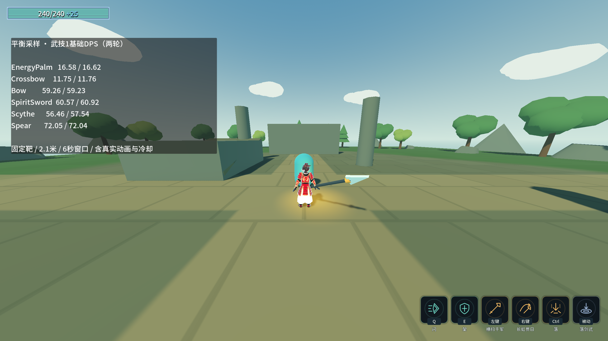

# H专项：保留数值的平衡采样

用户选择：**保留现值，先做平衡实测与建议**。本专项没有修改角色、武器、技能或增幅表。

## 方法

- 首轮真实连点采样暴露机制缺陷，未作为平衡结果交付；失败原文见[h-balance-intermediate.log](h-balance-intermediate.log)。TryPress提前开窗会跳过ATK，灵剑/镰刀出现0伤害。
- 本批同时修复连招：仅ATK开窗，提前按键缓冲，本段完整判定后才推进；每段只认一次ATK，动画Combo收招标记不截断表内窗口。等待事件超时使用每段计时，避免循环长枪把累计施法时间当成本段超时。
- 使用正式Player.tscn、PlayerLoadout、PlayerAbilityInput、当前角色动画与实际碰撞/投射物；不调用DebugFireAnimEvent，也不手推Ability物理帧。
- 同一位置、朝向与2.1米距离，对1.8米高/0.5米半径、无甲无盾、免击退的固定胶囊靶。当前元进度及其伤害/移速/暴击加成原样记录。
- 六种武技1各采样两次，每次约6秒。普通武技以按下0.04秒/松开0.08秒重复输入；蓄力弓在表内最大蓄力后松手，再等真实冷却恢复。动画、连招、前后摇和CD全部按正式流程运行。
- 每次记录实际窗口秒数、命中数、暴击数、命中攻击的BaseDamage总和、靶子实际掉血。基础DPS排除本次随机暴击倍数，仍只统计真正命中的弹体/判定；实际DPS包含本次暴击。
- 窗口终点立即取生命快照并停止计数；之后取消能力/清CD、等待残余弹体离开。不能把窗口外伤害补算进6秒结果。
- 承伤以两角色表内生命/护甲/减伤为源，调用生产Unit.ReceiveHit；分别测试无元进度与当前生命加成，每次固定10/20/40伤害、无暴击，直到死亡。

## 数据与边界

输出：[12份输出样本](balance-samples.csv)、[12份承伤样本](balance-defense.csv)、[完整验收证据](followup-h-evidence.log)。数值解读见[平衡建议](balance-review.md)。

H渲染采样49项通过/0失败，包含ATK前连点不跳段、所有近战段数真实命中、实际扣血与伤害事件一致及两种生命基准的承伤。

最终验收：Debug/ExportRelease均0警告/0错误；完整Main自测退出0、8条硬指标逐字一致。
G无头50/0、角色原生动画无头63/0、D无头90/0、C52/0、B74/0、A23/0、E39/0、新进程读档5/0，所有退出码0且stderr无ERROR/WARNING。
各渲染探针的截图检查在无头回归中跳过，因此计数与原渲染验收不同；H本批自身已实拍。
用户meta/能力卡/设置/装备存档保持，B的GM测试按原始字节恢复meta；C独立测试文件恢复原状，selftest.flag不存在。

这是固定靶的初始采样，不是六武器的综合强度排名。它不覆盖群怪、移动目标、远程安全距离、增幅成型、技能2并用、闪/架/跃升的防御收益或整局存活率。
短弩散射弹是否全部命中取决于距离和靶宽；蓄力弓与非蓄力武器的操作节奏也不同，不能直接用一次短窗口决定削弱或加强。

复现：`& './_tools/verify_followup_h.ps1'`。双构建、Main完整自测、8条指标、存档和selftest.flag由脚本检查。
因修复了连招机制，本批重新运行A/B/C/D/E、G特效/蓄力与角色原生动画回归，不能只引用G批旧结果。

