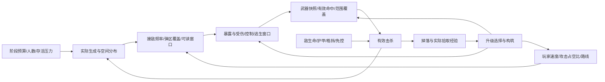

# 046 敌群差异化：可行性与战斗、成长模型

2026-10-28首次评估基线。**后续用户已选择B1，P1仅同步护甲说明，P2仅执行本报告最后风险表的文档与评估口径；其他候选不实施。用户另决定移除全部十二项死战专属构筑，包含契约。** 当前实施和验证见[实施记录](balance-046-implementation.md)。

以下保留首次评估时的现状、模型及候选，历史构筑模型不代表仍可获取，原“待选择/未修改/无引擎实测”描述仅对应首次评估阶段。原始输出数据不覆盖，后续证据单独保存。

## 判断

046可行，建议把目标定为“玩家能辨认高速追压、标准接敌、重型蓄势、远程驻位及跨距突袭，并据此决定先打谁”。**不能承诺只改移速，就能在直线、绕圈、狭道和停手攻击中始终保持几堆分离。** 当前已经有0～6.5米/秒的基础差速，且通过真实移动意图链消费；现在缺的是这些差异在实际攻击、避让和地形中的效果数据。

建议选择**B的最小子集：先保留现有速度档，以单个远程原型的既有驻位参数作对照**。先验证“前排追压、后排火力”的空间分层，再按实测决定是否调整标准近战。A作为低成本备选，C暂不进入实施。这里的推荐不是修改授权。

“后期成长后可以收割、进入低压”“飞刀贴脸吃满属于极端情景，不据此削弱”，均是本评估的目标约束。不会用敌速追平行军成型玩家，也不恢复旧评审中未获采纳的削弱建议。

## 证据边界与来源

| 标记 | 本轮有什么 | 不能据此声称什么 |
|---|---|---|
| 已核查 | 现行资源、执行源码、验收表C55/D55；880份来源文件SHA256 | 没有新一轮引擎实例采样，不能称实际轨迹已验收 |
| 解析推算 | 相对速度、接近时间、攻击占空比、固定伤害破甲、阶段供给 | 不是实际命中率、DPS、升级时间或胜率 |
| 反例模拟 | 60/120Hz点质量追逐，无地形/RVO/攻击循环 | 不是Godot模拟，不给重叠、压力、帧时的实测结论 |
| 历史实测 | 10月27日100敌短时渲染与避让对照 | 不是本轮实测，也不是完整12分钟性能通过 |
| 待测 | 玩家拉怪轨迹、实际停顿占比、分层持续时间、反应和逃生窗口 | 以下验收阈值均为候选，不冒充测得的结果 |

验收源为[原工作簿](../../../outputs/acceptance-20261026/更新与修复验收.xlsx)“验收清单”C55：差速后不全扎一堆；D55：先分析可行性再执行。脚本只读ZIP/XML，原文和SHA256见[summary.json](../../../outputs/balance-046-20261028/summary.json)。

可复算材料位于[专属输出目录](../../../outputs/balance-046-20261028/README.md)。[source-snapshot.json](../../../outputs/balance-046-20261028/source-snapshot.json)保存显式字段与行号；[source-manifest.json](../../../outputs/balance-046-20261028/source-manifest.json)保存内容指纹。它们是评估快照，不是第二份生产配置。脚本未把未填写字段当作零，本文使用的代码默认值另有来源说明。

规则优先级：[人类已确认调整](../../balance-adjustments-20261027.md)覆盖[旧评审](../../balance-review-20261027.md)未采纳建议；039～045以[最新交付说明](../../content-update-039-045-20261028.md)和当前源码为准。旧数值清单与旧DPS样本只用于追溯，不直接充作现值。

## 当前速度与实际执行链

单位约定：世界长度按米解释，速度m/s，时间s，倍率无量纲；生命、护甲、护盾和伤害为各自计量点数，不能与速度直接相加。

| 压力角色 | 原型 | 基础m/s | 普通精英的自主走速m/s | 影响分层的现有机制 |
|---|---|---:|---:|---|
| 高速追压 | 快速近战 | 6.5 | 5.85 | 近身出手停步；攻击后后排会追上 |
| 一次性逼退 | 自爆 | 5.5 | 4.95 | 起爆预警与自毁；不能当持续追击单位 |
| 位移近战 | 持刀 | 4.8 | 4.32 | 回旋段7m/s、0.4s，名义位移上界2.8m |
| 标准近战 | 基础近战、连招 | 4.2 | 3.78 | 连招另有3段5.5m/s、每段0.22s，合计名义3.63m |
| 跨距近战 | 跳跃、俯冲、追踪冲锋 | 3.6 | 3.24 | 俯冲27m/s为三维速度；追踪冲锋19.5m/s |
| 远程驻位 | 远程投掷 | 3.5 | 3.15 | 偏好8m，近身近战＋后跳 |
| 远程/换位 | 普通远程、投掷抛弹、地鼠猎手 | 3.4 | 3.06 | 驻位/撤退/遁地；不应按同一走速认定同压力 |
| 冲锋/弹区 | 直线冲锋、矛盾冲锋、前射抛弹 | 3.2 | 2.88 | 冲锋覆盖基础意图；抛弹依弹道与爆炸 |
| 远程控制 | 法师、尖啸 | 3.0 | 2.70 | 蓄力或驻位，伤害覆盖不随身体走速等比变化 |
| 专用护卫 | 技能精英 | 2.9 | 见下述例外 | 不是随机精英原型，不能重复套精英组件 |
| 慢速重型 | 守卫 | 2.6 | 2.34 | 自带60甲、正面格挡 |
| 慢速重型 | 重击 | 2.3 | 2.07 | 近身1秒前摇、半径3m砸地、0.5s恢复 |
| 定点换位 | 胆小菇（1339） | 0 | 0 | 遁地换位，不靠走路接近 |

来源：[敌人表](../../../Config/Tables/Enemies/)、[精英基础](../../../Scripts/Combat/EliteModifier.cs)、[动作计划](../../../Config/EnemyPlans/)。精英列是“另加普通随机EliteModifier”的比较值，不含特性/状态/避让；技能精英自身已有组件和独立护甲，不使用此列机械再乘。当前21个非全局原型，其中包括专用护卫和新增胆小菇；旧敌人文档的20种计数已落后。完整逐种数值见[enemy-speeds.csv](../../../outputs/balance-046-20261028/enemy-speeds.csv)。

生效链已追到实际速度出口：

1. `EnemyConfig : UnitConfig` → `ApplyTo` → `Unit.ApplyBaseStats`，写`Unit.MoveSpeed`。[表应用](../../../Scripts/Config/UnitConfig.cs)
2. 生成后`ConfigIndex.ScaleEnemy`把全局速度倍率作为`Stats.MoveSpeedMultiplier`的乘算修正；现值1.0。[全局行](../../../Config/Tables/Enemies/enemy_global.tres)、[应用](../../../Scripts/Config/ConfigIndex.cs)
3. 普通精英另乘0.9；迅捷×1.25，强横×0.85。快速普通精英是5.85，迅捷精英7.3125，强横精英4.9725m/s。每只最多一个特性，不能把迅捷与强横同时乘到同一只上。猎令普通目标还可临时×1.2。
4. `ChaseBehavior`以`MoveSpeed×SpeedScale`调用`UnitNavigation.MoveTo`；后者把路径方向和speed传给`Movement.SetIntent`。`KeepDistanceBehavior`通过`KeepRange`取得合法点，不直接瞬移身体。
5. `CharacterMovement`普通分支：`desiredSpeed=intentSpeed×Stats.MoveSpeedMultiplier×ActionMovementSpeedScale`；加速度、RVO后写水平速度并`MoveAndSlide`。[执行出口](../../../Scripts/Combat/CharacterMovement.cs)
6. 地面动作锁、硬控、命中停顿、技能速度覆盖、冲刺和外力有独立分支；技能位移不自动乘基础走速。浮空维持主动速度固定为角色基础×0.5，不吃奔跑/成长。[039～045](../../content-update-039-045-20261028.md)

`StatSheet`运算是`((最后一个Override或Base)+ΣAdd)×ΠMultiply`，最后取最严格Cap；快速每级+0.08是加百分点，行军×1.75再乘。不能把快速三级算成1.08³，也不能把行军写成+0.75与快速共加。[属性表](../../../Scripts/Combat/StatSheet.cs)

## 为什么已有差速仍可能聚堆

**共同目标与有限终点。** 快慢单位都追同一玩家；一旦玩家停手或被地形拦住，速度只决定先后到达，所有近战最终都能进入同一个接敌环。`Chase.StopDistance`也不是一定停在该数值：实际近战不在射程内时仍继续接近。

**绕圈会切弦。** 玩家沿圆周走，追击者朝当前目标位置走，可以走内圈。相同基础速度不能理解成相同路程；开阔直线拉开的长队不代表绕柱或绕圈也能保留。慢速怪可能在圆内形成更紧凑的后群。

**攻击会重排队列。** `EnemyBrain`发现能力`IsBusy`就暂停新决策；攻击行为先停移动，再起手。领先的快怪前摇/收招期间，标准怪追上。重复站定还会成为RVO高优先级对象，让其他敌人绕它走。实际平均推进应测`有效行走占比×沿目标方向速度＋技能净位移/观察时间`，不能用基础速度代替。

**RVO是局部避让，不是战术分组。** 当前Mode=2、半径为实际身体×1.4，NeighborDistance=6、MaxNeighbors=10、TimeHorizon=0.65。它不分配队形或不同追击目标；狭道、转角、停步者、1.35倍精英体型都会收缩通行空间。不能把“无深度穿叠”解释为“视觉上几堆”。[配置](../../../Config/EnemyCrowd.tres)、[实现](../../../Scripts/AI/UnitNavigation.Avoidance.cs)

**跨距能力打破速度次序。** 追踪冲锋16m即能起手，位移19.5m/s且路径上限还有动作默认约束；持刀4m可发动2.8m突进；地鼠/胆小菇遁地换位。它们可能从慢队进入前排。保留这种有预警的突袭比强行按基础速度排队更有动作价值。

**生成与玩家选择也在重排。** 死战在玩家周围15～25m找合法点，并非永远从背后补怪。玩家回头、捡经验、守8秒信标、近战集火或后撤，均会改变队距。目标应检查压力与转火决策，而非把一张整齐队形截图作为通过依据。

## 相对速度、接近时间与行为阈值

直线同向、无技能/停顿/加速度的稳态模型：

`d(t)=d0+(vp-ve)t`；`Tcontact=(d0-r)/(ve-vp)`仅当`ve>vp`，否则从后方不会追上。

以下统一`d0=15m、r=2m`只比较走速，**不是**各敌人的真实射程或完整首次受伤时间。真实攻击还需前摇、执行、弹道、朝向、碰撞与玩家躲避。

| 角色A稳态 | 玩家m/s | 快速6.5接近s | 标准4.2接近s | 重击2.3接近s |
|---|---:|---:|---:|---:|
| 裸装走路 | 6.5 | 不追上 | 不追上 | 不追上 |
| 裸装奔跑 | 9.75 | 不追上 | 不追上 | 不追上 |
| 攻击/蓄力 | 2.275 | 3.077 | 6.753 | 520 |
| 行军攻击 | 3.98125 | 5.161 | 59.429 | 不追上 |
| 行军＋快速3级攻击 | 4.93675 | 8.316 | 不追上 | 不追上 |
| 行军＋快速5级攻击 | 5.57375 | 14.035 | 不追上 | 不追上 |

角色B裸装走路6.8、奔跑10.2m/s；普通地面Attack策略无移动攻击被动时主动输入锁定为0，技能自身位移与空中规则另算。不能把A的0.35移速套给B。A/B浮空维持分别3.25/3.4m/s，行军不放大。

玩家A攻击时间占比为q，其他时间走路，近似`vp平均=6.5×(1-0.65q)`。标准4.2从后方持续逼近需要`q>54.44%`；持刀4.8为40.24%，自爆5.5为23.67%，重击2.3为99.41%。如果其他时间在奔跑，标准怪阈值升到74.25%。这只说明节奏对压力的敏感性，交替走停的真实接近须积分，平均值不能给短时安全承诺。

**候选A的断点：** 基础近战4.2→3.8会使“裸装快—标准”速度差2.3→2.7（+17.4%），却使“标准—重击”差1.9→1.5（-21.1%）。行军攻击速度3.98125夹在两者之间：4.2尚有极慢追近，3.8完全失去后方持续追近。这是影响玩家行为的机制断点，不只是小改9.5%。因此不建议未测就执行。

可复算：[玩家速度](../../../outputs/balance-046-20261028/player-speeds.csv)、[普通/精英/迅捷精英接近时间](../../../outputs/balance-046-20261028/approach-times.csv)。慢重型的520秒不是实际战斗预测，它恰好说明必须依靠生成角度、攻击范围与玩家回头取得接敌机会。

### 速度并非充分条件的数值反例

点质量模型中，三名敌人同从玩家身后15m出发，统一2m停止，快/标准/重型速度6.5/4.2/2.3，无RVO/攻击/地形。观察30秒：

| 玩家轨迹 | 快—标准中心距m | 标准—重型中心距m | 含义 |
|---|---:|---:|---|
| 直走6.5m/s | 69.000 | 57.000 | 长队可被拉得很长，可能让重型退出交战 |
| 半径8m绕圈、速度6.5 | 4.597 | 2.560 | 绕圈切弦显著压缩分层 |
| 原地停留 | 0 | 0 | 全部终点相同，速度不能保留队距 |
| 直线移动攻击2.275 | 0 | 12.250 | 快/标准都到接敌环，两个前层合并 |

将标准改成3.8，绕圈标准—重型中心距还会降到约1.970m。原地重叠来自模型特意忽略避让，**不是生产重叠缺陷证据**。双步长输出用于观察离散误差，真实场景仍需下述引擎测试。[反例数据](../../../outputs/balance-046-20261028/pursuit-surrogate.csv)

## A/B/C路线与推荐参数

| 路线 | 范围 | 可获得什么 | 主要代价 | 结论 |
|---|---|---|---|---|
| A 只校准已有速度档 | 敌种MoveSpeed，单资源对照 | 开阔连续追逐的到达顺序更明显 | 停手/绕圈/狭道仍聚；改变行军阈值、经验可达性 | 便宜，但不足以保证046目标 |
| B 速度档＋既有驻位/停顿/绕行参数 | 敌种行、场景其实KeepDistance、既有动作Plan；不改共用移动规则 | 前排追击、远程驻位、重型蓄势、跨距突袭共同分层 | 远程退位增加找目标成本；停顿改动可能增加/减少攻击密度 | **推荐分小步验证，第一步不改速度** |
| C 新队列/分组逻辑 | 新增分组、目标点分配、组内槽位、重排/脱困/死亡/暂停处理 | 可主动维持局部队形或分配进攻角度 | 与RVO、导航净空、技能覆盖、精英体型/瞬移冲突；可能僵硬轮流进攻或多向围死 | 本轮不值得新增系统，须另行选定玩法后设计 |

以下都是**未执行候选**；一次只开一组主因，不能把整表直接批量落地。

| 优先级/组别 | 参数与来源 | 实际原值 | 候选 | 原因与预期 | 决断点 |
|---|---|---:|---:|---|---|
| P0 基线 | 全部现有速度、RVO/AI频率 | 见前表；Mode=2 | 保持 | 先知道分层被哪一段吞掉；保留既定性能方案 | 测试协议可继续细化，不据此改数值 |
| P1 B1（首选） | MeteorMage场景KeepDistance.PreferredDistance/Tolerance | 8 / 0.4m | 11 / 1.0m | 让落弹法师与8m投掷层、近战层区别；10～12m舒适带仍在16m技能触发内 | 玩家接受更靠后的法师；须比较追杀和远程覆盖 |
| P2 B2（独立对照） | ArcThrower场景KeepDistance.Strafe/StrafeScale | 未填，代码默认false/0.6 | true / 0.6 | 冷却走位阶段沿合法点缓绕；不在攻击时继续走，不新增绕后逻辑 | 玩家是否希望投掷兵更常横移；可能更难瞄准 |
| P2 A1（独立对照） | enemy_chaser.MoveSpeed | 4.2m/s | 3.8m/s | 与快怪拉开；不连带改连招4.2或自爆5.5 | 行军阈值、标准—重型更近的代价需玩家接受 |
| P2 B3（暂不叠加） | heavy_slammer.s0.RecoverSeconds | 0.5s | 0.65s | 增加砸地后转火/逃生窗口，代价是重型更易脱队 | 仅当实测收招窗口不足；不缩1秒前摇 |
| 保留 | 快速6.5、持刀4.8、重击2.3、守卫2.6；精英速度×0.9 | 现值 | 不改 | 已有角色差异；避免所有敌人被推向同一速度档 | 不为追上成型玩家全局提速 |
| 保留 | RVO半径1.4、邻居10、时间窗0.65；身体Mode=2 | 现值 | 不改 | 队形问题先不与避让、性能主因混改 | 不降AI频率，不恢复敌敌硬碰撞，不设50生产上限 |

B1只改一个原型的两项既有字段，工程范围是场景资源；B2也是既有导出字段。B3是现有动作恢复值。A/B都不需要新生产配置源，也不触碰预警/判定共用、跳跃避地板、输入Q、槽位唯一或共用受力规则。若这些参数不足，先报告失败场景，再讨论C，不暗中扩展工程范围。

## 战斗与成长模型

### 输出：按命中、出手与触发来源分别计量

`B=该动作基础伤害×蓄力/连招段系数×出手时DamageMultiplier`。`RollHit`大体为`B×暴击倍率×命中时目标增伤乘区＋固定附伤`，再进入目标防御。暴击期望因子为`1+p(c-1)`，裸装5%/2倍为1.05；巨人是命中时读取**玩家**最大生命×0.08，在暴击外加算，不是敌人生命百分比，也不能把已含攻击倍率的BaseDamage再乘一次。[攻击快照](../../../Scripts/Combat/AttackInstance.cs)、[巨人](../../../Scripts/Rewards/RuneRules.cs)

实战有效输出宜写为`Σ(各类实际有效命中频率×每击期望伤害×有效覆盖目标数)`；持续区域按每目标实际命中间隔算，爆发另给固定1/3/5秒窗口。攻击速度、CD、动画事件、蓄力、连招输入、击中停顿和弹道均影响频率，不能拿武器行0.5秒间隔直接算六武器DPS。六武器当前`UsesWeaponComponent=false`、Damage=0是旧枪械组件停用；真实攻击从技能和近战命中盒读取，绝非零伤害。

可控构筑样本：起步无成长；中期力量3级＋生命3级（伤害×1.45、生命+60）；成型力量6级＋生命6级＋**巨人携带**（×1.9、生命+120）。A/B生命分别200/220起步。它们是敏感性样本，不断言玩家某分钟必拿到这些条目。行军与巨人作为各自配装对照，不能假定同一符文槽同时携带。

| 武器/攻击样本 | 当前基础与方式 | 起步期望每命中 | 中期 | 成型巨人 | 应同时评估的成本/收益 |
|---|---|---:|---:|---:|---|
| 能量掌左键 | 10，单波 | 10.50 | 15.225 | 45.55 | 飞行/瞄准、移动攻击减速、穿挡价值 |
| 飞刀左键单把 | 12，实际3把散射 | 12.60 | 18.27 | 49.54 | 单目标中几把、清群覆盖、距离；贴脸3把全中不作为削弱理由 |
| 弓左键满蓄 | 24×1.9，1.4秒3个后置档加算 | 47.88 | 69.426 | 116.572 | 蓄力暴露、松手时机、命中率；早放/基础蓄力另分样本 |
| 灵剑首段 | 20，后续×1.15/1.3/1.45/1.8 | 21.00 | 30.45 | 67.10 | 连段输入和贴身；右键灵剑追击另计，不套死战灵偶比例 |
| 镰刀首段 | 26，后续×1.2/1.9 | 27.30 | 39.585 | 79.07 | 末段360°群体、投掷留场与回收；不以单靶定价 |
| 长枪首段 | 22，后续×1.1/1.25/1.1 | 23.10 | 33.495 | 71.09 | 前伸/贯穿、四段循环；右键当前为直射长枪（50伤、40m/s、最多2目标、CD10s，无回程）；下落伤害另按真实速度 |

以上为**防御前单次命中期望**，不是DPS/有效扣血。A基础来自当前技能Params，B来自`Player.tscn`命中盒覆盖和`MeleeStrike.tscn`回退；完整计算见[combat-scenarios.csv](../../../outputs/balance-046-20261028/combat-scenarios.csv)。

四条死战路线如何改变频率与行为：

| 路线 | 可复算的触发边界 | 行为与循环 |
|---|---|---|
| 拾荒 | 每20原始敌经验一次0.4B回响，最多存1次；护膜每20原始经验给5%最大生命临时盾，4秒，上限10% | 杀怪→拾取→充能→下一次主武技有效命中；经验倍率/目标奖励经验不加速充能。差速拉太长会降低拾取率 |
| 守阵 | 地面停1秒建5m圈，直接攻击×1.15；圈内每2秒备一次0.35B脉冲 | 原地建阵会使敌群收敛；玩家命中才放脉冲，不是站着自动清怪。余火离圈增伤2秒给腾挪窗口 |
| 协击 | 每出手最多1轮；两次0.35B，至少1.5秒；集束替为1.1B、至少2.2秒、再穿2人 | 触发后还需真实碰撞/目标存活；不能把飞刀3把当3轮，不能把2枚理解为永远每秒+70%总DPS |
| 契约 | 敌经验×1.2；只放大实际生命伤害×1.1；50秒猎令/15秒期限/目标移速×1.2；完成给14经验 | 主动转火高价值目标；清算每次+3%、至15%直接增伤。无合法目标等待，不能当作固定每50秒必得收益 |

衍生身份与防递归已追踪：死战协调器只接受`Damaged`、实际损耗>0、玩家来源、`IsManualWeaponAttack`且非Secondary/DoT；同次多弹共用CastId。死战回响/脉冲/协击用冻结B直接构造HitInstance，走目标防御，**不再RollHit，不再次加暴击、直接攻击增益或巨人**。这不能外推成“项目所有衍生伤害都不吃巨人”：巨人规则自身未筛Secondary，其他创建后调用RollHit的链需逐链记录。[触发](../../../Scripts/Run/Survival/SurvivalBuildRuntime.cs)、[伤害入口](../../../Scripts/Run/Survival/SurvivalAugmentDamage.cs)、[协击](../../../Scripts/Run/Survival/SurvivalEchoRules.cs)

主技能本体可享直接增伤，但不冒充主武技触发灵偶。生命链接在防御前分摊，Transferred不再分摊/生成主命中；召唤有限单批免费，不继承特性，不提供死战经验/猎令/遗物重复收益。以上用于避免模型重复计算，不作为额外削弱清单。

### 生存、护甲与控制：不能只算HP/DPS

普通敌人`H=行HP×1.875×阶段生命系数`；常规精英再×2.5，巨壮等出生特性再参与最终H；额外甲`max(120,0.3H)`再加原型基础甲。玩家/普通加甲/死铠/重铸/基础甲仍按原规则，未统一改比例。

比例护甲是出生/显式回满的来源，不是持续恢复。普通`RefreshStats`或战斗中单独改变最大生命不会补回损甲；重复初始化也不能累加多份精英甲。实际玩家配装还要另乘局外成长、能力卡和其他合法来源，以上空白基准不代表用户真实存档强度。

目标减伤`r=min(0.9,1-(1-rArmor)(1-rExtra))`，有甲时才有rArmor；整击先减伤，再扣**护甲→临时/普通护盾→生命**，破甲余伤不重新放大。粗略无盾耐久`EHP≈H/(1-rExtra)+A/[(1-rExtra)(1-rArmor)]`，跨甲的大单击要用逐击模拟。

| 示例（阶段生命×1，无附加特性） | HP/甲 | 连续近似EHP | 固定防御前100伤的精确击数 |
|---|---:|---:|---:|
| 普通基础近战 | 112.5 / 0 | 112.5 | 2 |
| 普通重击 | 450 / 0 | 450 | 5 |
| 精英重击 | 1125 / 337.5 | 1607.143 | 17 |

阶段.65/1.0/1.3、10/30/100伤与普通/精英对照见[durability.csv](../../../outputs/balance-046-20261028/durability.csv)，守卫按其实际35%护甲减伤，而不是套统一30%。精英不只“血厚”：有甲存续免普通受击硬直，破甲当击按命中前有甲，下一击才可普通打断；无甲普通非DoT有效命中给0.18秒硬直，并按动作可中断窗口终止技能。首领全程霸体免控，不能从普通怪控制覆盖推导首领压制。

控制覆盖应记真实区间并集`U=|∪控制区间|/战斗时间`，不要把0.18×命中数相加超过100%。Freeze单次1秒与10秒触发冷却，不能直接得出永久冻结；Slow×0.55会同时改变追击、射程驻位和玩家逃生阈值。护甲免普通硬直不等于免所有强控，格挡者自身硬直也是独立规则。[反应](../../../Scripts/Combat/CombatReaction.cs)、[防御](../../../Scripts/Combat/Unit.cs)

预警/反应窗口用`W=首次可读危险提示→该次真实伤害可到达玩家`，另记录锁向时刻、玩家能取消/跳跃/闪避的时刻。不能简单用Windup字段当真人可用反应：EnemyPlan等待真实ATK动画事件；迅捷保留前摇，仅加快恢复与冷却。远程需要加入实际弹道飞行，冲锋需要横向离开真实扫掠区域；同屏并发、镜头、遮挡应由玩家录像验证。

例如猎手13.2m/s追踪弹，静止10m直线飞行约0.758秒；胆小菇6.6则1.515秒。投掷抛射1.1666667秒、抛弹1.2833333秒是实际FlightSeconds，不是Speed字段决定的飞行时长。保留前摇与预警同解算。重击1秒名义准备＋0.5秒恢复可作为测试观察点，不据字段直接认定玩家有完整1秒反应。

### 生成、经验与成长：供给不是实际收益

当前死战阶段数据由[模式资源](../../../Config/Modes/twilight_survival.tres)读取，而非复制旧快照的取整时间。

| 起止s | 预算压力/s | 存活人数/压力上限 | HP/伤害阶段倍率 | 精英概率 |
|---|---:|---:|---:|---:|
| 0～72 | 2.0 | 18 / 36 | .65 / .65 | 0 |
| 72～201.6 | 2.6 | 24 / 48 | .75 / .75 | 0 |
| 201.6～360 | 3.1 | 28 / 64 | .85 / .8 | .03 |
| 360～525.6 | 3.8 | 32 / 84 | 1 / .9 | .05 |
| 525.6～648 | 4.7 | 38 / 108 | 1.15 / 1 | .08 |
| 648～720 | 5.5 | 42 / 132 | 1.3 / 1.1 | .10 |

导演生成间隔.45s（名义最多2.22次排队/s）、最多4个待生成、出生预告.75s、周围15～25m；预算bank封顶、存活数/压力、体型净空、精英费用和失败重试都会限制实际投放。死战用阶段EliteChance，不能再乘每个原型EliteChance当双概率；主线使用自己的波次/生成流程，须分模式记录。

纯预算积分2572.56压力，按2经验/压力得到5145.12的**供给参考量**。不是已经杀到/捡到的经验，更不是敌人数。生成失败、未花/封顶预算、召唤无经验、击杀速度、精英附加费用、捡取和目标奖励都要单列。

`XPdot≈实际击杀率×平均击杀经验×实际拾取率×经验倍率＋目标经验率`；升n次累计门槛`14n+7n(n-1)/2`。供给参考的25%/50%/75%/100%若全部化为有效经验且无额外奖励，分别为到18/26/32/37级的数学情景。快速/力量每级固定加百分点、生命每级+20；只有指定成长项显示等级，不把UI单图标认成不可重复获得。

差速可能形成“快怪先死、经验在前；重型远落后→回头拾取/集火更少→成长滞后”的反馈，也可能给弱配装制造安全补输出窗口。因此必须同时看经验拾取和升级间隔。成型后击杀更快、存活压力降低是可接受目标；不设置要求后半局始终高压的验收线。

## 可复现验收协议（待实施）

### 固定条件与安全边界

每个版本固定种子46001/46002/46003，同一版本记录源码/资源SHA256、构筑、模式、地形、初始坐标与每次输入。对照相同种子使用相同初始单位与坐标；路径落点按每种最终体型验证，不合法则该场景作废而非悄悄换点。每轮暖场3秒、测60秒，按活动游戏时间采样，暂停单列；组内顺序轮换，避免冷启动总落在基线上。

运行必须复用[_tools/Validation.Common.ps1](../../../_tools/Validation.Common.ps1)的`Open-ProjectValidationLease`、`New-ValidationMirror`、`Invoke-ValidationEngine`、`Assert-ValidationSaves`，单实例顺序跑；不杀用户编辑器、不操作真实存档。新增夹具只在专属/隔离工程，不通过共享Scripts联接写生产源码。锁不可得则等待或记录未跑，不能绕锁起并行Godot。本轮没有启动这些测试。

### 测试矩阵

| 层次 | 固定内容 | 玩家输入/观测 |
|---|---|---|
| 纯导航平地 | 隔离平地80×60m；30敌：快速/基础近战/重击各10；同半径20m后方扇区等角交错，允许按体型净空调整但固定保存坐标 | 直走20m后折返；半径8m/16m绕圈；只走/奔跑；不攻击。先识别纯速度效果 |
| 攻击与追逐 | 同一30敌和坐标；另加远程/法师混合配方并保存 | A连续攻击、2秒攻击/2秒移动、满蓄弓、B逐段连招及当前直射长枪；记录真实按键与Busy时间，不自动施放主技能 |
| 狭道 | 两片20×20m区域以长12m通道相连；净宽2m/4m；最终体型逐一验证可达 | 从一端穿到另一端再回身；窄处不要求强行分堆，要求可通行、无永久堵塞、出口重建压力层 |
| 绕障 | 平地中6×6m障碍；同侧起步，玩家按固定折线路径绕行；再做玩家绕圈 | 分辨路径切弦、转角卡顿、RVO让位与攻停；不能归咎为配置速度失效 |
| 普通/精英 | 同原型配方，指定部分替为精英；迅捷/强横/侧翼分别单独波次，严格每只最多一个、同波一种 | 相同生命/攻击规则；记录精英体型、实际速度和免控，不能把所有特性混成一轮 |
| 主线 | 正式森林同区同节点/波次种子，初/中/成型对照；六武器各覆盖 | 同波击杀/转火/受伤/拾取，与静态夹具比较；不拿死战阶段倍率套主线 |
| 完整死战 | 正式720秒活动生存＋终局首领直至结束；不缩时、不注入额外经验，不以无敌维持生产压力 | 六武器基线起步；把相同奖励序列作为成对对照；随机奖励跑和锁定构筑跑分开。另各路线代表成型/行军/巨人分组 |
| 性能压力 | 50/100敌独立压力夹具，原生产配置不改；实际4K渲染条件与历史报告一致 | 记录首次攻击冷启动、帧时P50/P95/P99/最大、超过16.67/33.33ms比例、GC、人数和弹体/危险区峰值 |

第一阶段每候选先跑3种子配对筛查；若方向一致再对重点组合跑10种子。完整死战至少覆盖六武器基线各3种子、选中方案同配装成对对照，再补四路线代表构筑；不把这些样本数包装成精确胜率置信。真人试玩重点看是否自然形成转火和逃生决策，自动输入只负责复现条件。

### 指标定义与候选通过线

| 指标 | 计量方法 | 候选判据/解释 |
|---|---|---|
| 压力层队距 | 每.1s取各角色到玩家的水平距离P25/中位/P75，另取群间最近中心距；按同一批次/地形区段对比，附样本数 | 开阔有效追逐段，快—标准中位差≥2m、标准—重型≥2m，持续帧占比≥60%；先测基线再定是否可行，不能用只有1只的空组凑通过 |
| 稳定性 | 每组至少5个活体；死亡后该组不足则停止算队距，单列存活/击杀差异；同初始位置的纯导航与可击杀实验分开 | 不能靠杀掉前排/停止刷新得到“分层变好” |
| 深度穿叠 | 每.2s，中心高度差≤1m且水平距<.8×两实际身体半径和；报告对数、占全部有效对的比例、峰值和持续时间 | 同人数/体型下不劣于基线；不靠取消RVO换队形；模型外轮廓另看录像 |
| 近身压力 | 实际可发动近战/冲锋威胁的时间并集；不可普通打断的近身者另计；报告最长连续段和P95 | 初/中期不因分层变成持续无交战；高压尾部不明显变长。成型低压允许 |
| 远程覆盖 | 每秒威胁源数；实际飞行弹/地板危险在玩家可达邻域的时空覆盖；按锁定/追踪/落点分类 | 后排后移须仍产生可读攻击，不能只变成屏外无互动火力；实测前不给覆盖百分比结论 |
| 逃生窗口 | 以玩家最终身体净空和真实移动/闪避/跳跃规则重放：预警后能到达且在伤害时刻安全的位置；记录最早安全到达时间及窗口 | 提案希望多数高压事件仍有≥.5s可执行腾挪机会；这是待玩家确认的设计目标，不声称所有技能必须硬夹.5s |
| 转火代价 | 当前武器从前排切到目标的转向/移动/首击时间；重型/法师实际参与战斗比例 | B1不能明显增加无意义追跑；候选看P95首击延迟及未交战残留比例 |
| 成长兑现 | 每分钟掉落/拾取经验、未拾经验峰值、升级间隔、力量/快速等级、关键件获得时刻、恢复来源 | 发现经验滞留先解释空间变化，不立即补全局伤害/经验；后期低压不判失败 |
| 帧时 | 活动帧与暂停分别计；实际存活数/压力/弹体/危险区并记；成对种子报告中位变化及最差轮 | 不用平均FPS替代长帧；建议P95/P99不回退>10%，100敌目标仍按原“平均和1%低帧均60”独立验收 |

窄道/原地阶段不要求几堆。先保证无持续3秒以上“有可达路径且允许移动却完全无推进”的新堵塞，再看出通道后5秒内能否恢复角色差异；被动作锁、硬控、目标已近身的停止不算导航堵塞。上述阈值都是待定设计线，未经玩家选择不能写验收表为通过。

历史性能证据：[10月27日报告](../../performance-results-20261027.md)。100敌RVO短时样本约81.1平均FPS、12.8的1%低帧，深度重叠平均0对；这仅说明该场景的局部避让效果，不能证明模型轮廓不挤或长局达标。50仍是条件性回退，不是当前生产上限；本报告不调整AI频率、人数、阴影或碰撞。

## 风险优先级与待决项

| 优先级 | 风险/发现 | 现有证据 | 可执行判断 |
|---|---|---|---|
| P0 | 把差速配置当作046已完成 | 当前差速存在，但无本轮轨迹/压力实测 | 046保持待决；先选A/B/C，再按协议对照 |
| P0 | 提速吞掉攻击预警或越过共用运动规则 | 动作有独立速度覆盖和真实ATK事件 | 候选不全局加速动作/动画；首次伤害/跳跃反制须回归 |
| P1 | A减速跨越行军攻击阈值，且缩小标准—重型差 | 3.98125位于3.8和4.2之间；速度差两向变化 | A不默认落地，优先B1现有驻位对照 |
| P1 | 精英同种也改变次序/控制成本 | 基础精英×.9，迅捷×1.25，额外甲按最终H | 按原型＋精英状态分层记录，不只看敌种名 |
| P1 | 胆小菇/猎手弹速不同 | 当前scaredy_shroom=6.6、burrow_hunter=13.2，且胆小菇射程触发120、走速0 | 明确是有意的不同原型还是新原型未同步；本轮不擅自按旧“地鼠加速”批量修改 |
| P1 | 护甲说明与执行口径冲突 | UnitConfig.MaxShield注释写“护甲之前、不吃甲减伤”；ReceiveHit实际先甲、再盾且整击先减伤 | 所有计算以执行为准；另列说明同步项，不能据注释建立第二套模型 |
| P1 | 差速让经验/远程目标滞留，影响成长 | 死战预算/拾取是闭环，当前无对应长局数据 | 同时记拾取率、首击延迟、残留怪参与率；不以加全局伤害掩盖 |
| P1 | 完整12分钟帧时仍未验证 | 历史报告明确只测短样本，100敌1%低帧目标未达 | 选中方案必须实渲染长局；本轮不宣称性能通过 |
| P2 | 文档与同名回退误导调参 | 老敌人清单仍20种；武器行Damage=0但实际技能有伤害；强类型Action覆盖旧Step值 | 本报告按当前引用/覆盖链；以后同步相关说明和来源，不重跑会覆盖生产资源的制作脚本 |
| P2 | 用单靶/单瞬间定义整个构筑强弱 | 飞刀散射、镰刀群伤、长枪范围、手动输入和防递归不同 | 六武器按距离/单群/持续爆发/暴露分组，不作本轮额外削弱 |

建议玩家讨论的具体选择：**B1先保留全部移速，仅把落弹法师驻位从8±0.4m试为11±1m**，还是先做A1基础近战4.2→3.8的单变量试验。B2横移和B3收招留作独立后续对照；C只有玩家确实要主动队形/分批围攻时才进入方案设计。任何方案均未写入生产或验收表。
