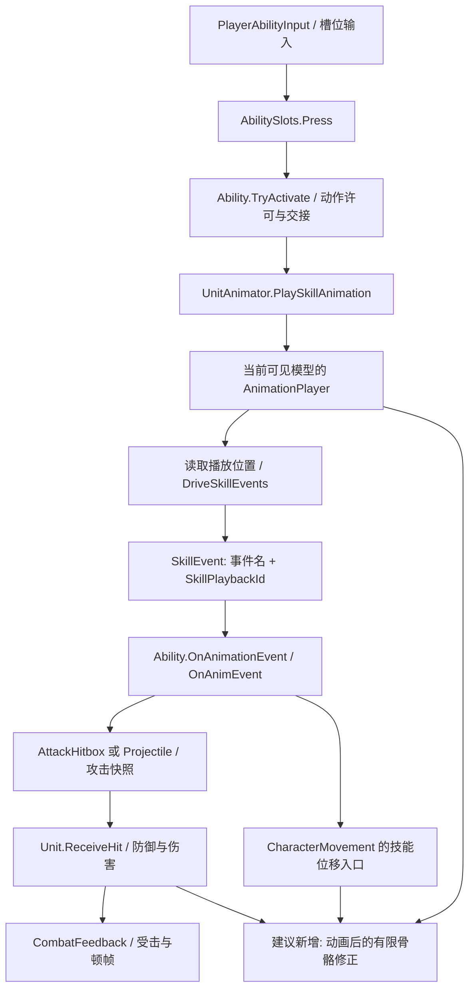

# 程序化动画研究与选型

研究日期、外部资料访问日期：2026-10-30（Asia/Singapore）。工程：`F:\Godot项目\项目a`；设计资料：`F:\Godot项目\3d肉鸽雨中哈迪斯`。

> 同日需求修订：用户明确现有模型／动画基本不能作为参考、未来会替换，希望全程序化并覆盖非人形。以下默认主选型已被[全程序化方案与性能评估](F:/Godot项目/项目a/docs/reviews/20261030/fully-procedural-animation-performance.md)取代；本报告的工程现状与资料调查按研究记录保留，不再以当前动作库作为后续制作前提。

## 1. 选型结论

**推荐继续使用现有关键帧动作和技能事件，在动画求值后叠加受限的程序修正。首阶段不更换动画驱动框架，不引入 IK 插件，不让程序动画接管身体位移或伤害判定。** Godot 4.7.2 已具备本项目首批需要的原生接口；真正的短板是动作资产的针对性、骨架语义配置、武器与判定的一致性，以及更新时序和变换所有权。现有玩家／新敌人行动计划的真实事件链应保留，但旧近战敌人和首领仍有计时攻击路径，不能假定全项目已经统一为事件驱动。

优先顺序：①近战武器轨迹／握持校正；②移动、转向与后撤的躯干惯性；③真实接地后的落地缓冲。三项都先限玩家，分别开关、分别比较。有人形手臂的模型使用双骨 IK；无手的旅童使用悬浮武器锚点修正，两者共用动作事实，不强行共用骨链。普通敌人先保证基础攻击姿态、预警和实际出手一致；精英／首领再按屏幕重要程度增加有限的瞄准、接地和受击修正。

脚部 IK、视线、少量装饰弹性是补充方案。AnimationTree 分层混合和离线重定向有价值，但要在前述小原型确认后单独接入。当前不建议投入全程序步态、全量根运动迁移、自动追目标的攻击扭曲、Motion Matching／神经动画、活体全身物理控制。

这不是“用 IK 自动修好所有动画”的方案。攻击是否有力，仍首先取决于蓄势轮廓、发力时序、触地／挥动姿势和恢复段；程序层主要使这些动作在实际速度、镜头、武器和地形下保持可信。[骨骼修正设计](https://godotengine.org/article/design-of-the-skeleton-modifier-3d/)、[位移与动画的协调分析](https://theorangeduck.com/page/code-vs-data-driven-displacement)支持这种分工。

## 2. 本轮范围与证据等级

- **已核实·工程**：CodeGraph 结构查询；当前脚本、场景、配置和制作说明；8 个新角色／敌人 GLB 的直接读取，以及11个旧场景模型的元数据；两个本地动画 ZIP 的目录、许可和 GLB 元数据；本机引擎版本和 MSBuild 属性；3 张既有截图的人工观察。
- **已核实·外部能力**：Godot 4.7 版本文档、4.7.2-stable 引擎源码、本机 GodotSharp API XML；官方 TPS 和布娃娃示例源码；原作者文章及论文项目页。
- **工程推断**：原生后处理应能不改变现有战斗语义地改善动作；玩家先做比 50 名单位同时做更划算。这些有接口依据，但不等于本项目实机验收。
- **待原型**：各模型关节转动后是否好看；武器贴合误差；自由镜头下的轮廓；混合后的事件同步；暂停、插值和换模时序；实际 CPU／GPU／GC 成本。

本轮只新增本报告和[资产清单](F:/Godot项目/项目a/docs/reviews/20261030/procedural-animation-asset-inventory.json)。没有运行游戏、导入资源、构建项目、修改生产脚本／GLB／骨架／动画／验收 Excel，没有安装插件、改引擎、提交或推送。仅调用引擎 `--version` 和 MSBuild 属性查询；没有占用运行验证锁或访问游戏存档。起始 `git status --short` 有 1964 行，包含大量已有工作，不应把工作区整体状态视作本轮产物。未发现磁盘上的适用 AGENTS.md，按本轮提供的中文和 CodeGraph 规则执行，未委托其他代理。

## 3. 当前工程核实结果

### 3.1 引擎、语言与场景

| 项目 | 本轮结果 | 依据／限制 |
|---|---|---|
| 引擎 | `4.7.2.stable.mono.official.ed1daf0bf` | 对既有 `Godot_v4.7.2-stable_mono_win64_console.exe --version` 的输出；没有启动编辑器 |
| Godot C# SDK | `Godot.NET.Sdk/4.7.2` | [ActRoguelike.csproj](F:/Godot项目/项目a/ActRoguelike.csproj:1) |
| 目标框架／语言 | `net8.0`／C# `12.0` | `dotnet msbuild ... -getProperty:TargetFramework,LangVersion,NETCoreSdkVersion`；当前求值 SDK 为 `10.0.401`，不是把 SDK 10 等同 C# 10 |
| 渲染／物理 | Forward+、Windows D3D12、Jolt、物理插值开启 | [project.godot](F:/Godot项目/项目a/project.godot:1) |
| 正式链路 | Base → Expedition；另有 Survival | [README](F:/Godot项目/项目a/README.md:1)；Main 是回归入口 |
| 玩家 | 正式 A 为旅童，B 为 Samurai | [猎手配置](F:/Godot项目/项目a/Config/Tables/Characters/chr_hunter.tres:1)、[武器大师配置](F:/Godot项目/项目a/Config/Tables/Characters/chr_weapon_master.tres:1)，不能以 Player.tscn 初始 Model 判断实际角色 |

本机 API XML 确认 `TwoBoneIK3D`、`LookAtModifier3D`、`RetargetModifier3D` 以及 `SkeletonModifier3D._ProcessModificationWithDelta(System.Double)` 存在。C# 自定义修正可以覆盖 `_ProcessModificationWithDelta(double delta)`；这是 API 可用性核实，未编译新组件。XML 位于 `F:\Godot项目\Godot_v4.7.2-stable_mono_win64\GodotSharp\Api\Debug\GodotSharp.xml`。

### 3.2 资产与骨架质量

直接解析 GLB JSON 与 BIN，而非只摘录旧文档；完整骨名、动作名／时长、根骨平移范围、文件 SHA-256 见资产清单。下表动作数不包含外置技能库。

| 资产 | 蒙皮关节／内置动作 | 可用基础与明显限制 | 当前使用状态 |
|---|---:|---|---|
| CloverWayfarer | 15／6 | 有双腿、Spine、Chest、Neck、Head；无手臂；有 3 根披风骨。适合躯干、脚部、悬浮焦点；不适合手握 IK | 正式猎手视觉档案；另有 7 段技能适配 |
| Samurai | 24／8 | 有手臂、脚与脚趾；蒙皮根是 Hips；躯干用 Spine02／Spine01／Spine，不能假定有 Chest | 正式武器大师；外置技能 25 段 |
| Lyra | 24／6 | 同类人形命名，但不能由同名推定所有 rest／骨轴一致 | 备用档案；外置技能 25 段 |
| GeneratedPilot | 23／11 | Root、Hips、标准四肢，含 attack、jump_start、land 等 | 制作／展示样例，不是当前正式角色 |
| StoneGolemPlus | 17／5 | 有躯干、四肢、手、脚；没有脚趾。刚性岩块，适合有限倾斜和少量接地校正 | 最新保留的纯岩块美术方向；已有 MotionFx 测试档案，不等于正式刷怪表已换模 |
| StoneSlammer | 23／6 | 持锤、动作触地点已有制作验证 | 2026-10-26 已取消持锤方向，保留历史源／样例，不能按旧确认状态重新投入 |
| ScaredyShroom | 4／4 | Root、Stem、Head、Cap；没有腿。应做姿态、出土／射击和视线，不能套双足 IK | 胆小菇表使用该档案；基础走／跑映射为 idle |
| GhostMage | 7／2 | 身体／头／杖／帽／尾；无双足链 | 已有敌人视觉档案，cast 为源动作，技能事件另接 |

另外审查 `Assets/Models/enemies/` 的10个旧敌人及 `Assets/Models/player/` 的旧角色：每个 GLB 有2个 skin，各引用同一组7个唯一关节，均为32段动作。骨名是 root、leg-left／right、arm-left／right、torso、head，**没有独立肘膝和手脚链**。不能把两个skin累计的14条引用当成14根唯一骨骼，也不能给当前 Chaser／FastMelee／Boss 的这类模型直接添加双骨手脚 IK。它们适合躯干倾斜和头部转向；如果要关节弯曲质量，需替换／重制骨架资产。该组只核实元数据，没有重验权重和变形。

8 个文件的 `WEIGHTS_0` 检查未发现非有限值或权重和偏离 1 超过 0.001 的顶点行。4 个角色的关节静态 scale 未发现非单位值；这些只说明基础数据整齐，**不能证明肘膝弯曲、披风、腋下蒙皮、骨轴、运动穿插合格**，也没有验证所有扩展权重集。Lyra／Samurai 没有独立 Root，后续根运动抽取不能盲用 Root 路径。

现有档案把模型旋转／均匀缩放放在模型变换中，程序目标必须经实际 Skeleton 全局逆变换进入骨架空间，不能把世界坐标直接当骨架坐标。未来更换比例后，骨链长度、膝肘 pole、武器偏移、地面射线距离都要重校；不能只改骨名。

观察的既有截图：[旅童持弓](F:/Godot项目/项目a/Logs/evidence/clover-combat/attack-Bow.png)、[Plus 重砸](F:/Godot项目/项目a/docs/screenshots/stone_golem_plus_impact.png)、[蘑菇](F:/Godot项目/项目a/docs/screenshots/enemy_models_mushroom.png)。可确认无手悬浮、岩块关节、无腿蘑菇的结构差异；单图无法判断转向连续性、滑步和打击速度。截图 HUD 有“只在试装”的旧文案，正式配置与更新后的接入说明优先。

本地 `动画库` 两个 Standard ZIP 都标 CC0 1.0；UAL1、UAL2 的原地版本**各 43 段**，每套各有对应 `_RM` 根运动版本，骨架均 65 关节。两套合计 86 个动画条目不是 86 个不重复动作，A_TPose 等有重叠。UAL1 包含跑跳／着地／受击，UAL2 包含盾姿／击退及近战条目；具体清单已保存。官网整个产品的 120+／130+ 描述不能当成本地 Standard 的实际数量。[UAL1 作者页](https://quaternius.com/packs/universalanimationlibrary.html)、[UAL2 作者页](https://quaternius.com/packs/universalanimationlibrary2.html)。

### 3.3 从输入到命中的真实链路

| 环节 | 文件／接口 | 已有契约与本方案接点 |
|---|---|---|
| 自由镜头与移动 | [PlayerController](F:/Godot项目/项目a/Scripts/Player/PlayerController.cs:34)、[CameraRig](F:/Godot项目/项目a/Scripts/Camera/CameraRig.cs:85) | 镜头水平轴转换移动意图，身体实际物理由 Movement 执行；镜头物理同频并启用插值。程序倾斜读实际速度／转速，不能驱动镜头或再次转身体 |
| 手动技能输入 | [PlayerAbilityInput.Activate](F:/Godot项目/项目a/Scripts/Player/PlayerAbilityInput.cs:78) | 当前槽位解析，蓄力／维持有输入归属；辅助瞄准是可选状态，不能因增加视线 IK 强制开启锁敌 |
| 换角色／武器 | [PlayerLoadout.Apply](F:/Godot项目/项目a/Scripts/Player/PlayerLoadout.cs:18) | 清槽、结束旧动作／奖励、重新装入技能、重置输入后 Apply 外观；支持 068～070 的替换技能 |
| 可见模型／武器 | [CharacterDisplay.Apply](F:/Godot项目/项目a/Scripts/Visual/CharacterDisplay.cs:81) | 模型／武器缓存；ActiveModel／EquippedWeapon 是表现权威；BindVisual 绑定真实播放器；不能修改留作缓存的旧 Model |
| 骨架声明 | [UnitVisualProfile](F:/Godot项目/项目a/Scripts/Config/UnitVisualProfile.cs:10) | 已有模型、骨架／播放器路径、主握持骨、Socket、动画映射和 MotionFx。尚无通用躯干／四肢／pole／支撑相位语义映射 |
| 技能库 | [SkillAnimationLibrary.LoadInto](F:/Godot项目/项目a/Scripts/Combat/SkillAnimationLibrary.cs:61)、[PrepareForRuntime](F:/Godot项目/项目a/Scripts/Combat/SkillAnimationLibrary.cs:136) | 预热、实例私有动画副本、关闭方法轨道；仅重定位同名骨骼路径，不是姿态重定向 |
| 动画与事件 | [UnitAnimator.PlaySkillAnimation](F:/Godot项目/项目a/Scripts/Combat/UnitAnimator.cs:560)、[DriveSkillEvents](F:/Godot项目/项目a/Scripts/Combat/UnitAnimator.cs:704) | 真实动画位置触发，播放序号隔离重播／跨单位事件；读取方法轨道的事件名，当前分发不带任意参数。首两物理回调有启动宽限 |
| 动作许可／取消 | [Ability.TryActivate](F:/Godot项目/项目a/Scripts/Abilities/Ability.cs:522)、[OnAnimationEvent](F:/Godot项目/项目a/Scripts/Abilities/Ability.cs:751)、[Finish／Cancel](F:/Godot项目/项目a/Scripts/Abilities/Ability.cs:1046) | 缺动画拒绝，缺事件不补伤害；可取消窗口参考动画时间；Finish／Cancel 都清理自有状态。姿态尾部不能保留旧命中窗口 |
| 近战 | [MeleeComboAbility.OnAnimEvent](F:/Godot项目/项目a/Scripts/Abilities/MeleeComboAbility.cs:438)、[Strike](F:/Godot项目/项目a/Scripts/Abilities/MeleeComboAbility.cs:509) | ATK 开判定和输入窗口；盒／圆柱尺寸来自段配置，不是逐帧剑刃碰撞。剑突在同次判定开始，结束恢复 |
| 身体运动 | [CharacterMovement](F:/Godot项目/项目a/Scripts/Combat/CharacterMovement.cs:147) | 来源所有权速度覆盖、冲刺、重力、外力和 MoveAndSlide；视觉层不写 GlobalPosition／Velocity，不使用 IK 目标充当落点 |
| 后撤／架／落 | [Backdash](F:/Godot项目/项目a/Scripts/Abilities/BackdashAbility.cs:1)、[GuardStance](F:/Godot项目/项目a/Scripts/Abilities/GuardStanceAbility.cs:1)、[FallAttack.Land](F:/Godot项目/项目a/Scripts/Abilities/FallAttackAbility.cs:298) | Dodge 开后撤与无敌，Dodger 关无敌；GuardOn 开真实防御窗口；下落攻击 Land 结束其位移并派发技能落地事实。纯姿态不能缩短这些窗口 |
| 命中与反馈 | [AttackHitbox](F:/Godot项目/项目a/Scripts/Combat/AttackHitbox.cs:198)、[Unit.ReceiveHit](F:/Godot项目/项目a/Scripts/Combat/Unit.cs:401) | Area 重叠／特定球体扫掠→命中策略→攻击快照→防御与伤害；接触点由碰撞几何估算，并非可见刀刃精确接触 |
| 敌人 | [EnemyPlanAbility](F:/Godot项目/项目a/Scripts/Abilities/EnemyPlanAbility.cs:47) | 行动计划冻结步骤，真实 ATK 后执行；EnemyAction 用 0.55／Windup 调速。当前一些动作还写 Model 的位置／旋转，接入程序层须明确所有权 |
| 旧近战敌人与首领 | [MeleeAttackAbility.Tick](F:/Godot项目/项目a/Scripts/Abilities/MeleeAttackAbility.cs:63)、[Chaser技能行](F:/Godot项目/项目a/Config/Tables/Skills/skl_enemy_chaser_melee.tres:1)、[首领技能行](F:/Godot项目/项目a/Config/Tables/Skills/skl_boss_melee.tres:1) | Chaser／FastMelee／Boss场景确实引用此类；Chaser与Boss技能行没有AnimName／AnimEvent，分别以Windup=0.4／0.55秒开判定，不是等待ATK。Ability的动画存在闸门只对配置了AnimName的路径生效 |

敌人场景也要结合配置看：HeavySlammer 正式行目前无 VisualProfile，仍指向占位胶囊；ScaredyShroom 场景虽有占位 Model，配置会经 [UnitConfig.ApplyModel](F:/Godot项目/项目a/Scripts/Config/UnitConfig.cs:352) 在进树前替换为蘑菇。Plus 已有真实动作／MotionFx 实战测试，不代表重击生产表自动使用它。

旧敌人的独立链路是 EnemyBrain／MeleeAttackBehavior → 同一 Ability.TryActivate → MeleeAttackAbility.OnActivate重置阶段 → Tick跨过Windup → AttackHitbox → Unit.ReceiveHit；末端结算仍统一，出手时钟并未统一。以上流程图画的是已接真实事件的技能路径。以后给旧敌人补合格攻击动画时，应另列迁移任务，保持原预警、Windup、窗口和取消语义，经过实测后改为事件触发；本研究不提前改这部分战斗行为。

远程例子：[ArrowVolleyAbility.OnAnimEvent](F:/Godot项目/项目a/Scripts/Abilities/ArrowVolleyAbility.cs:332) 在真实ATK后进入FireVolley，读取释放快照并生成／配置箭；[Projectile](F:/Godot项目/项目a/Scripts/Combat/Projectile.cs:266) Launch后每物理步进行实际推进和ray／shape sweep，再进入目标ReceiveHit。手／武器瞄准修正必须表现同一个释放方向，不能仅转动弓模型、却让箭继续沿另一方向发出；已发射弹体独立运行，不能因施法者收招而被姿态层收回。

六种武器的表现需求应分开配置：

| 武器 | 优先修正 | 需保持的战斗／外观边界 |
|---|---|---|
| 能量波 | 旅童焦点蓄势／释放、胸部后坐 | 以真实释放事件为准，不把每枚组成弹重复当一次全身释放 |
| 飞刀 | 焦点朝向、连续投射的低幅响应 | 刀舞等追击是独立组成段，不重复加硬直或改弹道 |
| 弓 | 释放方向、弓与躯干连接；有人形手臂时再做辅助握点／拉弦 | 蓄力／释放快照和真实ATK不变；无手模型不假装有拉弦手 |
| 灵剑 | 单手握持、刃部轨迹、突进与身体发力 | 原连招段判定／剑突由技能控制；秘法切刃的隐藏与回位优先 |
| 镰刀 | 长柄与身体间距、回旋收势 | 离手隐藏／收回和死亡收割的ActiveModel转圈优先，不能双重旋转 |
| 长枪 | 主副握点、枪尖轨迹、下冲时朝向 | CharacterDisplay的俯冲世界方向、离手驻枪和收回优先，不由手IK抢回枪体 |

这些是适配需求判断，不代表六种武器的最终动作设计已经完成。

### 3.4 主要缺口及其玩家影响

1. **缺定向基础动作与步频匹配**：UnitAnimator 以水平速度阈值切 idle／walk／run，没有已接入的方向混合、支撑相位或转身补步。自由镜头下斜走、后撤、急停容易显滑；脚 IK 不能替代缺失的后退动作。
2. **技能混合接口与实现不一致**：PlaySkillAnimation 有 `blend=0.08` 参数，内部调用 `_player.Play(full)` 没传该参数；不能说现有所有技能已经有 0.08 秒过渡。实际效果还取决于播放器默认配置。应在独立原型中先量当前切换，再决定修正幅度，不在本轮顺便改它。
3. **武器轨迹与判定是两套几何**：骨挂点随动画运动，近战判定主要是技能前方体积，MeleeSwingFx 又按判定大小生成视觉挥动。漂亮的刀光不保证实际剑刃经过目标。首阶段应收敛到既有判定覆盖，不把刀刃挂点直接换成新的伤害源。
4. **缺通用运行时骨架语义与姿态仲裁**：档案有主握点，但没有腿链、躯干、注视轴和左手辅助握点。CharacterDisplay 每物理帧恢复武器 rest／特殊俯冲朝向；UnitCastGlow 另写旅童 FocusSocket；新组件直接写同一变换会互相覆盖。建议单一合成入口或独立、明确归属的偏移层。
5. **落地事实不统一**：DriveJump 已基于真实接地保持空中姿态并跳到缓冲段；FallAttack 有自身 Landed，Movement.Physics 的 KnockdownLanded 专用于飞行被打落。普通跳跃没有等价的统一着地速度事实；不能把三者混成“任意落地都触发践踏／伤害”。
6. **事件时序有项目特有风险**：关闭原生方法回调是现有代码记录的崩溃绕行，不是已证实所有 4.7.2 工程共有的引擎缺陷。AnimationPlayer 默认 idle 求值，而事件由物理回调轮询；本项目代码没有统一设置 CallbackModeProcess。新增后处理并不自动使事件、最终挂点和物理查询同一时刻，需要实测。不能承诺引擎文档意义的“同帧”等同碰撞采样顺序完全一致。
7. **候选模型频繁替换**：同名骨骼路径校验不验证 rest、比例、关节方向和蒙皮变形。建立语义映射和小型适配数据，比给每个候选模型写专用技能分支更稳。
8. **旧敌人仍缺攻击姿态与出手时钟对齐**：旧近战路径不会调用PlaySkillAnimation，移动动画可继续按速度切换，不能仅靠加入后处理就获得可信挥击。对这些单位，先补合格攻击片段并单独迁移到真实事件，比增加脚IK更有价值；其7骨简化结构也限制了修正上限。

## 4. 外部研究：可用能力与项目适配

### 4.1 原生后处理与 C#

SkeletonModifier3D 在 AnimationMixer 后执行，按 Skeleton 子节点顺序处理。4.7 推荐带 delta 的覆盖方法；influence 由 Skeleton 统一混合，修正器应计算完整目标，避免再乘一次同样权重。初始化可能以 delta=0 调用，绑定和积分需防护。[4.7 API](https://docs.godotengine.org/en/4.7/classes/class_skeletonmodifier3d.html)

4.7.2 源码的 Skeleton 更新先备份动画姿态、执行 modifiers、更新蒙皮，随后恢复原始姿态。因此不能在任意 `_PhysicsProcess` 中读骨骼并假定已经拿到本帧最终姿态；最终结果采样应选择 `ModificationProcessed`／`SkeletonUpdated` 阶段，并验证挂点更新顺序。[Skeleton 源码](https://raw.githubusercontent.com/godotengine/godot/4.7.2-stable/scene/3d/skeleton_3d.cpp)、[Modifier 源码](https://raw.githubusercontent.com/godotengine/godot/4.7.2-stable/scene/3d/skeleton_modifier_3d.cpp)

建议顺序：基础动作 → 躯干惯性／有限受击偏移 → 受限瞄准 → 手／脚 IK → 必要的末端朝向。左右腿互不重叠可并列；父骨修正要先于依赖它的子链。每项是否开启、影响哪些骨骼由模型档案决定。不要用到处写骨姿态的 `_Process` 脚本竞争最后写入。

### 4.2 IK、瞄准与握持

TwoBoneIK3D 采用解析几何，有明确 root／middle／end 和 pole 目标，适合肘、膝的短链；链中额外骨不会被当作完整多关节解算。FABRIK／CCDIK 等适合尾巴／长链，但迭代次数、初值和限制需额外控制。旧 SkeletonIK3D 已标弃用，不应作为新模块基础。[双骨 API](https://docs.godotengine.org/en/4.7/classes/class_twoboneik3d.html)、[4.6 作者说明](https://godotengine.org/article/inverse-kinematics-returns-to-godot-4-6/)、[旧 API](https://docs.godotengine.org/en/4.7/classes/class_skeletonik3d.html)

武器建议以主手／主焦点驱动，武器上的辅助握点再约束副手；不能让两只手同时追随一个由双手结果计算的武器，形成反馈环。为长枪、弓保存独立握点、拉弦点／释放点；单手灵剑／镰刀不应默认左右手都锁死。旅童仅调整武器锚点和躯干关系，不创建虚构手臂。BoneAttachment3D 用跟随模式，避免 override_pose 与 modifier 并用。[挂点 API](https://docs.godotengine.org/en/4.7/classes/class_boneattachment3d.html)

LookAtModifier3D 有轴、角限制和过渡；父骨先于子骨。适合头／胸的小角度跟随，不适合把瞄准整条脊柱无限扭向身后。视线目标来自既有瞄准／技能目标，目标丢失平滑回正；蓄势锁定方向后，程序层不能在挥击中偷改攻击方向。自由镜头看身后时应退权，不以镜头方向强制转颈。[LookAt API](https://docs.godotengine.org/en/4.7/classes/class_lookatmodifier3d.html)

### 4.3 地形、步态与移动惯性

地形贴脚至少需要地面探测、足底厚度、脚掌朝向、膝盖 pole、抬脚／支撑相位和骨盆高度限制；双脚 raycast 加 IK 本身不等于锁脚。支撑期保留落脚点，抬脚释放，速度过快／目标过远解除锁定；急停、撞墙时先避免继续播大步前行。原作者的分析明确提醒：错误锁脚可能比轻微滑脚更难看。[锁脚与位移分析](https://theorangeduck.com/page/code-vs-data-driven-displacement)

本项目先做“速度匹配＋小幅惯性”，再考虑贴地。方向／速度从真实移动取得，转速在本地空间计算；用半衰期或解析阻尼控制响应，避免简单 `lerp(..., k*dt)` 的帧率依赖。幅度限制、传送清零和暂停冻结仍需项目实现。[弹簧原作者文章](https://theorangeduck.com/page/spring-roll-call)

步态完全生成还要处理落脚规划、重心、不同形体、加减速、急转和攻击时双脚支撑。Overgrowth 的原作者展示了从基础控制逐层叠加的路线，但它是长期定制系统，不是一个可移植 Godot 节点。[作者记录](https://www.wolfire.com/blog/2008/11/procedural-animation-redux/)、[官方源码仓库](https://github.com/WolfireGames/overgrowth)。本轮没有完整审读该游戏动画系统，不能据其演示推定本项目工作量。

### 4.4 动画混合、重定向和根运动

AnimationTree 原生具备 BlendSpace、过滤分层、OneShot、状态机及 C# 调参；4.7 还有循环相位同步选项。官方 TPS 源码包含行走／瞄准横移混合、起跳／下落状态与 root motion → MoveAndSlide，证明这些模块能协作，但示例采用的位移权威与本项目不同。[混合文档](https://docs.godotengine.org/en/4.7/tutorials/animation/animation_tree.html)、[TPS 源码](https://raw.githubusercontent.com/godotengine/tps-demo/master/player/player.gd)

本项目当前事件轮询依赖 AnimationPlayer.CurrentAnimationPosition；当 AnimationTree 接管时，多个动画节点有各自时间／权重，不能继续把这个属性当唯一技能时间。若以后接入树，必须有一个权威技能轨道／播放序号，明确事件只来自该轨道，处理循环、混合、Seek、同名重播及取消。首批原型不需要这次迁移。也不能让 Tree 和 Player 同时主动驱动同一组骨骼。

重定向优先制作期用 BoneMap／SkeletonProfile 与 Rest Fixer；标准人形可复用 UAL 原地动作，转存为模型自己的动作库，再接既有技能事件。仅重命名骨骼不够；非人形／旅童缺臂不能从标准人形自动补出合理施法。RetargetModifier3D 可在不同 rest 骨架间运行时传姿态，但要保留源／目标骨架和映射，每次替模增加运行与维护负担；只有持续共用标准动作源的明确需求才值得用。[重定向文档](https://docs.godotengine.org/en/4.7/tutorials/assets_pipeline/retargeting_3d_skeletons.html)、[运行时 API](https://docs.godotengine.org/en/4.7/classes/class_retargetmodifier3d.html)

原生能提取根运动并交给碰撞移动，但本项目后撤距离、突进和空中状态已有逻辑权威。推荐保持原地资产；以后某个强接触动作确需根运动，也应经 Movement 的单一来源通道、被碰撞裁剪后回馈视觉，不能直接挪 Model 掩盖穿墙。对现有 12 米／0.3 秒后撤，写实脚步不能自然覆盖 40m/s，优先读清“快速撤离”姿态，不因动画观感偷偷改距离。

### 4.5 扭曲、物理反应和更复杂路线

Motion Warping 能对指定窗口和目标约束改曲线／根运动，原始论文与 Epic 实现均强调动作约束及窗口。[原论文作者机构页](https://publications.ri.cmu.edu/motion-warping)、[Epic 技术文档](https://dev.epicgames.com/documentation/en-us/unreal-engine/motion-warping-in-unreal-engine)。后者是 Unreal 5.8 的机制参考，不是 Godot 兼容插件。当前更适合“受限的姿态对齐”，不适合让近战自动吸向敌人：那会改变自由瞄准、距离、预警和取消，必须另获玩法裁定。首领重砸落点也只能服从已冻结的攻击快照。

受击先用真实 Hit／Damage／Blocked 事实触发小角度姿态偏移，力度、方向与既有反馈一致；不能追加硬直或击退。死亡可按少数重要单位试 PhysicalBoneSimulator3D，但要配置碰撞、关节、恢复和生命周期。官方明确每根物理骨都有成本；官方 ragdoll demo 使用 Jolt 与插值，只能说明机制可用，不能证明 50 名敌人全身物理可承受。[物理骨 API](https://docs.godotengine.org/en/4.7/classes/class_physicalbonesimulator3d.html)、[布娃娃教程](https://docs.godotengine.org/en/4.7/tutorials/physics/ragdoll_system.html)、[示例配置](https://raw.githubusercontent.com/godotengine/godot-demo-projects/master/3d/ragdoll_physics/project.godot)

SpringBoneSimulator3D 可用于披风／叶片／尾巴的次级摆动，支持自有碰撞，不能把 Y 分支当单链；文档警告缩放可能破坏效果。旅童的三根披风骨应独立评估，现有模型变换和后续体型增幅也须测试。它不应该参与武器主轨迹或 ATK 触地时刻。[SpringBone API](https://docs.godotengine.org/en/4.7/classes/class_springbonesimulator3d.html)

Motion Matching、Learned Motion Matching、PFNN 和 DeepMimic 证明高质量移动／物理动作可由数据库或训练生成，但分别需要足量动作覆盖、搜索／训练管线或物理策略。现有少量技能、不同骨架和高优先级的确定出手窗口，不构成立刻投入的条件。[LMM 原作者](https://theorangeduck.com/page/learned-motion-matching)、[PFNN 原作者](https://theorangeduck.com/page/phase-functioned-neural-networks-character-control)、[DeepMimic 论文项目](https://xbpeng.github.io/projects/DeepMimic/index.html)。不将“论文中实时”换算成当前 C#／50 单位性能承诺。

## 5. 方案比较

成本是本项目相对判断，不是报价；性能为操作规模推断，尚无新原型实测。视觉上限以基础资产合格为前提。

| 方案 | 能解决什么／视觉上限 | 模型／骨架依赖 | 制作与维护 | 运行成本 | 兼容风险／验证依据 | 决策 |
|---|---|---|---|---|---|---|
| 关键帧＋有限骨骼修正 | 转向、后坐、受击、落地衔接；中高，保留动作性格 | 少量语义骨，缺骨可停用 | 低～中；每档案标轴与限幅 | 少量骨计算＋一次 C# 回调；非零 | Modifier API、本机绑定／源码已核实；时钟待测 | **主方案** |
| 原生双骨手 IK | 副手贴握、枪／弓连接；高 | 正确手臂链、pole、武器握点 | 中；每武器／模型校姿 | 每链解析解算＋目标节点 | 4.7.2 有 C#；伸直／越界、更新顺序待测 | 玩家按需 |
| 悬浮锚点曲线＋躯干响应 | 无手角色的武器蓄势／释放连接；中高 | 一个语义锚点 | 低～中；每武器调整 | 几个变换，不需 IK | 当前 FocusSocket 与 CharacterDisplay 写入冲突须解决 | 旅童优先 |
| 受限 LookAt／瞄准 | 头／胸与目标连接；中 | 正确轴、限制和姿态 | 低～中 | 1～2 骨；可停用 | 原生 API；背向和近目标翻转需测 | 补充 |
| 双足地形 IK＋支撑锁脚 | 坡面悬脚、静止站姿；高 | 完整腿链、足底、支撑相位 | 中～高；不同腿型需校 | 两足探测＋两链；骨盆可增加采样 | 原生有求解器，无现成完整接地策略 | 第二阶段、先玩家 |
| AnimationTree 分层／方向混合 | 移动攻击、持盾、横移与动作连续性；高 | 同骨架、相容参考姿态、方向动作 | 中～高；需改时间适配 | 同时求值多个动作／轨道 | 官方 C# 文档＋TPS；现有事件位置读取不兼容直接替换 | 后续专项 |
| 制作期重定向 UAL | 补足基础／近战动作，降低重复制作 | 合理人形骨架与 rest | 中；首套较高，稳定后复用 | 烘焙后无额外源骨架成本 | BoneMap 官方文档；本地包许可／数量已核实 | 推荐资产路线 |
| 运行时 RetargetModifier | 保留原 rest，共享活动源动作 | 源／目标两套骨架映射 | 中～高；替模要重测 | 两套姿态与映射处理 | 原生有；目标姿态覆盖及修正顺序需测 | 条件性采用 |
| 局部姿态／步幅扭曲 | 小距离适配、手端／脚端对齐；中高 | 允许改姿态的窗口／接触信息 | 中～高 | 有限骨、可能加 IK | 技术成立，当前项目未实现；过量修正会滑／拉伸 | 严格限幅补充 |
| 根运动＋目标扭曲 | 指定距离／接触点完整对齐；高 | 高质量根轨迹、目标约束 | 高；改 Movement／事件接口 | 曲线、空间校验、碰撞与反馈 | 原生根运动可用；完整扭曲非现成工程能力 | 当前暂缓 |
| 全程序步态 | 自适应步幅与落脚；高但调校决定质量 | 每种身体结构和支撑策略 | 很高；换骨架重新调步态 | 地形查询、落点规划、IK | 有公开研究／游戏案例；无本项目证据 | 暂缓 |
| SpringBone 次级摆动 | 披风／叶片／尾巴活力；中 | 额外链、尺度可控 | 中；限制碰撞与穿插 | 按链关节与碰撞数增长 | 原生；缩放／分支警告明确 | 小范围补充 |
| 局部／全身布娃娃 | 死亡／大受力物理反应；高 | 物理骨、关节、碰撞体 | 高；不同形体维护重 | 刚体／关节／接触求解 | 原生 Jolt 示例；活体恢复与游戏语义未验证 | 少数死亡可试，活体暂缓 |
| Motion Matching／神经动画 | 多动作过渡与复杂移动；高 | 大量一致动作与训练／搜索管线 | 很高；模型替换影响大 | 搜索／推理／内存与后处理 | 原作者论文；没有可直接套用的现有资产与事件适配 | 当前不投入 |

第三方插件本轮不进入选型：原生接口已覆盖首批需求，缺口是项目动作数据和集成策略，不是缺一个 IK 求解器。没有安装／试跑插件，因而不宣称任何社区插件“4.7.2 已兼容”。若原型暴露原生确切缺陷，再比较候选的固定版本、许可证、近期维护、C#／GDExtension 依赖、导出平台和替换边界；不能用旧 4.0 教程据此添加 GDExtension。旧 SkeletonIK3D 的弃用状态已核实，应排除。

## 6. 推荐落地顺序与三个可撤回原型

以下接口名如 `ProceduralPoseProfile` 是**建议新增**，不是现有实现。全部先放隔离测试场／档案开关，默认关闭；不改正式技能规则。估时仅帮助排序：原型①约 3～5 个工程日，②约 2～3 日，③约 2～3 日，前提是资产和测试场可用；不是质量或交期承诺。

### 6.1 前置：一天级别的绑定与取证准备

复用 UnitVisualProfile，新增可选程序姿态子资源，声明能力而非模型名：躯干、左右手／腿链、pole、足底偏移、主锚点、辅助握点、角度／距离限制。换模时解析一次并缓存骨索引；缺臂／缺腿仅关闭该修正。运行状态放实例，不存 Resource。

在现有 UnitAnimator 绑定／动作变更处通知程序组件重绑和清理。保留 SkillPlaybackId、暂停、ImpactPause、死亡、隐藏模型、替换技能、换装和退树的生命周期。暂不调整现有事件时钟；先记录“动画位置→事件→命中窗口→最终武器姿态→Movement 位移”的时间序列，确定基线。

每个变换只设一个写入者：CharacterDisplay 的武器 rest／Dive、UnitCastGlow 的焦点前送、现有 ActiveModel 旋转和新程序偏移必须组合，不能依靠节点先后碰巧生效。优先在模型包装场景声明单独偏移层，维护 Profile 路径；特殊俯冲／离手状态优先，程序握持退权。

### 6.2 原型①：一段近战＋悬浮远程的武器连接

**体验目标**：看见蓄势、刃部／枪尖发力和收回；武器不脱手／穿胸；视觉主要危险区与现有判定一致。

- 样例：Samurai 的长枪武技1单段；旅童的能量波或弓释放作无手对照。先各一段，不把六种武器一起翻新。采用长枪是因为长轴更易量出误差，既有俯冲世界朝向分支也能验证退权。
- 接入：MeleeComboAbility 的播放／ATK／StrikeCount、UnitAnimator.SkillEvent／VisualActionChanged、CharacterDisplay.ActiveModel／EquippedWeapon、IWeaponPresentationSource。命中体仍按原技能配置；不从 IK 输出生成新伤害。
- 最小资产：当前模型／原武器；主握点、副握点与枪尖 Marker；保留原事件时间的一段合格蓄势／挥动／恢复动作。可用 UAL2 作姿态参考并离线重定向，但 Standard 是否包含理想长枪动作要按清单选，不承诺包里恰有需要的招式。若动作本身不合适，应先改独立动作副本。
- 有手方案：主手关键帧驱动武器，副手 TwoBoneIK 限定到枪身握点；先保证肘部 pole。无手方案：对焦点加小幅收蓄／前送／回位曲线，和已有释放闪光合成；不另加“假手”。
- 参数：握点局部变换、pole 方向、权重进入／退出时间、角度／伸展上限、释放偏移、动作相位曲线；每种武器独立配置。挥动曲线以当前动作位置为时钟；不能为贴合目标而更改目标方向或出手时间。
- 验收：A/B 使用相同真实输入和种子；ATK 次数／顺序、窗口长度、伤害／命中名单、取消／冷却结果一致；视频标出判定体与枪尖。在主要接触段，接触姿势与判定开始差不超过 1 个物理步；副手偏离握点的 95 分位先以 3cm 为试验目标（按角色实际世界缩放计）。超范围、枪穿胸、肘翻折一律退权而非拉长手臂。
- 必测：自由镜头前／侧／后，冲刺接攻击、攻击接闪、蓄力取消、离手／下落、换武器、068～070 替换／撤销、暂停／顿帧、死亡。关闭原型必须还原所有局部偏移与订阅，不能残留命中体。
- 性能：1 玩家、50 敌群战下只开玩家修正；记录 C# 帧分配、骨链数、节点增量和帧时。枪尖与判定记录只在诊断模式采样，关闭日志后测运行成本。

### 6.3 原型②：移动转向／后撤的躯干惯性

**体验目标**：起步有推动感、转向带身体、急停收住；后撤读成主动撤离，碰墙停止后身体及时收回。

- 接入：只读 CharacterMovement.PlanarVelocity、IsGrounded、IsDashing、IsFacingLocked 和身体朝向变化；后撤相位参考 Backdash 的真实播放，不接管 BeginVelocityOverride 或无敌。
- 最小资产：旅童 Chest／Hips 以及 Samurai 对应躯干语义映射；已有走跑和后撤动作，不必新模型。缺躯干映射可用一个受控的模型局部偏移层降级，必须与现有 Model 转圈合成。
- 参数首版探索：前后倾 0～8°、侧倾 0～6°、转向扭转 0～8°、半衰期 0.06～0.12 秒；后撤可有独立上限。数值只是候选，不是已确认风格。用实际速度差分加限幅，传送／重定位当帧清历史，避免巨大加速度脉冲。
- 动作仲裁：地面普通移动全权重；重砸、持盾、技能蓄势按档案减权；空中单独参数或关闭。不得用倾斜改变命中盒方向、碰撞体、移动朝向锁定和摄像机。
- 验收：30／60／120fps 渲染下相同物理输入，峰值倾角与恢复时间相近，建议差 ≤10%；急转 180° 无跳变或持续扭身；停止后 0.25 秒内回到中立附近（首版候选目标）；后撤距离、碰撞裁剪和 Dodge／Dodger 结果与基线一致。轮廓在玩家默认镜头可见，在近景不过量。
- 性能：每角色 1 个程序组件、1～3 个骨操作，不为每根骨新增 Tick 节点；暖场后目标为不增加持续托管分配。只在姿态偏离／速度变化时启用，稳定中立可休眠；底层 SkeletonModifier 还有管理成本，是否值得分离节点要实测。

### 6.4 原型③：真实落地缓冲，兼顾重砸接地

**体验目标**：正常落地有承重、重击触地有重量，空中不会提前蹲下，落地反馈不拖慢重新操作。

- 玩家先用旅童现有 jump 的空中／着地段；读取 DriveJump 的真实接地转换，叠加极小 Hips／躯干缓冲，避免与已有 JumpLandingTime 双重下蹲。Samurai 缺当前 jump 映射时需要独立短着地姿势资产，不用 idle 硬挤出大下蹲。
- 普通着地若需强度，建议由 Movement 在 MoveAndSlide 前保存下落速度、完成后产出只读落地事实；这是以后实施的最小新接口。本轮未添加。FallAttack.Landed、KnockdownLanded 继续各自语义；同一真实着地最多给视觉一次脉冲，不能触发额外践踏、击退或跳跃。
- Plus 只作后续对照：保留已确认 slam 的 ATK 和触地点，校验双拳触地姿势；必要时仅在冲击附近短窗口做低幅末端修正，不能全程把双手吸在地上。正式 HeavySlammer 占位体不拿来验岩块动作。
- 最小资产：现有旅童 jump、双脚／Hips 映射、一个地面测试台；可选 Plus 原 slam。参数为最小落地速度、强度曲线、骨盆位移上限、胸部倾角、上升／恢复时间与连续落地保护。首版骨盆下移可从 0～5cm、总恢复 0.12～0.22秒试起，服从脚长和画面。
- 验收：只有真实接地后出现，不能因按跳键／播放动画提前出现；高度、滞空、落地伤害、控制恢复均不变；普通跳／空中跳／下落攻击／被打落／台阶／坡边分别计数，传送不误触发；暂停／顿帧不继续衰减；连续接技能能立即退权。视频比对脚底／地面穿插，默认镜头能读出重量。
- 性能：玩家单次脉冲；没有坡面 IK 时不加双足逐帧射线。使用计时实例，稳定落地后休眠。Plus 的双手校正单独计量，不与玩家效果混算。

### 6.5 之后再投入的阶段

第一阶段三项分别通过后，先挑效果收益最明显的保留，其余可删除。第二阶段针对玩家／少数重要近敌补“速度匹配、支撑相位、双足地形 IK”；接地射线只过滤 World，不命中自身／其他单位，导航点不代替地面法线；悬空、陡面、射线丢失、距离超限时渐退。第三阶段才评估 AnimationTree 上下身分层、横移／持盾动作和更广的 UAL 离线资产复用。每次替换骨架回归语义映射，不要求最终资产沿用当前骨名。

## 7. 玩家、普通敌人与精英／首领的成本分配

| 对象 | 推荐配置 | 不默认开启的内容 | 玩家可感知收益 |
|---|---|---|---|
| 玩家 | 定向关键动作、武器连接、躯干惯性、着地；之后双足 IK | 全身物理、自动目标位移扭曲 | 手动控制响应、武器有连接、移动／攻击衔接 |
| 普通敌人（约50） | 合格的蓄势／攻击／恢复；近处可见者少量躯干／头部；按需受击姿态 | 全员脚 IK、多链迭代、装饰弹性、实时捕获叠加 | 群战先读懂谁何时打，保持命中与预警一致 |
| 精英 | 沿原型选择增强，优先轮廓和受击方向；屏幕近处再加 IK | 每种词条叠一套程序系统 | 威胁和动作更清楚，避免特效盖住起手 |
| 首领 | 专用关键帧、少量脚／手接触修正，目标锁定后保持预警一致 | 活体全身物理和无限追目标 IK | 重量、接地和大动作可信，且可躲避 |

程序修正的优先级可以按玩家、当前攻击者／近处屏幕重要对象、远处对象分配；不要只按距离忽略自由镜头。候选初始上限为“玩家＋最近可见 4 名敌人”，只是性能实验档位，不是已确定生产限制。关闭／降频的是纯视觉目标探测和修正，**技能动画、事件、取消、命中与物理不能随可见性停掉**。

历史性能报告没有证明基础骨骼动画是主要瓶颈：100 个模型待机隔离样本中，播放／暂停平均帧时约 2.42／2.47ms，差异不足以支持停动画。正式战斗最终 100 敌人样本 p99 约 44.68ms、1% 低帧约12.61FPS；50 敌人早期样本也有明显低帧波动。都是原报告机器／版本／场景的短样本，不是当前研究的新测试，不把 50 当成已达稳定60。[性能报告](F:/Godot项目/项目a/docs/performance-results-20261027.md:1)

原型性能验收建议：

1. 同机、同分辨率、同镜头／输入轨迹／种子、同敌人组合；1、10、50敌人，必要时100作压力探测；远景／默认镜头／近景各测。每组 OFF→ON→ON→OFF，至少3轮，暖场后采60秒，并另保留首次使用长帧。
2. 记录平均及 p95／p99 整帧、物理帧、CPU 作用域和 GPU；记录托管分配 bytes/s、GC 次数／暂停、节点数、活动修正器／骨链、射线／物理查询数。Godot 原生资源／节点增长另查，C# 分配为零不代表原生零分配。不要相加嵌套 profiler 作用域。
3. 首版预算候选：三个原型合计，玩家修正 CPU 平均增量 ≤0.15ms；玩家＋4名重要敌人 ≤0.5ms，p99 整帧增量 ≤1ms；GC 无新增周期性尖峰，重复换模／换装100次节点与订阅回到基线。数字是淘汰门槛建议，需用户目标硬件和稳定基线确认，不是已测结果。
4. 每物理步双足两次射线，50只×60Hz 就是约6000次查询／秒，还不含脚趾、骨盆与 IK；这是数量估算，不是“必然卡顿”的实测。先限制对象、缓存查询参数／骨索引、复用数组，禁止每帧递归找骨／模型、LINQ、字符串日志、复制动画／材质或新建目标节点。
5. 画面验收与性能都通过再推广。按项目既有验证设施使用隔离工程／存档、公共锁和真实生产场景，沿用 content、replacement／replacement_render、charge、动作中断、landing、六武器与068～070回归。本轮未执行这些测试，不冒充通过。

指标选择遵循[Godot 性能指南](https://docs.godotengine.org/en/4.7/tutorials/performance/general_optimization.html)。现有 UnitMotionFx 已有独立捕获视口和额外帧耗时，不能把新姿态层的轻量成本与所有单位同时开 MotionFx 混为一谈；[已有实战测试](F:/Godot项目/项目a/docs/anime-motion-combat.md:1)只覆盖其当时的1／4／8只条件。

## 8. 后续资产和接口规范建议

| 规范项 | 建议交付 | 替换模型时验证 |
|---|---|---|
| 身份／来源 | 英文资产Id、来源与许可、版本／导出设置、Blender源、GLB、动作清单；不按路径或显示名写玩法分支 | 引用无丢失、旧源可追溯；用户最新美术裁定优先 |
| 坐标／尺度 | 脚底原点、项目米制、明确前向／上向；记录模型到单位的旋转／缩放；骨架避免非均匀缩放 | World↔Skeleton坐标正确；体型增幅、负尺度／镜像、pole与探测长度复核 |
| 语义骨 | 按需映射 Pelvis、Chest、Head、左右 Upper／Lower／End；附前向轴、弯曲平面与限制 | 不要求骨名固定；缺臂／腿关闭对应能力，结构错误明确报告 |
| 非人形 | 声明悬浮锚点、身体轴、攻击末端、接地部位；专用 SkeletonProfile 或不参与人形重定向 | 蘑菇／法师／岩块不能由 humanoid 自动映射结果当作验收 |
| 武器挂点 | 主握、副握、发射／拉弦／刀尖／尾端等语义点；每武器rest和离手／俯冲优先规则 | 接不同角色／体型时不脱节；挂点只表现，不自动成为命中体 |
| 动作内容 | 清楚蓄势、发力、接触与恢复；原地动作优先；记录参考速度／步周期、支撑相位 | 近／侧／背与实际镜头都能读；重定向后手脚接触和蒙皮需人工复核 |
| 动画事件 | 按当前技能契约使用 ATK、Dodge／Dodger、GuardOn／GuardOff 等，保存时间、动作版本、取消锁；表现事件单独命名 | 同一动画不同模型的战斗事件按契约对齐；缺事件拒绝而非计时补发；不要假定任意参数现已被分发 |
| 根运动 | 说明原地／根运动版本、根骨与轴、是否含升降／转向 | 逻辑Movement只消费一次；Model和骨架不能再次叠加根位移；跳跃高度仍真实物理权威 |
| 程序层 | 每项修正的骨集合、顺序、限幅、时钟、退权、合成写入者 | 暂停、顿帧、重播、取消、技能替换／撤销、换模、死亡、隐藏与退树无残留 |
| 采样／验收 | 快速触地点沿已验证流程保留60fps导出／导入；逐帧对照骨姿态、挂点与事件 | 采样率不是质量保证；GLB导入后重新测接触帧，不能只看Blender预览 |

制作期重定向保留源 rest、原动作和结果副本，不能为统一人形而破坏已确认非人形轮廓。语义映射应是一份可替换配置，计算结果／缓存索引属于实例；资源变更或换模时重建。UnitVisualProfile 现有 Validate／SkillAnimationLibrary.ValidateBindings 可扩展检查语义链、骨重复、父子关系和事件存在，结构通过后仍需实机画面评审。

## 9. 未决假设与决策点

- **优先保留哪个原型**：取决于自由镜头 A/B 录像和手动试玩。推荐先做①，因它直接关系命中可信度；若当前基础动作达不到可调条件，先补一段合格动作，不用 IK 强行救。
- **最终角色是否保留无手设定**：尚未定稿，方案提供有手／无手两种适配；本报告不替用户决定造型。
- **体型与目标硬件**：性能门槛以本机已有数据提出实验值，没有用户最低配置，不能给全平台承诺。
- **AnimationTree 迁移**：需要独立的技能时间／事件适配设计和历史崩溃最小复现；不将“官方有混合”当成可以无缝替换现有驱动的证据。
- **贴脚收益**：需要在实际最终地形看脚是否经常可见、斜坡悬脚是否影响体验；不能为了展示复杂技术优先于武器与预警。

## 10. 来源登记

下列均于 **2026-10-30** 访问。API／示例证明可用机制，未试跑不等于项目兼容测试；论文证明技术路线，不代表可直接集成。正文已在结论附近关联来源。

| 编号 | 来源与链接 | 适用版本／本轮用途 |
|---|---|---|
| S01 | [SkeletonModifier3D API](https://docs.godotengine.org/en/4.7/classes/class_skeletonmodifier3d.html) | Godot4.7；求值顺序、权重、delta=0、信号 |
| S02 | [Design of the Skeleton Modifier 3D](https://godotengine.org/article/design-of-the-skeleton-modifier-3d/) | 官方设计文章；modifier设计和子顺序，具体API以4.7为准 |
| S03 | [Skeleton3D源码](https://raw.githubusercontent.com/godotengine/godot/4.7.2-stable/scene/3d/skeleton_3d.cpp) | 固定4.7.2-stable；备份／修正／蒙皮／恢复和更新时序 |
| S04 | [SkeletonModifier源码](https://raw.githubusercontent.com/godotengine/godot/4.7.2-stable/scene/3d/skeleton_modifier_3d.cpp) | 固定4.7.2-stable；virtual分发与active |
| S05 | [TwoBoneIK3D API](https://docs.godotengine.org/en/4.7/classes/class_twoboneik3d.html) | 4.7；解析双骨、pole、虚拟骨边界 |
| S06 | [TwoBoneIK3D源码](https://raw.githubusercontent.com/godotengine/godot/4.7.2-stable/scene/3d/two_bone_ik_3d.cpp) | 固定4.7.2；target／pole与两圆求解 |
| S07 | [Inverse Kinematics Returns to Godot 4.6](https://godotengine.org/article/inverse-kinematics-returns-to-godot-4-6/) | 官方作者2025-12-16；IK框架和迭代／解析区别，附示例但未下载试跑 |
| S08 | [LookAtModifier3D](https://docs.godotengine.org/en/4.7/classes/class_lookatmodifier3d.html) | 4.7；轴、角限制、父子顺序、目标翻转 |
| S09 | [BoneAttachment3D](https://docs.godotengine.org/en/4.7/classes/class_boneattachment3d.html) | 4.7；跟随／override与modifier冲突警告 |
| S10 | [Using AnimationTree](https://docs.godotengine.org/en/4.7/tutorials/animation/animation_tree.html) | 4.7；混合、C#、相位、root motion |
| S11 | [AnimationMixer](https://docs.godotengine.org/en/4.7/classes/class_animationmixer.html) | 4.7；物理／idle求值与根运动 |
| S12 | [Godot官方TPS player.gd](https://raw.githubusercontent.com/godotengine/tps-demo/master/player/player.gd) | 访问时master快照，未锁commit；阅读状态／瞄准／位移，不直接移植 |
| S13 | [Retargeting 3D Skeletons](https://docs.godotengine.org/en/4.7/tutorials/assets_pipeline/retargeting_3d_skeletons.html) | 4.7；rest、BoneMap、比例和silhouette限制 |
| S14 | [RetargetModifier3D](https://docs.godotengine.org/en/4.7/classes/class_retargetmodifier3d.html) | 4.7；运行时传姿态、目标覆盖 |
| S15 | [SkeletonIK3D](https://docs.godotengine.org/en/4.7/classes/class_skeletonik3d.html) | 4.7；确认弃用，不用于新基础 |
| S16 | [SpringBoneSimulator3D](https://docs.godotengine.org/en/4.7/classes/class_springbonesimulator3d.html) | 4.7；链、碰撞、缩放／分支限制 |
| S17 | [PhysicalBoneSimulator3D](https://docs.godotengine.org/en/4.7/classes/class_physicalbonesimulator3d.html) | 4.7；指定骨模拟与启停 |
| S18 | [Ragdoll system](https://docs.godotengine.org/en/4.7/tutorials/physics/ragdoll_system.html) | 4.7；物理骨制作与性能成本 |
| S19 | [官方布娃娃示例配置](https://raw.githubusercontent.com/godotengine/godot-demo-projects/master/3d/ragdoll_physics/project.godot)、[脚本](https://raw.githubusercontent.com/godotengine/godot-demo-projects/master/3d/ragdoll_physics/ragdoll_physics.gd) | master访问快照，声明4.7／Jolt／插值；未运行 |
| S20 | [Quaternius UAL1](https://quaternius.com/packs/universalanimationlibrary.html) | 作者页2025-03；动画范围／格式；本地Standard实际43段另核实 |
| S21 | [Quaternius UAL2](https://quaternius.com/packs/universalanimationlibrary2.html) | 作者页2026-01；补充动作范围；本地Standard实际43段另核实 |
| S22 | [The Orange Duck: Code vs Data Driven Displacement](https://theorangeduck.com/page/code-vs-data-driven-displacement) | 2021-09-23；物理代理／视觉、同步和锁脚边界 |
| S23 | [The Orange Duck: Spring Roll Call](https://theorangeduck.com/page/spring-roll-call) | 通用数学；半衰期、解析阻尼和连续性，不是Godot插件 |
| S24 | [David Rosen: Procedural animation redux](https://www.wolfire.com/blog/2008/11/procedural-animation-redux/) | 2008；原作者分层过程，未据视频推导性能 |
| S25 | [WolfireGames/overgrowth](https://github.com/WolfireGames/overgrowth) | 官方源码，Apache-2.0，游戏美术不随代码开放；仅调查项目边界，未全面审读 |
| S26 | [Witkin／Popović Motion Warping](https://publications.ri.cmu.edu/motion-warping) | SIGGRAPH1995；曲线约束与动作变形原理 |
| S27 | [Epic Motion Warping](https://dev.epicgames.com/documentation/en-us/unreal-engine/motion-warping-in-unreal-engine) | 页面为UE5.8；目标窗口机制参考，不是Godot兼容证据 |
| S28 | [Learned Motion Matching](https://theorangeduck.com/page/learned-motion-matching) | SIGGRAPH2020作者页；数据规模与内存权衡 |
| S29 | [PFNN](https://theorangeduck.com/page/phase-functioned-neural-networks-character-control) | SIGGRAPH2017作者页；数据／地形输入的神经移动路线 |
| S30 | [DeepMimic](https://xbpeng.github.io/projects/DeepMimic/index.html) | SIGGRAPH2018论文项目；物理策略与训练前提 |
| S31 | [Godot General optimization tips](https://docs.godotengine.org/en/4.7/tutorials/performance/general_optimization.html) | 4.7；实测、多硬件、CPU／GPU／尖峰口径 |

访问受限记录：GDC Rosen 演讲落到维护页，50MB演讲PDF超出网页工具读取上限；Chris Hecker网站临时不可用；部分猜测的脚部教程URL／示例路径404。上述未读内容没有作为技术事实依据，也没有声称看完演讲。最终结论使用已成功读取的原生API、固定版本源码、原作者文章与现有项目证据。

本地主要依据：[068～070更新](F:/Godot项目/项目a/docs/content-update-068-070-20261029.md:1)、[内容制作](F:/Godot项目/项目a/docs/content-authoring.md:1)、[美术接入](F:/Godot项目/项目a/docs/art-onboarding.md:1)、[旅童接入](F:/Godot项目/项目a/docs/clover-combat-trial.md:1)、[Plus产线](F:/Godot项目/项目a/docs/stone-golem-plus-pipeline.md:1)、[MotionFx约定](F:/Godot项目/项目a/docs/motion-fx-authoring.md:1)、[测试设施](F:/Godot项目/项目a/docs/testing.md:1)。旧文档状态与当前代码／配置冲突时，本报告已明确标注，不把历史展示通过当成当前生产验收。
