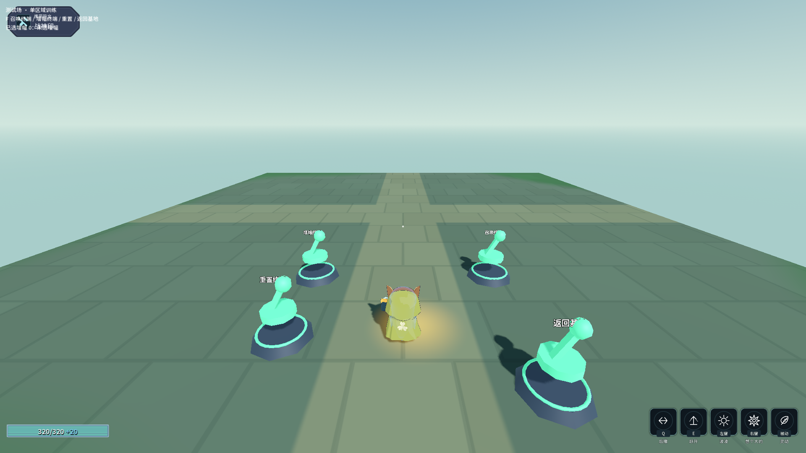
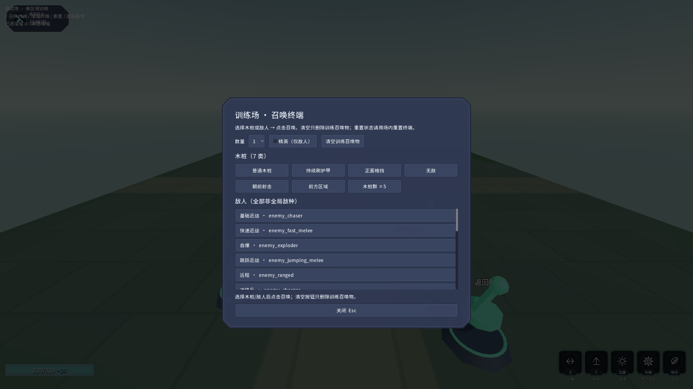
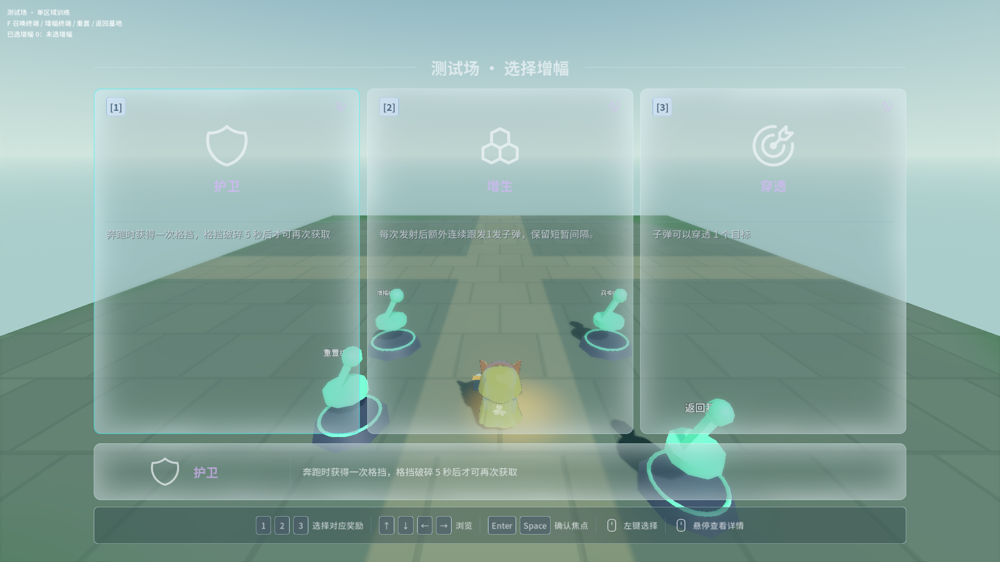

# 071 训练场：单区域、七类木桩、召唤面板、增幅与重置

2026-10-31。按用户确认的 v5 方案落地；**未提交、未推送**。视觉细化仍由视觉对话负责。

## 1. 实际改动

### 入口

- `Scenes/Levels/Base.tscn`：删除 `PracticeTarget` 节点及 `BasePracticeTarget.tscn` 的 `ext_resource`。
- `Scripts/Run/BaseCamp.cs`：在 `(0,0,-7)` 生成 `TrainingGate`，复用 `InteractionKind.Expedition`，指向新 `Config/Modes/training_destination.tres`。
- `Config/Modes/training_destination.tres`：`Title="测试场 · 木桩与增幅"`，`ScenePath="res://Scenes/Training/TrainingGround.tscn"`，说明“不结算、不写存档”。

### 训练场

- `Scenes/Training/TrainingGround.tscn`：单块 40×40m 平地、`MapManager`、`Player`、`Hud`、`WorldOverlay`、中央 `SpawnPoint`/`SpawnRoot`、四个交互终端（召唤/增幅/重置/返回基地）；不挂 `RunController`/`StageController`。
- `Scripts/Training/TrainingGroundController.cs`
  - 场景内创建 `RunBuild`、`RewardPool`、`Weapon`；`PlayerLoadout` 延迟到 `ConfigRows` 就绪后应用。
  - 召唤 7 类木桩：普通/护甲刷新/正面格挡/无敌/朝前射击/前方区域/木桩群 ×5。
  - 召唤全部非全局 `EnemyConfig`，支持 1/3/5 与精英。
  - 增幅：`RewardScreen` 三选一，`RunBuild.Add`，`ModeId="training_ground"` 排除模式专属。
  - 重置：`UiRouter.ResetForSceneChange` + 重载当前场景，清空 `RunBuild`、玩家状态与召唤物。
  - 返回基地/死亡/坠落自动复位。
  - 训练专用 HUD 显示已选增幅。
- `Scripts/Training/TrainingSpawnScreen.cs`：专用召唤面板，7 个木桩按钮、全部敌人列表、数量、精英、清空、关闭。
- `Scripts/Training/TrainingArmorDummy.cs`：每 2.5s +20 甲，训练上限 100，破甲后继续。
- `Scripts/Training/TrainingBlockDummy.cs`：常驻 `BlockComponent`（0.2 剩伤、正面约 120°、无格挡硬直），持续面向玩家。
- `Scripts/Testing/TrainingGroundProbe.cs` + `Scenes/Debug/_TrainingGroundProbe.tscn`：26 项断言（含增幅选择应用、重置两次、3 张渲染截图）。

## 2. 验证

| 项 | 结果 | 证据 |
|---|---|---|
| Debug 构建 | **0 警告 / 0 错误** | `build.ps1` |
| ExportRelease 构建 | **0 警告 / 0 错误** | `dotnet build -c ExportRelease` |
| 训练场专项（渲染） | **26/0，exit 0，stderr 0，含 3 张截图** | `Logs/validation/v5-training-probe-render3.log` |
| 训练场场景烟测 | exit 0，stderr 0，导航 2 多边形 | `Logs/validation/v5-training-smoke2.log` |
| 基地场景烟测 | exit 0，stderr 0 | `Logs/validation/v5-base-smoke.log` |
| Main 自测 | exit 0，stderr 0，`selftest.flag` 不存在 | `Logs/validation/v5-main-selftest2.out.log` |
| 生存无头/渲染 | PASS | 见 `balance-v5-implementation.md` |
| 内容校验 | PASS | `run-20261031_195959.json` |

## 3. 未验证 / 边界

- ✅ **重置两次**已改为原地清空并纳入专项：第一次清空增幅；第二次同时清空增幅与召唤物。
- ✅ **截图**：`Logs/evidence/training/071-overview.png`、`071-dummies.png`、`071-spawn-panel.png`、`071-panel.png`。
- ⚠️ **7 个既有探针**部分重跑：蓄力 80/0、龙之箭 42/0 通过；弓 38/1（唯一失败是长枪“多 1 档”的既有待确认项）；角色替换 67/0；角色设计 62/53、符文 81/2 仍是旧基线/旧断言，未作为本轮通过证据；草地基准未跑。
- ❌ **真实五存档 SHA256** 未单独逐份重算；生存脚本报告 `SavesUnchanged=true`。
- ❌ **commit/push** 未做（本轮边界）。
- ⚠️ 入口经 `Expedition` 后端会执行 `AdventureCheckpoint.Capture`；训练场无结算、不写存档，但会留下回退点，下一次出征会覆盖。若要完全跳过，可后续给 `ExpeditionDestination` 加 `CaptureCheckpoint=false`。
- ⚠️ 训练场召唤真实敌人依赖 `MapManager` 2 个导航多边形；复杂体型/大量敌人仍需长测。
- ⚠️ 面板为程序化 UI，未做视觉精修；可由视觉对话替换样式。

## 4. 文件

`Scenes/Levels/Base.tscn`、`Scripts/Run/BaseCamp.cs`、`Config/Modes/training_destination.tres`、`Scenes/Training/TrainingGround.tscn`、`Scripts/Training/*.cs`、`Scripts/Testing/TrainingGroundProbe.cs`、`Scenes/Debug/_TrainingGroundProbe.tscn`。
