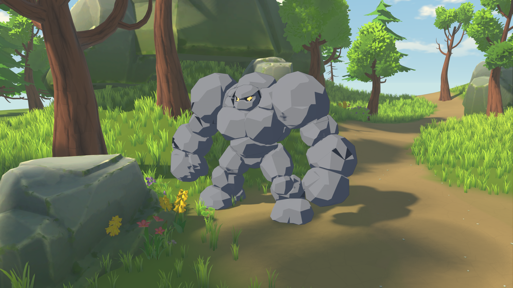

# 石头人 Plus 产线记录

日期：2026-10-21。用户确认简化后的两张纯石块形象，并指定第一张形象进入混元产线、第二张作为最终色调。

## 选择与执行

1. 定稿图固定在 `ArtSource/Concepts/enemies/stone-golem-plus-v1/`：`geometry-reference.png` 为混元输入，`palette-reference.png` 为平涂参考。
2. 沿用 `ArtSource/Tools/hunyuan_client.py` 的单 API Key 接入；3.0、LowPoly、混合四边面、PBR 关闭。任务 `1504389242456629248`，服务返回实际消耗 25 积分。任务号和输入指纹已保存，未重复提交。
3. 原始 OBJ、GLB 和 SHA-256 校验清单保存在 `ArtSource/Generated/stone-golem-plus-v1/`，保留原始输出。
4. Blender MCP 整理为脚底原点、3 米高，保留混元的大岩块形体；去掉生成贴图，整理为黑灰、深色眼窝和暖黄眼睛三个简单材质。
5. 对相邻岩块做关节分区、连通性修正及封口，17 骨刚性蒙皮，单顶点单权重；完成待机、行走、双拳重砸、受击和死亡五段动作。
6. GLB 以 60 fps 导出和导入。外观预制独立加入 30×30 米森林美术样板，使用细描边和清晰三渲二色块。

最终几何：4,584 三角面、2,481 源顶点，原始生成结果为 4,447 三角面。源工程和机器可读统计位于 `ArtSource/Blender/stone-golem-plus/`。

## 查看与范围

运行 `ArtSource/Tools/Start-NatureArtLab.cmd`。F3 切换石头人 Plus 的近景、侧面和玩家跟随镜头，F4 演示重砸。原持锤石人、蘑菇与小法师保留。

当前是独立外观样件，未替换正式敌人配置或接伤害结算。无武器及装饰，使用第一张的几何轮廓和第二张的简单色调。

运行记录位于 `docs/screenshots/stone_golem_plus_validation.json`。验证涵盖骨骼、五段动作、真实骨骼抬臂变化、完整重砸后回待机以及三个表面的材质应用。

最终带画面验证的 `hero`、`side`、`walk`、`windup`、`impact` 五次运行均退出码 0、标准错误为空、存档校验未变化。直接检查运行时 GLB：4,584 三角面、17 骨、五段动作、无嵌入贴图，约 539 KiB。源工程以压缩副本保存，活动场景为 `StoneGolemPlus_Hunyuan_v1`，保留当前 Blender 中的其他场景。
